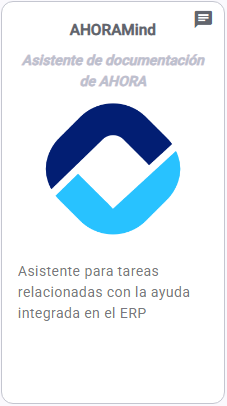
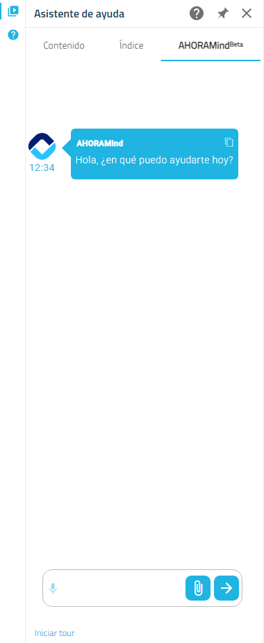

# AHORAMind - ERP help agent

{ width="160" align=right }

AHORAMind answers your **questions about how the ERP works**. You ask in your own words and it answers from AHORA's documentation, with links to the pages it took the answer from. You don't have to leave the ERP or search through manuals.

> Hola, ¿en qué puedo ayudarte hoy? (Hi, how can I help you today?)

It's designed for any user: whether you're just starting or looking for an option you rarely use.

## Where to find it

- **In the help panel**: click **Ayuda** (Help, the **?** icon in the top bar) and open the **AHORAMind** tab, next to **Contenido** (Contents) and **Índice** (Index).

    

- **In the chat's list of agents**, under the name **AHORAMind**.

## What it can do for you

| You ask it… | For example |
|---|---|
| How to do something | *"How do I close an accounting year?"* |
| Where a screen or option is | *"How do I get to journal entry management?"* |
| What something is or what it's for | *"What is a creditor invoice?"* |
| How to set something up | *"How do I set up a new invoicing series?"* |

It answers step by step and, at the end, gives you the **links** to the documentation it used, so you can read more if you want.

Within the same conversation you can keep asking about the same thing: *"and how do I get to that screen?"*.

!!! tip "Ask about a specific task"
    *"How do I record a partial collection?"* works better than *"collections"*. The more specific the question, the more precise the answer.

## What AHORAMind doesn't do

- **It doesn't query your company's data.** It doesn't know how much you've invoiced or what a customer owes. That's what the other agents are for, such as [Alfred](Alfred.md).
- **It doesn't open screens or create anything** in the ERP. It explains how to do it.
- **It doesn't make up links.** It only gives you those from the documentation it has consulted; if there are none, it tells you.
- **It only talks about the AHORA ERP.** About other AHORA products (POS, Flexygo, SAT, CRM…) it will tell you it specialises in the ERP.

## Model and keys

AHORAMind works with a **Claude** (Anthropic) or **OpenAI** model. In a new installation it comes with Claude Haiku, fast and cheap for this kind of question. An administrator changes the model and the keys in **Administración > Configuración de IA** (AI configuration): see [AI models](Modelos.md).

If its provider's key is missing when you open AHORAMind, the chat tells you which one you need and where to get it.
