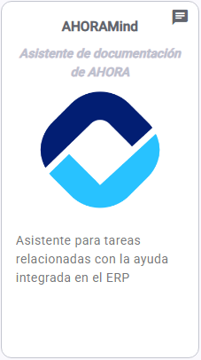
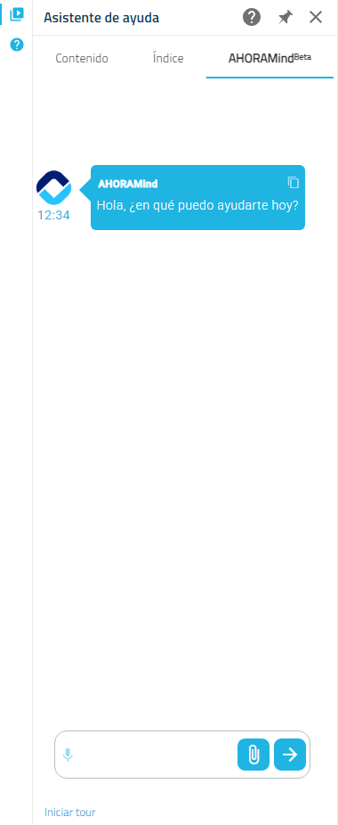

# AHORAMind - Agente de ayuda del ERP

{ width="160" align=right }

AHORAMind responde tus **dudas sobre cómo funciona el ERP**. Le preguntas con tus palabras y te contesta a partir de la documentación de AHORA, con los enlaces a las páginas de donde lo saca. No tienes que salir del ERP ni buscar en manuales.

> Hola, ¿en qué puedo ayudarte hoy?

Está pensado para cualquier usuario: el que empieza y el que busca una opción que usa poco.

## Dónde lo encuentras

- **En el panel de ayuda**: pulsa **Ayuda** (el icono **?** de la barra superior) y abre la pestaña **AHORAMind**, junto a **Contenido** e **Índice**.

    

- **En la lista de agentes del chat**, con el nombre **AHORAMind**.

## Qué puede hacer por ti

| Le preguntas… | Por ejemplo |
|---|---|
| Cómo se hace algo | *«¿Cómo cierro un ejercicio?»* |
| Dónde está una pantalla u opción | *«¿Cómo accedo a la gestión de asientos?»* |
| Qué es o para qué sirve algo | *«¿Qué es una factura de acreedor?»* |
| Cómo se configura algo | *«¿Cómo configuro una nueva serie de facturación?»* |

Te contesta paso a paso y, al final, te da los **enlaces** a la documentación que ha usado, para que amplíes si quieres.

Dentro de la misma conversación puedes seguir preguntando sobre lo mismo: *«¿y cómo accedo a esa pantalla?»*.

!!! tip "Pregunta por una tarea concreta"
    Mejor *«¿cómo registro un cobro parcial?»* que *«cobros»*. Cuanto más concreta es la pregunta, más precisa es la respuesta.

## Lo que AHORAMind no hace

- **No consulta los datos de tu empresa.** No sabe cuánto has facturado ni qué le debe un cliente. Para eso están los demás agentes, como [Alfred](Alfred.md).
- **No abre pantallas ni crea nada** en el ERP. Te explica cómo hacerlo.
- **No inventa enlaces.** Solo te da los de la documentación que ha consultado; si no hay ninguno, te lo dice.
- **Solo habla del ERP de AHORA.** De otros productos de AHORA (TPV, Flexygo, SAT, CRM…) te dirá que está especializado en el ERP.

## Modelo y claves

AHORAMind funciona con un modelo de **Claude** (Anthropic) o de **OpenAI**. En una instalación nueva viene con Claude Haiku, rápido y económico para este tipo de preguntas. El modelo y las claves los cambia un administrador en **Administración > Configuración de IA**: mira [Modelos de IA](Modelos.md).

Si al abrir AHORAMind falta la clave de su proveedor, el chat te dice cuál necesitas y dónde sacarla.
