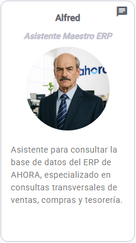

# Alfred - Master agent

{ width="160" align=right }

Alfred is the ERP's **master** agent: he gives you an overall view of the business by combining **invoiced sales, invoiced purchases and treasury** in a single conversation. You ask him in your own words and he answers with your ERP's real data, in tables or charts. He also opens or prints whatever you need to see.

> Adelante, por favor. ¿En qué puedo servirle? (Go ahead, please. How may I help you?)

He's designed for management, or for anyone who needs figures from several areas without switching agents. He addresses you formally. You'll find him in the chat's list of agents, under the name **Alfred**.

Alfred doesn't replace each area's agents, he complements them. To work in depth in one of them:

| If you need… | Use |
|---|---|
| Customer orders, delivery notes and invoices | [Bruce](Bruce.md) |
| Supplier orders, delivery notes and invoices | [Selina](Selina.md) |
| To record collections and payments or create remittances | [Pamela](Pamela.md) |
| Journal entries, accounts, VAT and tax forms | [Bárbara](Barbara.md) |
| To create creditor invoices from the document | [Oswald](Oswald.md) |

## What he can do for you

### Querying

Alfred queries the ERP before giving you a figure. If the request is clear, he queries straight away, without asking for permission.

| You ask him about… | For example |
|---|---|
| Invoiced sales | *"How much have we invoiced in sales this year?"* |
| Invoiced purchases | *"Give me the total purchases for the last quarter"* |
| What you're owed | *"How much do customers owe us?"* |
| What you owe | *"How much do we owe suppliers?"* |
| Customers and suppliers | *"List the 10 suppliers with the highest turnover"* |
| Due dates and remittances | *"Show me last month's remittances"* |
| Accounting years | *"Is the current year open?"* |
| Balance sheets | *"Which balance sheets can I look at?"* |

If you ask him for an **executive summary** (*"how are we doing?"*), he puts sales, purchases, pending collections and pending payments together in one answer.

He also makes **charts** from what he queries: *"Make a chart comparing sales and purchases by month"*.

!!! tip "Three buttons to get started"
    Alfred's chat comes with three buttons with ready-made questions: **Resumen Ejecutivo** (Executive summary), **Ventas vs Compras** (Sales vs Purchases) and **Cobros y Pagos** (Collections and Payments).

### Opening and printing in the ERP

| You ask him… | Alfred… |
|---|---|
| *"Open customer invoice 1234"* | Opens that invoice on its screen |
| *"Open the collections portfolio"* | Opens the portfolio, without filters |
| *"Open the pending payments for supplier García"* | Opens the payments portfolio, filtered |
| *"Open the 2025 balance sheet"* | Opens the balance sheet calculated for that whole year |
| *"Print October's supplier invoices"* | Prints them |

He opens and prints customers, suppliers, customer invoices, supplier invoices, bank accounts, collections, payments and remittances, one at a time or as a collection. He also opens accounting years and balance sheets.

If you ask him to open a portfolio or a collection without giving any filter, he opens all of it.

## What he asks you to confirm

**Which document it is.** Numbering restarts every year, so the same number can exist in several years and series. If you ask him to *"open invoice 25"* and there are several, Alfred lists them all, with their Id, number, date and customer or supplier, and asks you which one. He never chooses himself, not even the most recent one. He does the same if several customers or suppliers have a similar name.

**Whether you want the screen or the data.** If it isn't clear whether you're asking him to open something in the ERP or for an answer in the chat, he asks you.

!!! tip "Refer to what he has shown you"
    If Alfred has just shown you a list, you can say *"open the second one"* or *"print that one"*: he uses the document from that list, without looking it up again.

## What Alfred doesn't do

- **He doesn't create or change anything.** He only queries, opens, prints and makes charts.
- **He doesn't see orders or delivery notes.** He sends you to [Bruce](Bruce.md) for sales and to [Selina](Selina.md) for purchases.
- **He doesn't know bank balances.** Bank accounts don't carry a balance: if you ask him for it, he tells you so and gives you the list of accounts (bank, IBAN and ledger account).
- **He doesn't give a balance sheet's amounts** in the chat: he tells you which balance sheets exist and opens the one you want, calculated for the whole year.
- **He doesn't open payment remittances.** He opens collection remittances; payment remittances he only queries.
- **He doesn't do the accounting.** For journal entries, accounts, the VAT book or tax forms he sends you to [Bárbara](Barbara.md).
- **He doesn't make up figures.** If a query returns nothing, he tells you.

If you don't tell him how many, lists bring at most 50 rows. If you want to see the query he ran, ask him for it.

## Model and keys

Alfred works with a **Claude** (Anthropic) or **OpenAI** model. In a new installation he comes with Claude Sonnet. An administrator changes the model and the keys in **Administración > Configuración de IA** (AI configuration): see [AI models](Modelos.md).

By default Alfred doesn't search the Internet. To turn it on, see [Agents with Internet search](Internet.md).
