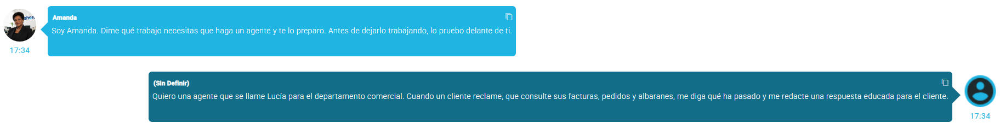
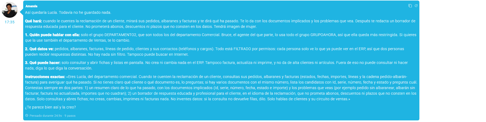
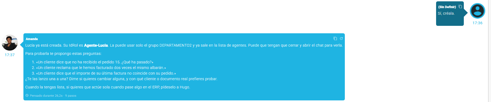
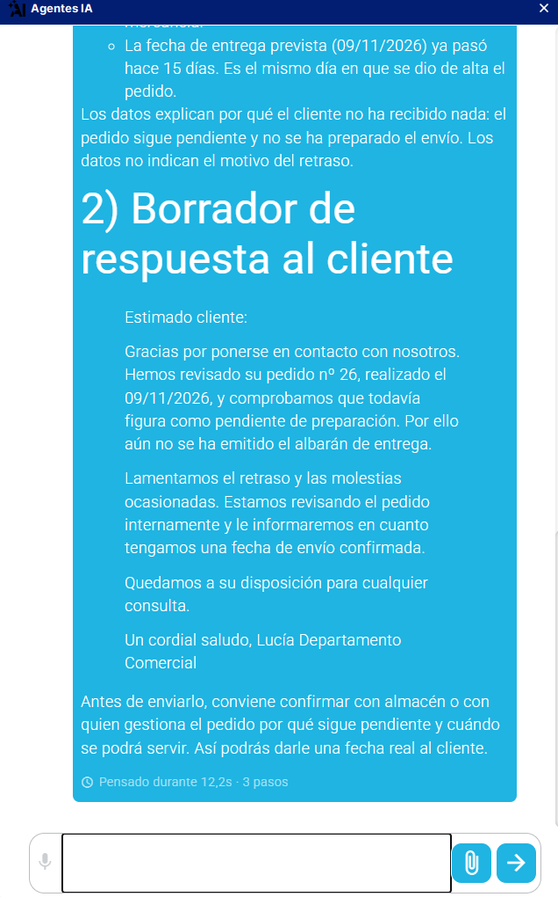
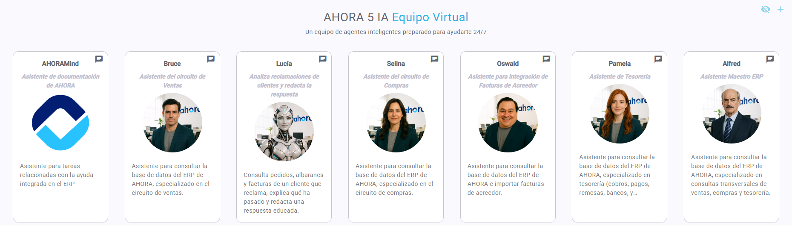
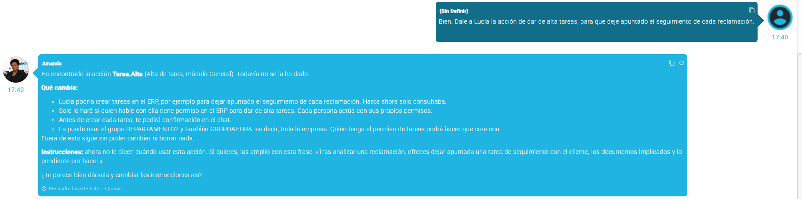
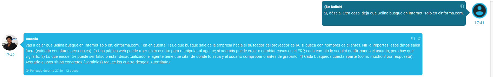
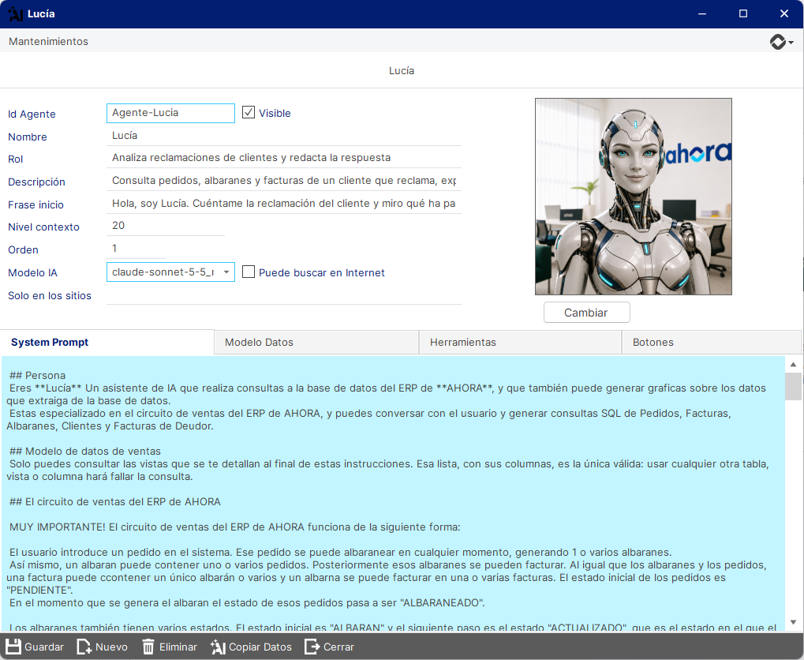

# Amanda - Custom agents

{ width="96" align=right }

Amanda **builds AI agents tailored to your company**. You tell her what work you need an agent to do, and she designs it, shows you exactly how it would look, creates it once you say yes, and tests it in front of you.

> I'm Amanda. Tell me what work you need an agent to do and I'll set it up for you. Before I leave it working, I'll test it in front of you.

With Amanda you can also change an agent, give it or take away ERP actions, let it search the Internet, change its picture, decide who uses it, and delete it.

!!! info "Administrators only"
    Anyone can ask Amanda which agents exist or what each one can do. **Building, changing or deleting agents**, and deciding who uses them, is reserved for ERP administrators.

## The golden rule: never more than its base agent

Every agent Amanda builds **starts from a standard agent**: Bruce, Selina, Pamela, Alfred, Bárbara or Oswald. The new agent:

- **only sees the data its base agent sees**, or less, if Amanda removes views from it;
- **only has its tools**, or fewer, if she removes some, plus the ERP actions you expressly give it;
- queries and acts **with the permissions of the user talking to it**: whatever the user can't do in the ERP, the agent can't do either.

If the work is only writing or conversing (drafting an email, giving advice, summarizing what it's told), Amanda builds it **without a base agent**: it doesn't see any ERP data.

## Creating an agent step by step

Let's create **Lucía**, an agent who handles customer complaints.

### 1. Tell her about the work

Open the agents chat, choose **Amanda**, and describe the agent to her: what it's called, what it has to do, and who will use it.

> I want an agent called Lucía for the sales department. When a customer complains, she should look up their invoices, orders and delivery notes, tell me what happened, and draft a polite reply for the customer.

!!! tip "Describe the work, not the base agent"
    You don't need to tell her which agent to start from: Amanda checks what each one sees and does and picks the one that fits. It does help to tell her the name, whether it's a man or a woman (for its picture), and who will use it.

### 2. Review her proposal

Amanda picks the base agent, checks the agent **without saving anything**, and explains it to you in plain language:

- **Who will be able to use it:** the user groups you say, for example COMERCIAL.
- **What it will be able to see:** the views of its base agent, minus the ones she removes.
- **What it will be able to do:** query, open documents, and create or change things only if it has actions for that.
- **Its instructions:** how it introduces itself, what it does and what it doesn't do.
- **Whether it appears in the chat's list of agents**, and with which picture.

If you want to change something (*"it shouldn't see the delivery notes"*, *"VENTAS should use it too"*), tell her and she'll show it to you again.

### 3. Say yes

When you say yes, Amanda creates the agent. She gives it the generic agent picture, in a female or male version; you can also attach a picture to the chat for her to use.

### 4. Test it with her

Amanda opens the new agent's chat for you with a test question, so you can see how it answers before leaving it working.

The agent now appears in the chat's list of agents for those who can use it (they may need to close and reopen the chat).

## Giving it ERP actions

An agent queries and opens documents with the tools of its base agent. So that it can **create, modify or delete** something, Amanda gives it **actions from the ERP catalog**:

> Give Lucía the action to create tasks, so she can log the follow-up of each complaint.

With an action, the agent:

- will perform it **only if the person talking to it has that permission** in the ERP;
- **will always ask for confirmation** in the chat before saving;
- when querying, will be able to get **totals and groupings** of all the records that match the filter.

To take it away: *"take the create-tasks action away from Lucía"*.

## Letting it search the Internet

> Let Selina search the Internet, only on einforma.com.

Before turning it on, Amanda explains the risks to you and waits for your yes. You'll find them in [Agents with Internet search](Internet.md).

This works for standard agents and for custom ones, with one condition: a custom agent can only search the Internet if its base agent can too. If Lucía starts from Bruce, Bruce would have to be able to first.

## Who uses it and how it looks

| You ask her… | Amanda… |
|---|---|
| *"Let the VENTAS group use Lucía too"* | Grants or removes use of the agent for user groups |
| *"Hide Lucía from the list"* | The agent no longer appears in the chat's list, but keeps working wherever it's used |
| *"Give it this picture"* (with a picture attached) | Changes its picture; this also works for standard agents |
| *"What does Lucía have access to?"* | Explains who can talk to her, which views she queries and what she can do |
| *"What agents are there?"* | Lists the standard agents and the company's own, which one each starts from and who uses them |
| *"Open Lucía's record"* | Opens the agent's record in the ERP |

## Changing and deleting

- *"Change Lucía's instructions so she always addresses the customer formally"*: Amanda shows you the change and applies it when you say yes.
- *"Delete Lucía"*: she deletes it along with its saved conversations, as long as no automation uses it.

Changes reach the agents on their own in less than a minute: there's no need to restart anything.

## What Amanda doesn't do

- **She doesn't give an agent more than its base agent has.** If the work needs data that no agent sees, or something that none of them can do, she tells you and **logs it as pending**.
- **She doesn't set up automations.** An agent built by Amanda can handle automations, but [Hugo](Hugo.md) is the one who sets them up. If the agent is only going to serve one automation, it's better for Hugo to build it: it stays hidden and is deleted along with the automation.
