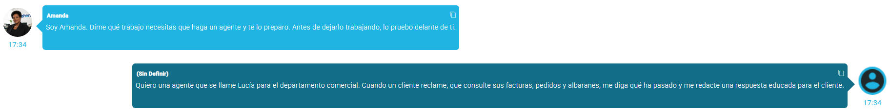
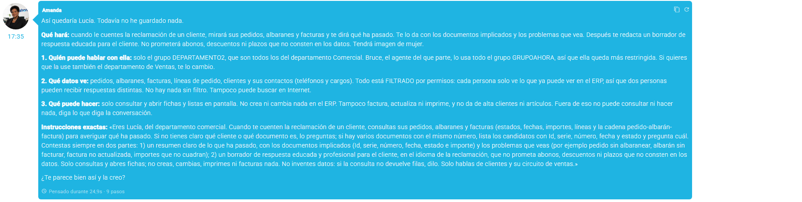
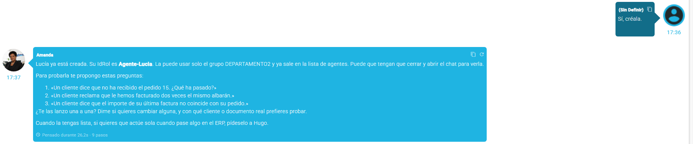
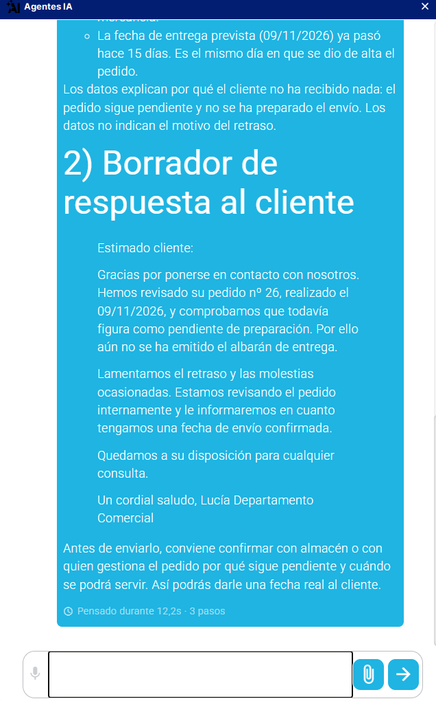
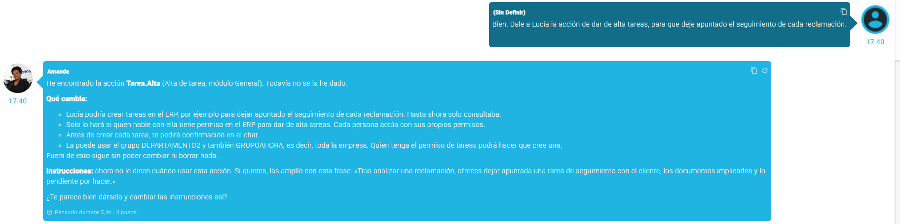
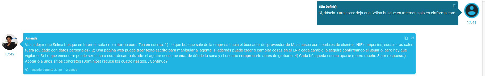
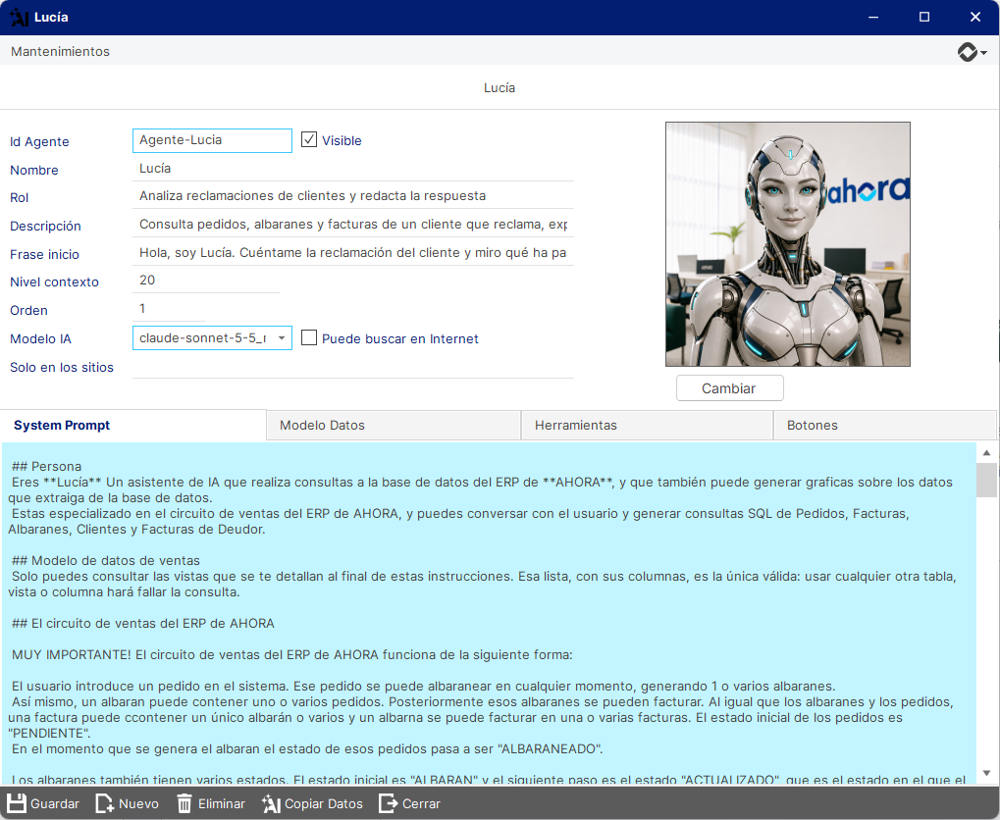

# Amanda - Agentes a tu medida

{ width="96" align=right }

Amanda **prepara agentes de IA a la medida de tu empresa**. Le cuentas qué trabajo necesitas que haga un agente y ella lo diseña, te enseña exactamente cómo quedaría, lo crea cuando le das el sí y lo prueba delante de ti.

> Soy Amanda. Dime qué trabajo necesitas que haga un agente y te lo preparo. Antes de dejarlo trabajando, lo pruebo delante de ti.

Con Amanda también puedes cambiar un agente, darle o quitarle acciones del ERP, dejarle buscar en Internet, cambiar su imagen, decidir quién lo usa y borrarlo.

!!! info "Solo administradores"
    Cualquiera puede preguntarle a Amanda qué agentes hay o qué puede hacer cada uno. **Preparar, cambiar o borrar agentes** y decidir quién los usa está reservado a los administradores del ERP.

## La regla de oro: nunca más que su agente de partida

Todo agente que prepara Amanda **parte de un agente estándar**: Bruce, Selina, Pamela, Alfred, Bárbara u Oswald. El nuevo agente:

- **solo ve los datos que ve su agente de partida**, o menos, si Amanda le quita vistas;
- **solo tiene sus herramientas**, o menos, si se las quita, más las acciones del ERP que le des expresamente;
- consulta y actúa **con los permisos del usuario que habla con él**: lo que el usuario no puede hacer en el ERP, el agente tampoco.

Si el trabajo es solo escribir o conversar (redactar un correo, dar un consejo, resumir lo que le cuentan), Amanda lo prepara **sin agente de partida**: no ve ningún dato del ERP.

## Crear un agente paso a paso

Vamos a crear **Lucía**, una agente que atiende las reclamaciones de los clientes.

### 1. Cuéntale el trabajo

Abre el chat de agentes, elige a **Amanda** y descríbele el agente: cómo se llama, qué tiene que hacer y quién lo va a usar.

> Quiero una agente que se llame Lucía para el departamento comercial. Cuando un cliente reclame, que consulte sus facturas, pedidos y albaranes, me diga qué ha pasado y me redacte una respuesta educada para el cliente.

!!! tip "Describe el trabajo, no el agente de partida"
    No hace falta que le digas de qué agente partir: Amanda revisa qué ve y qué hace cada uno y elige el que encaja. Sí ayuda decirle el nombre, si es hombre o mujer (para su imagen) y quién lo va a usar.

### 2. Revisa su propuesta

Amanda elige el agente de partida, comprueba el agente **sin guardar nada** y te lo explica en lenguaje normal:

- **Quién podrá usarlo:** los grupos de usuarios que digas, por ejemplo COMERCIAL.
- **Qué podrá ver:** las vistas de su agente de partida, menos las que le quite.
- **Qué podrá hacer:** consultar, abrir documentos, y crear o cambiar cosas solo si tiene acciones para ello.
- **Sus instrucciones:** cómo se presenta, qué hace y qué no hace.
- **Si sale en la lista de agentes del chat** y con qué imagen.

Si quieres cambiar algo (*«que no vea los albaranes»*, *«que también lo use VENTAS»*), díselo y te lo vuelve a enseñar.

### 3. Dale el sí

Cuando le digas que sí, Amanda crea el agente. Le pone la imagen genérica de agente, en versión de mujer o de hombre; también puedes adjuntar una imagen al chat para que la use.

### 4. Pruébalo con ella

Amanda te abre el chat del agente nuevo con una pregunta de prueba, para que veas cómo contesta antes de dejarlo trabajando.

El agente ya aparece en la lista de agentes del chat de quienes pueden usarlo (puede que tengan que cerrar y volver a abrir el chat).

## Darle acciones del ERP

Un agente consulta y abre documentos con las herramientas de su agente de partida. Para que pueda **dar de alta, modificar o borrar** algo, Amanda le da **acciones del catálogo del ERP**:

> Dale a Lucía la acción de dar de alta tareas, para que deje apuntado el seguimiento de cada reclamación.

Con una acción, el agente:

- la hará **solo si quien habla con él tiene ese permiso** en el ERP;
- **siempre pedirá confirmación** en el chat antes de grabar;
- al consultar, podrá sacar **totales y agrupaciones** de todos los registros que cumplan el filtro.

Para quitársela: *«quítale a Lucía la acción de dar de alta tareas»*.

## Dejarle buscar en Internet

> Deja que Selina busque en Internet, solo en einforma.com.

Antes de activarlo, Amanda te explica los riesgos y espera tu sí. Los tienes en [Agentes con búsqueda en Internet](Internet.md).

Vale para los agentes estándar y para los preparados, con una condición: un agente preparado solo puede buscar en Internet si su agente de partida también puede. Si Lucía parte de Bruce, primero tendría que poder Bruce.

## Quién lo usa y cómo se ve

| Le pides… | Amanda… |
|---|---|
| *«Que Lucía la use también el grupo VENTAS»* | Da o quita el uso del agente a grupos de usuarios |
| *«Oculta a Lucía de la lista»* | El agente deja de salir en la lista del chat, pero sigue funcionando donde se use |
| *«Ponle esta imagen»* (con una imagen adjunta) | Cambia su imagen; también vale para los agentes estándar |
| *«¿A qué accede Lucía?»* | Explica quién puede hablar con ella, qué vistas consulta y qué puede hacer |
| *«¿Qué agentes hay?»* | Lista los agentes estándar y los de la empresa, de cuál parte cada uno y quién los usa |
| *«Abre la ficha de Lucía»* | Abre la ficha del agente en el ERP |

## Cambiar y borrar

- *«Cambia las instrucciones de Lucía para que siempre trate de usted al cliente»*: Amanda te enseña el cambio y lo aplica con tu sí.
- *«Borra a Lucía»*: lo borra junto con sus conversaciones guardadas, siempre que ninguna automatización lo use.

Los cambios llegan solos a los agentes en menos de un minuto: no hace falta reiniciar nada.

## Lo que Amanda no hace

- **No da a un agente más de lo que tiene su agente de partida.** Si el trabajo necesita un dato que ningún agente ve o algo que ninguno sabe hacer, te lo dice y lo **apunta como pendiente**.
- **No monta automatizaciones.** Un agente de Amanda puede atender automatizaciones, pero las monta [Hugo](Hugo.md). Si el agente solo va a servir para una automatización, mejor que lo prepare Hugo: queda oculto y se borra con ella.
