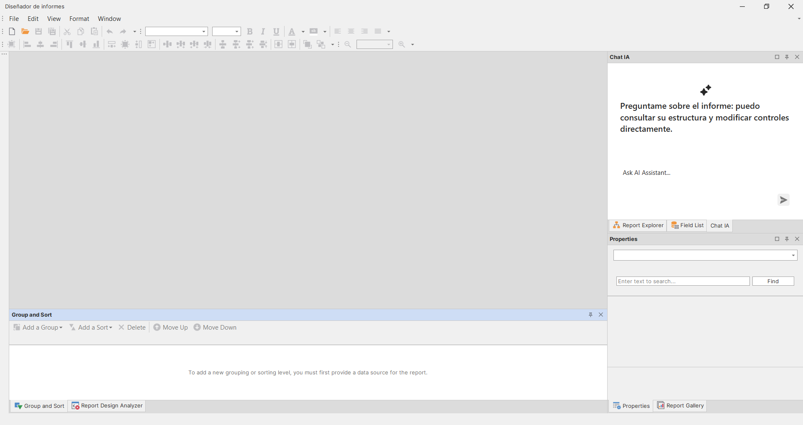
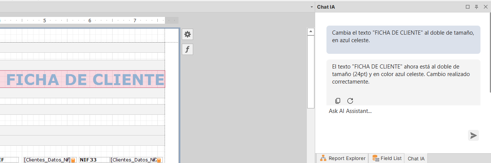
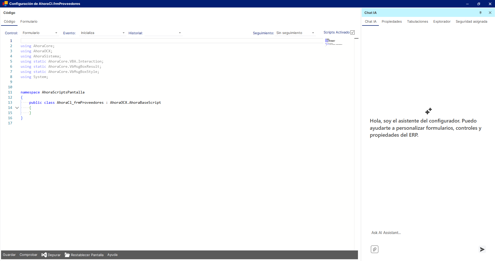
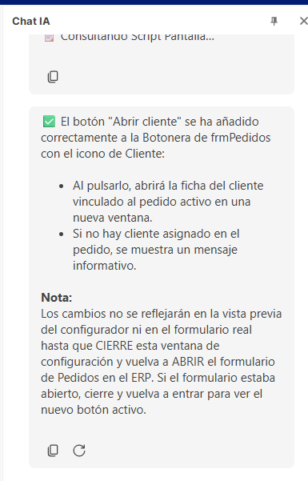
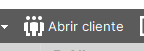
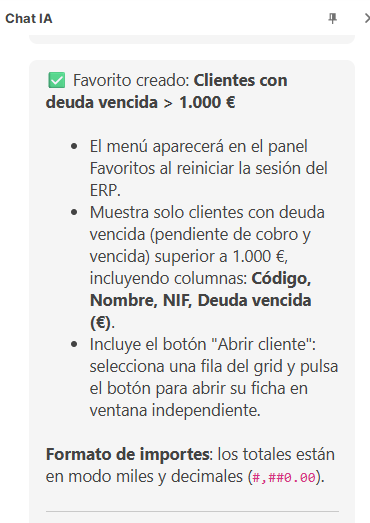
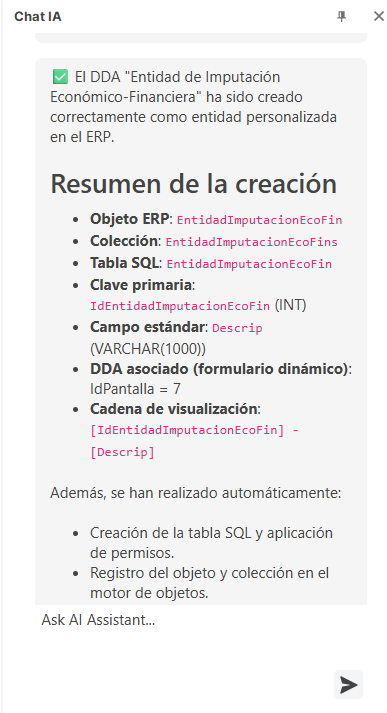

# Screen AI assistants

Besides the chat agents, the ERP comes with three **AI assistants** that work inside a screen and know what you have in front of you: the data in a grid, the report you're designing or the form you're configuring.

| Assistant | Where it works | Who uses it |
|---|---|---|
| **Gridito** | The grids: **Analizar con IA** (Analyse with AI) and the AI filter | Any user |
| **ReportDesigner** | The chat in the **Diseñador de informes** (Report designer) | Administrators, by default |
| **Configurador IA** | The chat in the screen configurator (**Ctrl+F10**) | Administrators |

## What they have in common

- They're agents like the chat agents: each one uses the model it has set and its provider's key, `AI_TOKEN_ANTHROPIC` for Claude and `AI_TOKEN` for OpenAI.
- In a new installation they start with **Claude Haiku**. Their model is changed in **Administración > Configuración de IA** (Administration > AI configuration), **Agentes** (Agents) tab. It's explained in [AI models](Modelos.md).
- If the key for an assistant's model provider is missing, its chat doesn't appear, and neither does **Analizar con IA** in the grids. No error is shown.
- They don't search the Internet. They work with what's on the screen and, in the configurator's case, with the database.
- What you write to them and what they see on the screen is sent to their model's AI provider.

!!! warning "AI makes mistakes"
    An assistant doesn't always give the same answer to the same question, and sometimes it gets things wrong. Check what it tells you and what it changes before you accept it.

## Gridito: the grids' AI

### Analizar con IA

1. In a grid, right-click the top-left corner, where the column titles meet the row margin.
2. Choose **Analizar con IA**.
3. A chat window opens to the left of the screen. Ask it whatever you want about the grid's data.

For example:

- *"Which customer has the largest outstanding amount?"*
- *"Summarise sales by month"*
- *"Are there any orders whose delivery date has already passed?"*
- *"Compare the three families with the most units sold"*

Things worth knowing:

- **It sees the rows the grid has loaded when you open the chat.** They're sent only once, with your first question. If you reload the grid, close the chat and click **Analizar con IA** again: each time a new conversation starts.
- **It has a limit of 200,000 characters of data.** If the grid has more, it only receives the first rows and tells you how many its answer is based on.
- **It doesn't receive images** or other binary data from the grid.
- **It only queries.** It doesn't change anything in the grid or in the ERP.

!!! tip "Very large grids"
    Filter the screen first so the grid only loads what you're interested in. That way the assistant sees every row and its answer is complete.

### The AI filter

The grids' **filter editor** also uses Gridito's model. You open it by right-clicking a column title. Instead of building the condition by hand, you describe it in your own words, for example *"this year's orders from customers in Madrid"*, and the AI turns it into the filter condition. Check it before applying it.

If you've just entered the key, close the screen and open it again so its grids get the AI filter.

## ReportDesigner: the report designer's chat

### How to open it

Open the report designer in one of these two ways:

- **Administración > Diseñador de informes**;
- in the window for running a DevExpress report (`.repx`), menu **Informes > Editar** (Reports > Edit).

By default, only administrators can see these two options. The chat is in the designer's **Chat IA** (AI chat) panel and works on the report in the active tab: with each message it receives its structure, with its bands and controls. You hide it and show it again with **View > Chat IA**.



### What you can ask it

| To | Example |
|---|---|
| Format | *"Make the title bold, blue and centred"* |
| New elements: labels, tables, lines, shapes, panels, check boxes, images, barcodes and QR codes, page breaks, page numbers, an embedded PDF | *"Add 'Page X of Y' to the page footer"* |
| Expressions and formats | *"Show the price with two decimals and the € symbol"* |
| Conditional colours | *"Show the amount in red if it's negative"* |
| Calculated fields and totals | *"Create a calculated field called Margin equal to SalePrice minus CostPrice"*, *"Sum the amount in the group footer"* |
| Groups and sorting | *"Group by customer"*, *"Change the level 0 group to Province"*, *"Sort the detail by date"* |
| Page | *"Make the report landscape"*, *"1 cm margins"*, *"DRAFT watermark"* |
| Subreports | *"Add a subreport with the order lines to the detail and bind its IdPedido parameter"* |
| Parameters | *"Create a date parameter called FechaDesde"* |
| Deleting | *"Remove the page footer band"*, *"Delete the Margin calculated field"* |

It applies the change to the report and sums it up for you.



!!! tip "Say where"
    Name the band or the control: *"in the report footer"*, *"below the City label"*. The assistant sees the names of all the controls and gets it right more often.

### What it doesn't do

- **It doesn't change the report's data connection.** If you ask it to, it tells you it can't and that you should contact a technician.
- **It doesn't save the report.** When you're happy with the result, save it as usual, with **File > Save**.

You can attach files to it, up to 5 of 10 MB each, with the paper clip or by dragging them onto the chat.

## Configurador IA: the screen configurator's chat

### How to open it

On any ERP screen, press **Ctrl+F10**. It only works for an administrator user. The screen's configurator opens, and in it the **Chat IA** panel.

The assistant knows the screen you're configuring: with each message it receives its controls, with their name, type and position, its current script and the control you have selected.



!!! warning "It works on the real database"
    Whatever it creates or changes is saved straight away in the database you're connected to. Try it first in a test environment.

### What you can ask it

| To | Example |
|---|---|
| Change how the screen behaves, with its C# script | *"When the postcode changes, fill in the province and the town"* |
| Add buttons and controls | *"Add a button to the button bar that opens the order's customer record"* |
| Create a favourite with its script | *"I want a favourite that shows the customers with more than €1,000 of overdue debt, with code, name, tax ID and total overdue, and a button to open the customer"* |
| Create a new DDA: table, object, collection and form | *"Create a Call log DDA with customer, date, call type, result and notes"* |
| Configurable fields | *"Add a FechaPrevistaEntrega field to the items"* |
| Custom stored procedures, triggers and views | *"Create a trigger that saves every change to an item's price in an audit table"* |
| Find out why something isn't working | *"A user in the Almacén group can't see the favourite I created yesterday: why?"* |
| Security and profiles | *"Which groups is this user in?"*, *"Give the Almacén group permission on this menu node"* |

Before writing a script, the assistant reads the real names of the screen's controls. If saving fails, it tells you why and fixes it.










### Seeing the changes

The changes don't show on the screen you have open:

| If you've changed | To see it |
|---|---|
| The screen's script or controls | Close the configurator and open the screen again |
| A DDA | Close the ERP completely and log in again |

The usual way is to go step by step: you ask for the change, close and open the screen, try it and, if something doesn't work, tell the chat so it can fix it.

### Elevated permissions: `/admin`

Some operations need database permissions that the ERP user doesn't have, such as creating custom views or the tables of a new DDA. If it's needed, the assistant tells you. Write in the chat:

```
/admin user password
```

with a SQL Server user that has those permissions.

- **The password never reaches the AI model and isn't stored.** The configurator intercepts the message before sending it, tests the connection and, if it works, uses it in this chat until you close the window.
- If a piece of data is missing or the credentials don't work, the chat tells you.
- Once elevated, **repeat your request**.

You can attach files to it, up to 5 of 10 MB each, with the paper clip or by dragging them onto the chat.

## Only one chat at a time

The report designer's chat and the configurator's chat can't be active at the same time. If you open one while the other is open, the ERP asks:

> Solo se puede tener una ventana de chat habilitada. ¿Desea desactivar la actual y activar esta?

(Only one chat window can be enabled. Do you want to disable the current one and enable this one?) If you answer no, the new window opens without a chat.

## If the chat doesn't appear

1. In **Administración > Configuración de IA**, **Agentes** tab, check that the assistant has a model and that its provider's key is set.
2. In the designer or the configurator, check that you don't have the other window with a chat open.
