# Asistentes de IA de las pantallas

Además de los agentes del chat, el ERP trae tres **asistentes de IA** que trabajan dentro de una pantalla y conocen lo que tienes delante: los datos de una rejilla, el informe que estás diseñando o el formulario que estás configurando.

| Asistente | Dónde trabaja | Quién lo usa |
|---|---|---|
| **Gridito** | Las rejillas: **Analizar con IA** y el filtro con IA | Cualquier usuario |
| **ReportDesigner** | El chat del **Diseñador de informes** | Los administradores, por defecto |
| **Configurador IA** | El chat del configurador de pantallas (**Ctrl+F10**) | Los administradores |

## Lo que tienen en común

- Son agentes como los del chat: cada uno usa el modelo que tenga puesto y la clave de su proveedor, `AI_TOKEN_ANTHROPIC` para Claude y `AI_TOKEN` para OpenAI.
- En una instalación nueva nacen con **Claude Haiku**. Su modelo se cambia en **Administración > Configuración de IA**, pestaña **Agentes**. Lo tienes explicado en [Modelos de IA](Modelos.md).
- Si falta la clave del proveedor del modelo de un asistente, su chat no aparece, y en las rejillas tampoco **Analizar con IA**. No sale ningún error.
- No buscan en Internet. Trabajan con lo que hay en la pantalla y, el configurador, con la base de datos.
- Lo que les escribes y lo que ven en la pantalla se envía al proveedor de IA de su modelo.

!!! warning "La IA se equivoca"
    Un asistente no siempre contesta igual a la misma pregunta, y a veces falla. Revisa lo que te dice y lo que cambia antes de darlo por bueno.

## Gridito: la IA de las rejillas

### Analizar con IA

1. En una rejilla, pulsa con el botón derecho en la esquina superior izquierda, donde se cruzan los títulos de las columnas y el margen de las filas.
2. Elige **Analizar con IA**.

    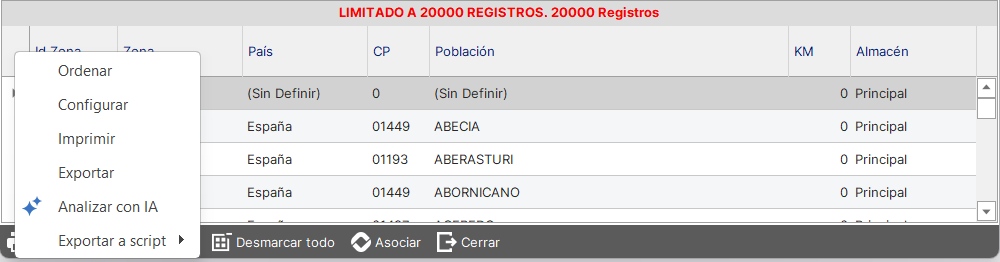

3. Se abre una ventana de chat a la izquierda de la pantalla. Pregúntale lo que quieras sobre los datos de la rejilla.

    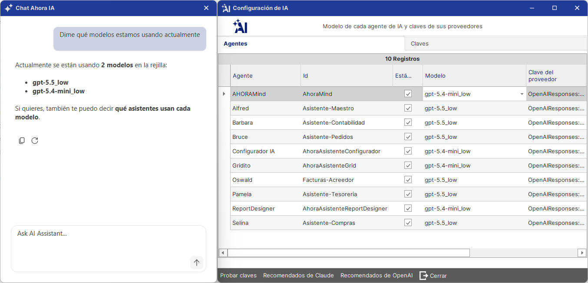

Por ejemplo:

- *«¿Qué cliente tiene más importe pendiente?»*
- *«Resume las ventas por mes»*
- *«¿Hay pedidos con la fecha de entrega ya pasada?»*
- *«Compara las tres familias con más unidades vendidas»*

Qué conviene saber:

- **Ve las filas que la rejilla tiene cargadas cuando abres el chat.** Se le mandan una sola vez, con tu primera pregunta. Si recargas la rejilla, cierra el chat y vuelve a pulsar **Analizar con IA**: cada vez empieza una conversación nueva.
- **Tiene un tope de 200.000 caracteres de datos.** Si la rejilla tiene más, recibe solo las primeras filas y te avisa de en cuántas se basa su respuesta.
- **No recibe imágenes** ni otros datos binarios de la rejilla.
- **Solo consulta.** No cambia nada en la rejilla ni en el ERP.

!!! tip "Rejillas muy grandes"
    Filtra antes la pantalla para que la rejilla cargue solo lo que te interesa. Así el asistente ve todas las filas y su respuesta es completa.

### El filtro con IA

El **editor de filtros** de las rejillas también usa el modelo de Gridito. Lo abres con el botón derecho en el título de una columna. En lugar de montar la condición a mano, la describes con tus palabras, por ejemplo *«pedidos de este año de clientes de Madrid»*, y la IA la convierte en la condición del filtro. Revísala antes de aplicarla.

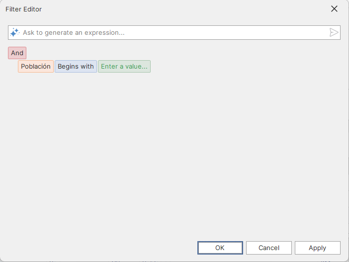

Si acabas de poner la clave, cierra y vuelve a abrir la pantalla para que sus rejillas tengan el filtro con IA.

## ReportDesigner: el chat del diseñador de informes

### Cómo se abre

Abre el diseñador de informes de una de estas dos maneras:

- **Administración > Diseñador de informes**;
- en la ventana de lanzar un informe de DevExpress (`.repx`), menú **Informes > Editar**.

Por defecto, las dos opciones solo las ven los administradores. El chat está en el panel **Chat IA** del diseñador y trabaja sobre el informe de la pestaña activa: en cada mensaje recibe su estructura, con sus bandas y sus controles. Lo ocultas y lo vuelves a mostrar con **View > Chat IA**.

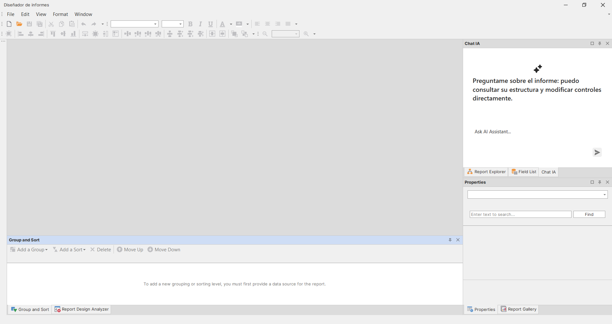

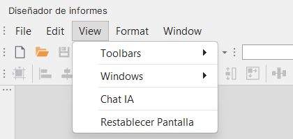

### Qué puedes pedirle

| Para | Ejemplo |
|---|---|
| Formato | *«Pon el título en negrita, azul y centrado»* |
| Elementos nuevos: etiquetas, tablas, líneas, formas, paneles, casillas, imágenes, códigos de barras y QR, saltos de página, número de página, un PDF incrustado | *«Añade "Página X de Y" en el pie de página»* |
| Expresiones y formatos | *«Muestra el precio con dos decimales y el símbolo €»* |
| Colores condicionales | *«Pon el importe en rojo si es negativo»* |
| Campos calculados y totales | *«Crea un campo calculado Margen que sea PrecioVenta menos PrecioCoste»*, *«Suma el importe en el pie del grupo»* |
| Grupos y orden | *«Agrupa por cliente»*, *«Cambia el grupo de nivel 0 por Provincia»*, *«Ordena el detalle por fecha»* |
| Página | *«Pon el informe en horizontal»*, *«Márgenes de 1 cm»*, *«Marca de agua BORRADOR»* |
| Subinformes | *«Añade en el detalle un subinforme con las líneas del pedido y enlaza su parámetro IdPedido»* |
| Parámetros | *«Crea un parámetro de tipo fecha llamado FechaDesde»* |
| Borrar | *«Elimina la banda de pie de página»*, *«Borra el campo calculado Margen»* |

Aplica el cambio sobre el informe y te lo resume.

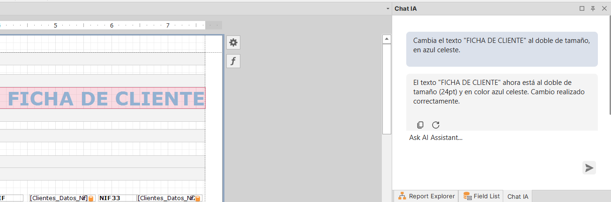

!!! tip "Di dónde"
    Nombra la banda o el control: *«en el pie del informe»*, *«debajo de la etiqueta Ciudad»*. El asistente ve los nombres de todos los controles y acierta más.

### Qué no hace

- **No cambia la conexión de datos del informe.** Si se lo pides, te dice que no puede y que contactes con un técnico.
- **No guarda el informe.** Cuando te guste el resultado, guárdalo como siempre, con **File > Save**.

Puedes adjuntarle archivos, hasta 5 de 10 MB cada uno, con el clip o arrastrándolos al chat.

## Configurador IA: el chat del configurador de pantallas

### Cómo se abre

En cualquier pantalla del ERP, pulsa **Ctrl+F10**. Solo funciona con un usuario administrador. Se abre el configurador de la pantalla, y en él el panel **Chat IA**.

El asistente conoce la pantalla que estás configurando: en cada mensaje recibe sus controles, con su nombre, tipo y posición, su script actual y el control que tengas seleccionado.

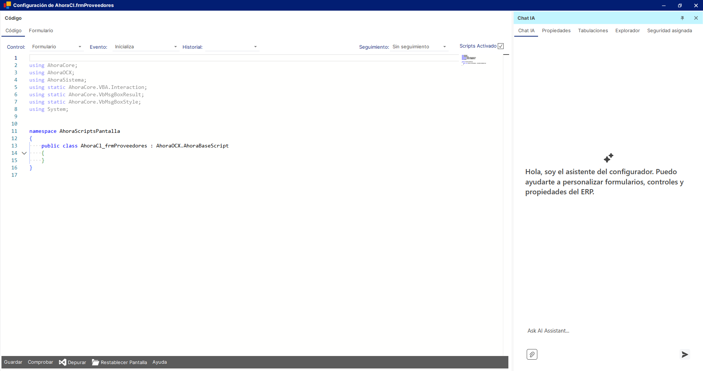

!!! warning "Trabaja sobre la base de datos real"
    Lo que crea o cambia se graba al momento en la base de datos a la que estás conectado. Prueba antes en un entorno de pruebas.

### Qué puedes pedirle

| Para | Ejemplo |
|---|---|
| Cambiar cómo se comporta la pantalla, con su script en C# | *«Cuando cambie el código postal, rellena la provincia y la población»* |
| Añadir botones y controles | *«Añade a la botonera un botón que abra la ficha del cliente del pedido»* |
| Crear un favorito con su script | *«Quiero un favorito que muestre los clientes con deuda vencida de más de 1.000 €, con código, nombre, NIF y total vencido, y un botón para abrir el cliente»* |
| Crear un DDA nuevo: tabla, objeto, colección y formulario | *«Crea un DDA Registro de llamadas con cliente, fecha, tipo de llamada, resultado y notas»* |
| Campos configurables | *«Añade un campo FechaPrevistaEntrega a los artículos»* |
| Procedimientos, triggers y vistas personalizados | *«Crea un trigger que guarde en una tabla de auditoría cada cambio de precio de un artículo»* |
| Averiguar por qué algo no funciona | *«Un usuario del grupo Almacén no ve el favorito que creé ayer: ¿por qué?»* |
| Seguridad y perfiles | *«¿En qué grupos está este usuario?»*, *«Da permiso al grupo Almacén sobre este nodo del menú»* |

Antes de escribir un script, el asistente lee los nombres reales de los controles de la pantalla. Si un guardado falla, te dice por qué y lo corrige.

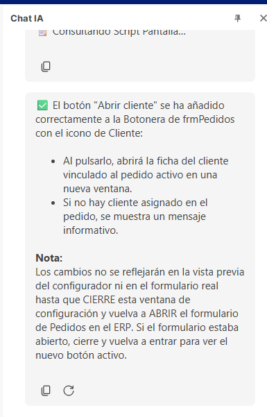

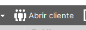

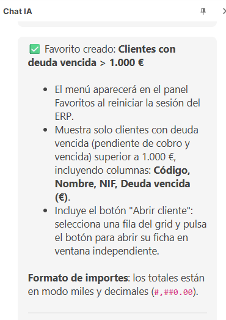


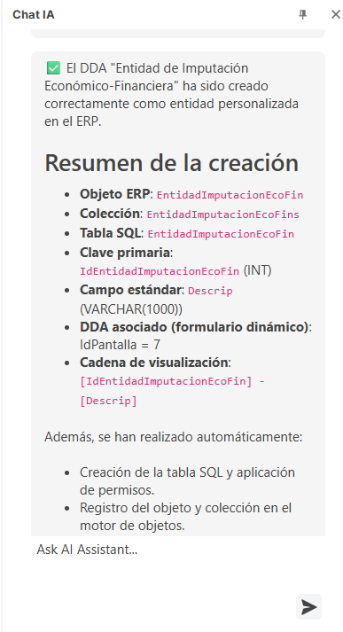

### Ver los cambios

Los cambios no se ven en la pantalla que tienes abierta:

| Si has cambiado | Para verlo |
|---|---|
| El script o los controles de la pantalla | Cierra el configurador y vuelve a abrir la pantalla |
| Un DDA | Cierra el ERP del todo y vuelve a entrar |

Lo normal es ir por pasos: pides el cambio, cierras y abres la pantalla, lo pruebas y, si algo no va, se lo cuentas al chat para que lo corrija.

### Permisos elevados: `/admin`

Algunas operaciones necesitan permisos en la base de datos que el usuario del ERP no tiene, como crear vistas personalizadas o las tablas de un DDA nuevo. Si hace falta, el asistente te lo dice. Escribe en el chat:

```
/admin usuario contraseña
```

con un usuario de SQL Server que tenga esos permisos.

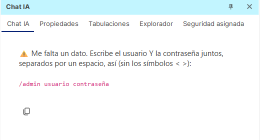

- **La contraseña no llega al modelo de IA ni se guarda.** El configurador intercepta el mensaje antes de enviarlo, prueba la conexión y, si vale, la usa en este chat hasta que cierres la ventana.
- Si falta un dato o las credenciales no valen, el chat te lo dice.
- Una vez elevado, **repite tu petición**.

Puedes adjuntarle archivos, hasta 5 de 10 MB cada uno, con el clip o arrastrándolos al chat.

## Un solo chat a la vez

El chat del diseñador de informes y el del configurador no pueden estar activos a la vez. Si abres uno con el otro abierto, el ERP pregunta:

> Solo se puede tener una ventana de chat habilitada. ¿Desea desactivar la actual y activar esta?

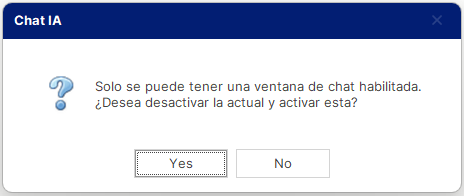

Si contestas que no, la ventana nueva se abre sin chat.

## Si no aparece el chat

1. En **Administración > Configuración de IA**, pestaña **Agentes**, mira que el asistente tenga modelo y que esté puesta la clave de su proveedor.
2. En el diseñador o el configurador, mira que no tengas abierta la otra ventana con chat.
