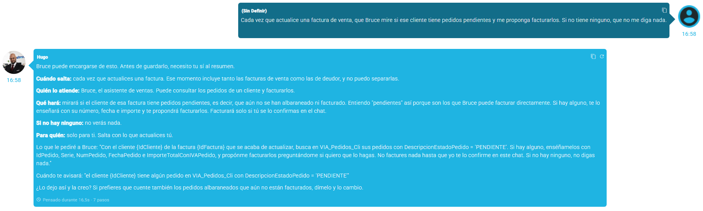
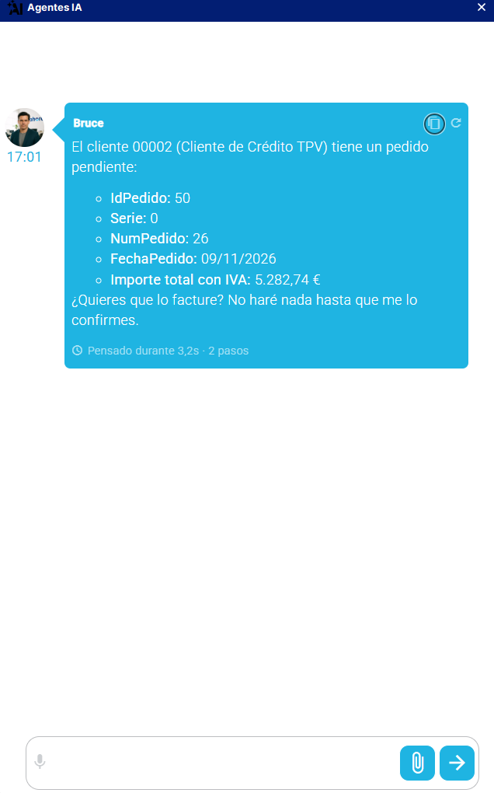
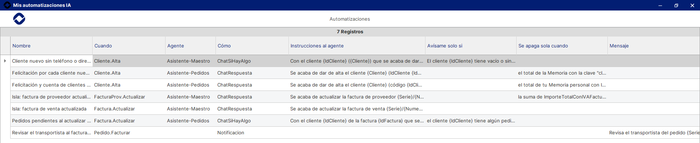

# AI automations

With AI automations, the ERP agents no longer wait for you to write to them: **they react on their own to what happens in the ERP**. When you post an invoice, create a customer, or a specific time arrives, an agent reviews the situation and tells you what you need to know, suggests what to do, or notifies whoever needs to know.

For example:

- *"Every time I post a sales invoice, have Bruce check whether that customer has pending orders and suggest invoicing them. If there are none, don't tell me anything."*
- *"When a customer is created without a phone number or address, have Alfred notify the COMERCIAL group."*
- *"Every working day at 9:00, have Pamela tell me the overdue collections."*

You don't need to program anything: you ask **Hugo**, the automations agent, in your own words, and he sets it up.

## What an automation is

Every automation answers four questions:

| Question | What it is | Example |
|---|---|---|
| **When does it fire?** | Something that happens in the ERP (an *action*) or a time | When a sales invoice is posted |
| **Who handles it?** | An AI agent, with its tools and permissions | Bruce, the Sales agent |
| **What does it have to do?** | The instructions Hugo gives it | Look at the customer's pending orders and suggest invoicing them |
| **How do you find out?** | The automation's *form* | «Por detrás, avisa si hay algo» (In the background, notify if there's something) |

This is how it works, step by step, when you post an invoice:

1. **You finish the action in the ERP** and the invoice is posted as usual.
2. If you have an automation for that moment, **the agent receives the invoice data**.
3. The agent **reviews what it has been asked to** with its tools.
4. If it has something to tell you, **its window opens** with the answer. If not, you see nothing.

The agent already receives the document data (customer, amount, date…), so it doesn't have to look it up. With its tools it can query whatever it needs, such as that customer's pending orders.

!!! info "The agent suggests, you decide"
    An agent never modifies anything on its own. If it suggests an action, such as invoicing some orders, it asks you for confirmation before doing it and does it with **your** ERP **permissions**: whatever you can't do, it can't do either.

## Turning them on { #activarlas }

Automations sit behind a parameter, which is **off by default**. While it's off, the ERP works exactly as if this feature didn't exist.

1. Check that the ERP's AI agents work: the agents chat answers and the key for the AI model they use is configured.
2. An administrator turns on the <fh-copy>IA_GANCHOS_ACTIVO</fh-copy> parameter («Automatizaciones de IA en los procesos», AI automations in processes) in the ERP's general configuration.
3. Each user **logs back into the ERP**. The parameter is read at login.

From that moment on, automations fire and their menus appear:

- **Archivo › Mis automatizaciones IA** (File › My AI automations);
- and, for administrators, **Diagnóstico de ganchos IA** (AI hook diagnostics), in the administration menu.

!!! info "Hugo doesn't turn the parameter on"
    Hugo is always in the list of agents, but he can't turn the parameter on: that's an administrator's decision. With the parameter off, Hugo **tells you right away**, before starting to set anything up, and offers to leave the automation ready for when it's turned on. In the meantime, he can't test it or open «Mis automatizaciones IA».

## Your first automation

Let's set up the first example above: suggesting to invoice a customer's pending orders when you post one of their invoices.

### 1. Ask Hugo for it

Open the agents chat, choose **Hugo**, and tell him what you want in your own words:

> Every time I post a sales invoice, have Bruce check whether that customer has pending orders and suggest invoicing them. If there are none, don't tell me anything.

Hugo looks for the ERP action that fits («Actualizar factura», Post invoice), picks the right agent, and **shows you how it would look** before saving anything: when it fires, who handles it, exactly what it will ask, and when it will notify you.

### 2. Confirm it

If it looks good, say **"yes"** and Hugo creates it. If you want to change something ("only sales invoices, not debtor invoices", "only if the orders add up to more than €1,000"…), tell him and he'll show it to you again.

### 3. Test it

Post an invoice for a customer who has pending orders. When the posting finishes, Bruce's window opens with what he found:

Now post an invoice for a customer with no pending orders: **nothing appears**. Bruce checked it in the background and, since he had nothing to tell you, didn't interrupt you.

!!! tip "Test without waiting"
    You can also ask Hugo to test it with a specific document: *"try it with invoice 52"*. That way you see what the agent would do without having to repeat the action in the ERP.

## Where to see them

In **Archivo › Mis automatizaciones IA** you have all your automations: when they fire, which agent handles them, their instructions, and whether they're active. From there you can change, deactivate or delete them.

You can also ask Hugo: *"what automations do I have?"*, *"deactivate the pending orders one"* or *"delete all the test ones"*.

## Good to know

- **They fire in your ERP.** An automation reacts to what **you** do in your open ERP. Those that are for everyone fire in each user's ERP, each with their own data.
- **Only the ones you ask for everyone belong to everyone.** By default, an automation is yours alone. Only an administrator can create them for the whole company.
- **Each time it fires, it queries the AI.** An automation handled by an agent uses AI every time it fires. For things that happen many times a day, the form «Por detrás, avisa si hay algo» with a clear condition is the better choice.
- **If something fails, your work goes on.** If the AI doesn't respond or there's an error in the automation, the ERP action finishes as usual and you don't see any error.
