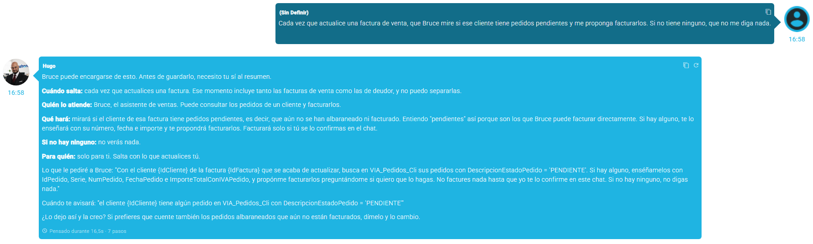
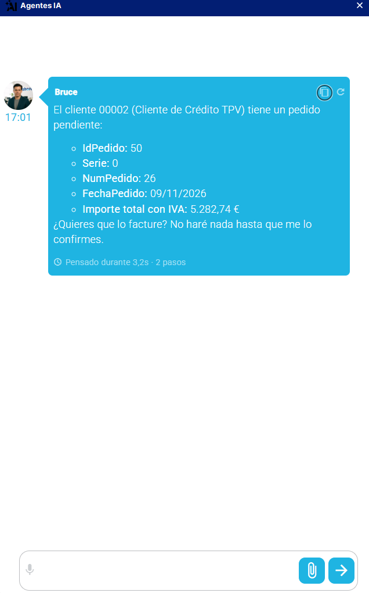
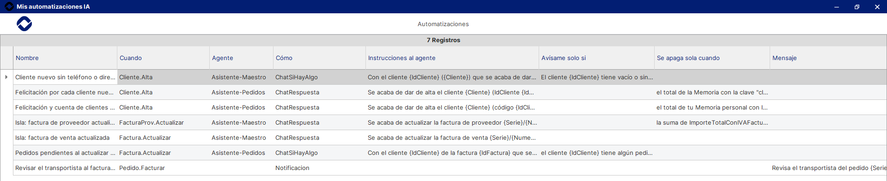

# Automatizaciones de IA

Con las automatizaciones de IA, los agentes del ERP ya no esperan a que les escribas: **reaccionan solos a lo que pasa en el ERP**. Cuando actualizas una factura, das de alta un cliente o llega una hora concreta, un agente revisa la situación y te cuenta lo que necesitas saber, te propone qué hacer o avisa a quien corresponda.

Por ejemplo:

- *«Cada vez que actualice una factura de venta, que Bruce mire si ese cliente tiene pedidos pendientes y me proponga facturarlos. Si no tiene ninguno, que no me diga nada.»*
- *«Cuando se dé de alta un cliente sin teléfono o sin dirección, que Alfred avise al grupo COMERCIAL.»*
- *«Cada día laborable a las 9:00, que Pamela me diga los cobros vencidos.»*

No hace falta programar nada: se lo pides a **Hugo**, el agente de automatizaciones, con tus palabras, y él la deja montada.

## Qué es una automatización

Toda automatización responde a cuatro preguntas:

| Pregunta | Qué es | Ejemplo |
|---|---|---|
| **¿Cuándo salta?** | Algo que pasa en el ERP (una *acción*) o una hora | Al actualizar una factura de venta |
| **¿Quién la atiende?** | Un agente de IA, con sus herramientas y permisos | Bruce, el agente de Ventas |
| **¿Qué tiene que hacer?** | Las instrucciones que le da Hugo | Mirar los pedidos pendientes del cliente y proponer facturarlos |
| **¿Cómo te enteras?** | La *forma* de la automatización | «Por detrás, avisa si hay algo» |

Así funciona, paso a paso, cuando actualizas una factura:

1. **Terminas la acción en el ERP** y la factura se actualiza como siempre.
2. Si tienes una automatización para ese momento, **el agente recibe los datos de la factura**.
3. El agente **revisa lo que le han pedido** con sus herramientas.
4. Si tiene algo que contarte, **se abre su ventana** con la respuesta. Si no, no ves nada.

El agente recibe ya los datos del documento (cliente, importe, fecha…), así que no tiene que buscarlos. Con sus herramientas puede consultar lo que necesite, como los pedidos pendientes de ese cliente.

!!! info "El agente propone, tú decides"
    Un agente nunca modifica nada por su cuenta. Si propone una acción, como facturar unos pedidos, te pide confirmación antes de hacerla y la hace con **tus permisos** del ERP: lo que tú no puedes hacer, él tampoco.

## Activarlas

Las automatizaciones van detrás de un parámetro, que está **apagado por defecto**. Mientras esté apagado, el ERP funciona exactamente igual que si esta funcionalidad no existiera.

1. Comprueba que los agentes de IA del ERP funcionan: el chat de agentes responde y está configurada la clave del modelo de IA que usan.
2. Un administrador activa el parámetro <fh-copy>IA_GANCHOS_ACTIVO</fh-copy> («Automatizaciones de IA en los procesos») en la configuración general del ERP.
3. Cada usuario **vuelve a entrar en el ERP**. El parámetro se lee al entrar.

A partir de ese momento las automatizaciones saltan y aparecen sus menús:

- **Archivo › Mis automatizaciones IA**;
- y, para los administradores, **Diagnóstico de ganchos IA**, en el menú de administración.

!!! info "Hugo no enciende el parámetro"
    Hugo está siempre en la lista de agentes, pero no puede activar el parámetro: eso lo decide un administrador. Con el parámetro apagado, Hugo **te lo dice de entrada**, antes de ponerse a montar nada, y te ofrece dejar la automatización preparada para cuando se active. Mientras tanto, no puede probarla ni abrir «Mis automatizaciones IA».

## Tu primera automatización

Vamos a montar el primer ejemplo de arriba: proponer facturar los pedidos pendientes de un cliente cuando actualizas una de sus facturas.

### 1. Pídesela a Hugo

Abre el chat de agentes, elige a **Hugo** y cuéntale lo que quieres con tus palabras:

> Cada vez que actualice una factura de venta, que Bruce mire si ese cliente tiene pedidos pendientes y me proponga facturarlos. Si no tiene ninguno, que no me diga nada.

Hugo busca la acción del ERP que encaja («Actualizar factura»), elige el agente adecuado y te **enseña cómo quedaría** antes de guardar nada: cuándo salta, quién la atiende, qué le pedirá exactamente y cuándo te avisará.

### 2. Confírmala

Si te parece bien, dile **«sí»** y Hugo la crea. Si quieres cambiar algo («solo las de venta, no las de deudor», «solo si los pedidos suman más de 1.000 €»…), díselo y te la vuelve a enseñar.

### 3. Pruébala

Actualiza una factura de un cliente que tenga pedidos pendientes. Al terminar la actualización, se abre la ventana de Bruce con lo que ha encontrado:

Ahora actualiza una factura de un cliente sin pedidos pendientes: **no aparece nada**. Bruce lo ha revisado por detrás y, como no tenía nada que contarte, no te ha interrumpido.

!!! tip "Probar sin esperar"
    También puedes pedirle a Hugo que la pruebe con un documento concreto: *«pruébala con la factura 52»*. Así ves lo que haría el agente sin tener que repetir la acción en el ERP.

## Dónde se ven

En **Archivo › Mis automatizaciones IA** tienes todas tus automatizaciones: cuándo saltan, qué agente las atiende, sus instrucciones y si están activas. Desde ahí puedes cambiarlas, desactivarlas o borrarlas.

También puedes preguntarle a Hugo: *«¿qué automatizaciones tengo?»*, *«desactiva la de los pedidos pendientes»* o *«borra todas las de prueba»*.

## Cosas que conviene saber

- **Saltan en tu ERP.** Una automatización reacciona a lo que haces **tú** en tu ERP abierto. Las que son para todos saltan en el ERP de cada usuario, cada uno con sus datos.
- **Solo las que pidas para todos son de todos.** Por defecto, una automatización es solo tuya. Solo un administrador puede crearlas para toda la empresa.
- **Cada vez que salta, consulta a la IA.** Una automatización atendida por un agente consume IA cada vez que salta. Para lo que pasa muchas veces al día, mejor la forma «Por detrás, avisa si hay algo», con una condición clara.
- **Si algo falla, tu trabajo sigue.** Si la IA no responde o hay un error en la automatización, la acción del ERP termina igual que siempre y no ves ningún error.
