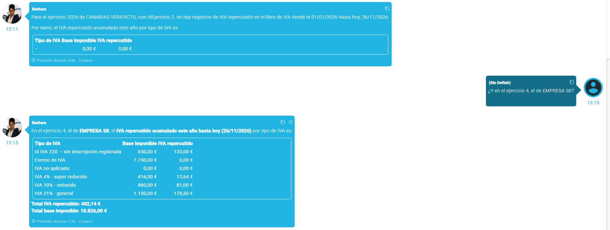
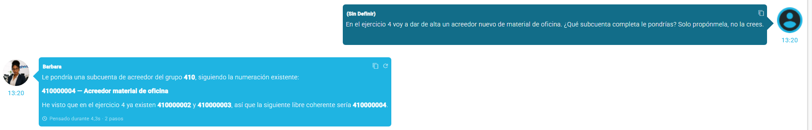

# Bárbara - Accounting and Tax Agent

{ width="160" align=right }

Bárbara is the **accounting and tax** agent. You ask her in your own words about financial years, accounts, journal entries, budgets, VAT or tax forms, and she answers with the data in your ERP. She also opens in the ERP whatever you need to see, so you don't have to look for it.

> Hola, ¿qué quieres revisar de contabilidad o fiscalidad? (Hi, what would you like to review in accounting or tax?)

She's designed for whoever does the bookkeeping: closing financial years, reviewing budgets or preparing tax returns. You'll find her in the chat's list of agents, under the name **Barbara**.

Bárbara doesn't handle collections, payments, remittances or banks: that's [Pamela](Pamela.md)'s job.

## What she can do for you

### Query

Bárbara queries the ERP's real data before giving you a figure. You don't need to know where each piece of data is.

| You ask her about… | For example |
|---|---|
| Financial years | *«¿Está abierto el ejercicio 2026?»* (Is the 2026 financial year open?) |
| An account's balance and movements | *«¿Qué saldo tiene la 572 a 31 de marzo?»* (What's the balance of 572 at 31 March?) |
| Journal entries and lines | *«¿Cuál es el asiento de mayor importe de este año?»* (Which entry has the largest amount this year?) |
| Chart of accounts | *«¿Qué subcuentas empiezan por 430?»* (Which sub-accounts start with 430?) |
| The year's result | *«¿Cuánto llevamos de beneficio este año?»* (How much profit have we made so far this year?) |
| Accounting budget | *«¿Cómo va el presupuesto de la 600 en agosto?»* (How is the budget for 600 doing in August?) |
| VAT book | *«¿Cuánto IVA soportado llevamos este trimestre?»* (How much input VAT have we got this quarter?) |
| Withholdings | *«¿Qué retención se le aplicó al proveedor García en su última factura?»* (What withholding was applied to supplier García on his last invoice?) |
| Depreciation | *«¿Qué cuota de amortización tiene el ordenador nuevo este año?»* (What's the depreciation charge for the new computer this year?) |
| VAT pro rata | *«¿Qué porcentaje de prorrata tenemos este ejercicio?»* (What pro rata percentage do we have this year?) |
| Accruals and expense types | *«¿Qué periodificaciones tenemos este ejercicio?»* (What accruals do we have this year?) |
| Tax forms | *«¿Cómo está el 303 del tercer trimestre?»* (What's the status of the third-quarter 303?) (see [Tax forms](#tax-forms)) |

She also makes **charts** with the data she queries: *«Hazme un gráfico de barras con el gasto mensual de la 628 este año»* (Make me a bar chart with this year's monthly spending on 628).

!!! tip "What you have selected in the ERP"
    If you don't say which year you mean, Bárbara uses the financial year you have selected in the ERP, and tells you so. For another one, name it: *«…del 2025»* (…for 2025).

### Open and print in the ERP

| You ask her… | Bárbara… |
|---|---|
| *«Ábreme el asiento 15»* (Open entry 15) | Opens journal entry management showing that entry |
| *«Enséñame en el ERP los movimientos de la 430000001»* (Show me the movements of 430000001 in the ERP) | Opens the account statement, with all its lines for the year |
| *«Ábreme el balance de situación de 2025»* (Open the 2025 balance sheet) | Opens the balance calculated for that full financial year |
| *«Imprime los asientos 3, 4 y 5»* (Print entries 3, 4 and 5) | Prints them |
| *«Ábreme la ficha del inmovilizado de la furgoneta»* (Open the fixed asset record for the van) | Opens the depreciation item |

She opens journal entries, accounts, financial years, cost centres, budgets, depreciation items, balances (Balance Sheet, Profit and Loss and Cash Flow Statement), accruals, expense lines, manual VAT entries, entry templates, customers and suppliers.

She prints journal entries and depreciation items, one or several at a time.

### Create

Bárbara can create two things:

- **A sub-account** in a financial year: *«Crea la subcuenta 430000099 "Cliente varios" en 2026»* (Create sub-account 430000099 "Sundry customer" in 2026).
- **A cost centre**: *«Crea el centro de coste 001 "Administración"»* (Create cost centre 001 "Administration").

## What she asks you to confirm

**A sub-account's length.** A sub-account with the wrong length isn't created. If you give her a code shorter than the financial year requires, Bárbara proposes the full code, the same way the ERP completes it when you type «430.99», and waits for your yes:

> La subcuenta tiene que tener 9 dígitos. ¿La creo como 430000099? (The sub-account must have 9 digits. Shall I create it as 430000099?)

She never pads with zeros on her own. The same goes for a cost centre: if the code doesn't have the length the ERP requires, she tells you how many characters are needed.

**Which entry a line belongs to.** The line number repeats in every journal entry. If you ask her to *«abre el apunte 2»* (open line 2) without saying which entry, she asks you.

## Tax forms

Tax forms are a separate ERP module, and not every company has it.

- **With the module**, Bárbara checks the status of the forms already generated (generated, calculated, validated, filed or cancelled), opens them on their screen and prints them one at a time.
- **Without the module**, she tells you it isn't installed. If you ask her how much the quarter's VAT comes to, she calculates it from the VAT book and makes clear it isn't the amount of a filed form.

Bárbara **doesn't calculate, validate, file or cancel** a tax form. If you ask her to, she tells you to do it yourself and offers to open it so you can do it from there.

## What Bárbara doesn't do

- **She doesn't generate journal entries.** If you want to post one with a template, she opens the entry templates so you can generate it yourself with the ERP's wizard.
- **She doesn't close or reopen financial years**, or depreciate or reverse depreciation on fixed assets.
- **She doesn't recalculate the VAT pro rata.** She tells you its percentage; the recalculation is done from **Ejercicios** (Financial years) in the ERP.
- **She doesn't create accruals, expense lines or manual VAT entries.** For a manual VAT entry she opens the blank screen and you fill it in and save it yourself.
- **She doesn't print budgets** or several tax forms at once: the ERP has no report for that. She offers to open them instead.
- **She doesn't open balances for part of a year**: only for the full financial year.
- **She doesn't make up figures.** If she can't query a piece of data, she tells you.

## Model and keys

Bárbara works with a **Claude** (Anthropic) or **OpenAI** model. In a new installation she comes with Claude Sonnet. An administrator changes the model and keys in **Administración > Configuración de IA** (AI configuration): see [AI models](Modelos.md).

By default Bárbara doesn't search the Internet. To turn it on, see [Agents with Internet search](Internet.md).
