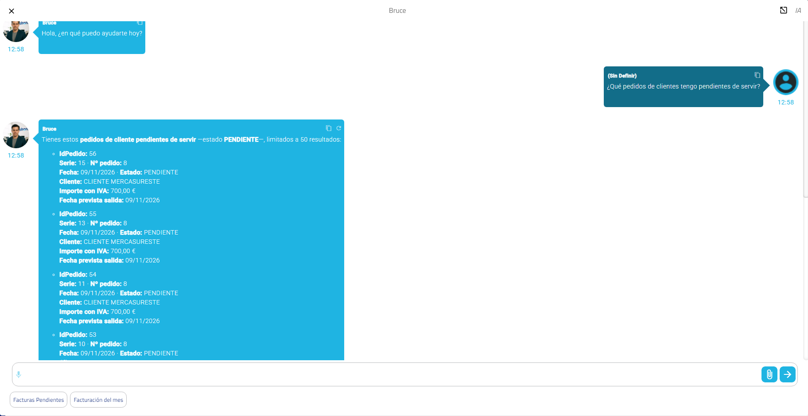
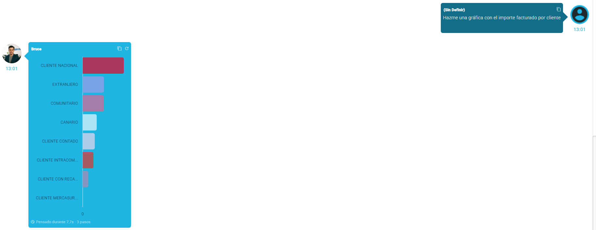
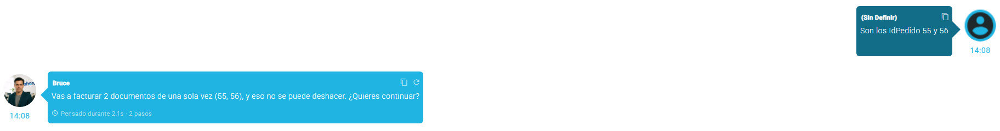

# Bruce - Sales Agent

{ width="96" align=right }

Bruce is the agent for the **sales cycle**: customer orders, delivery notes and invoices, customers and items. You ask him in plain language and he answers with the ERP's real data, draws you a chart, opens documents for you and, if you ask him to, creates delivery notes, invoices or updates documents.

> Hola, ¿en qué puedo ayudarte hoy? (Hi, how can I help you today?)

He's meant for sales staff, invoicing managers and management. You'll find him in the chat's list of agents (see [ERP AI agents](Introduccion.md)).

## What he can do

| You ask him for… | Bruce… |
|---|---|
| A query | Searches the sales data and gives you the answer or the list |
| A chart | Draws it in the chat, as vertical or horizontal bars |
| To open or print | Opens or prints a document, a customer, an item or a filtered collection |
| To create a delivery note or an invoice | Generates the delivery note or the invoice for the orders and delivery notes you tell him |
| To update | Updates delivery notes and invoices |
| To create a record | Creates customers and items |

Bruce works **with your user**: he only sees the customers, series and warehouses you have access to in the ERP.

## Queries and charts

He sees orders with their lines, delivery notes, invoices (including debtor invoices and advance payments), customers with their contacts, items with their stock per warehouse, and the sales series. Some examples:

- *«Muéstrame los pedidos pendientes de facturar»* (Show me the orders pending invoicing)
- *«Dame todos los datos del pedido 1234»* (Give me all the details of order 1234)
- *«Pedidos pendientes de albaranear entre el 20 de abril y el 20 de mayo»* (Orders pending delivery between 20 April and 20 May)
- *«Total de facturación del último mes, ordenado por cliente»* (Total invoiced last month, sorted by customer)
- *«Lista las facturas por fecha de actualización e indica cuáles están actualizadas»* (List the invoices by update date and show which ones are updated)
- *«Dime el total facturado en facturas de deudor este mes»* (Tell me the total invoiced in debtor invoices this month)
- *«Importe total de anticipos en el último año»* (Total amount of advance payments in the last year)
- *«Cuenta los artículos pedidos y albaraneados en el último mes»* (Count the items ordered and delivered last month)
- *«¿Cuánto stock disponible tengo del artículo TORNILLO-M8 en cada almacén?»* (How much available stock do I have of item TORNILLO-M8 in each warehouse?)
- *«Genera una gráfica con la facturación de cada cliente en el último mes»* (Make a chart of each customer's invoicing last month)

When you ask him for a list of documents, he gives you each one's **Id**, series, number, date, status and customer. With the Id you can then ask him to act on one from the list: *«factura el segundo»* (invoice the second one), *«abre el 29»* (open 29).

!!! tip "If the number repeats"
    Numbering restarts every year, so order 5 can exist in several years or series. If you give him a number that matches several documents, Bruce shows you all of them and asks which one you mean. He doesn't choose.

Bruce doesn't show you the SQL query he used, but if you ask for it he gives it to you.

## Opening and printing

Bruce opens in the ERP an **order**, a **delivery note**, an **invoice**, a **customer** or an **item**, or a **collection** of any of them with the filter you tell him. He also prints them.

- *«Abre los clientes de tipo Nacional»* (Open the customers of type Nacional, domestic)
- *«Abre las facturas del tercer trimestre de 2024»* (Open the invoices from the third quarter of 2024)
- *«Abre los pedidos del cliente EXTRANJERO»* (Open the orders of customer EXTRANJERO)
- *«Imprime la factura 52 de la serie A»* (Print invoice 52 of series A)

If you give him a name instead of a code, he looks it up first. To open a single record, the details have to identify only one; if not, he asks you.

## Creating delivery notes, invoicing and updating

Bruce follows the ERP's sales cycle:

| Action | On what | What it requires |
|---|---|---|
| **Create the delivery note** for an order | Orders in status PENDIENTE (pending) | You can give him the delivery note's date; if not, it gets today's |
| **Invoice** an order | Orders in status PENDIENTE, with no delivery notes | The invoice always gets today's date |
| **Invoice** a delivery note | Delivery notes that aren't invoiced | |
| **Update** a delivery note | Delivery notes in status ALBARAN (delivery note) | |
| **Update** an invoice | Invoices in status FACTURA NO ACTUALIZADA (invoice not updated) | |

He tells you the result document by document: the Id of the delivery note or invoice he generated or, if one failed, the reason.

- *«Albaranea el pedido 26 con fecha 15 de noviembre»* (Create the delivery note for order 26 dated 15 November)
- *«Factura los albaranes pendientes de EXTRANJERO»* (Invoice EXTRANJERO's pending delivery notes)
- *«Actualiza la factura 52»* (Update invoice 52)

!!! warning "One document per order or delivery note"
    Bruce generates one delivery note per order and one invoice per delivery note. He **doesn't group** several orders into one delivery note or several delivery notes into one invoice, and he doesn't split a document into several. Do that from the ERP.

## Creating customers and items

- *«Crea el cliente FICTICIO con NIF 12345678Z»* (Create customer FICTICIO with tax ID 12345678Z)
- *«Crea el artículo TORNILLO-M8, tornillo inoxidable de métrica 8»* (Create item TORNILLO-M8, stainless steel M8 screw)

For a **customer** he needs at least the name and the tax ID (NIF); if you don't tell him the type, he creates it as Nacional (domestic). If there's already a customer with that tax ID, he doesn't create another one: he tells you which one it is.

For an **item** he needs the code and the description. If you don't give him the code, he asks you for it or suggests one based on the description.

When he's done he gives you the code of the new record, but he doesn't open it: ask him if you want to see it.

## What he asks you to confirm

| If you ask him to… | Bruce… |
|---|---|
| Create the delivery note, invoice or update **a single document** | Does it without asking |
| Do it with **several documents at once** | Shows you which ones and asks *«¿Quieres continuar?»* (Do you want to continue?) before touching anything |
| Do something with a number that exists in several years or series | Shows you the candidates and asks which one |

The confirmation is valid for those same documents and for 15 minutes. If you take longer or change the list, he asks you again.

!!! warning "With a single document, he acts"
    If you only want to know whether something can be done, say so: *«¿se puede facturar el pedido 26? Solo pregunto»* (can order 26 be invoiced? I'm only asking). Bruce will check its status without invoicing it. What Bruce generates can't be undone from the chat.

## What Bruce doesn't do

- **Batches.** He doesn't create delivery notes for or invoice orders with batch-tracked items, and he doesn't invoice or update delivery notes with unassigned batches. He tells you so: assign the batch and do the operation from the ERP.
- **Locks.** If the document or the customer is locked, he doesn't go on. Unlock them in the ERP.
- **Invoices he can't update.** Those from another company, and those in a series that requires today's date when the invoice isn't from today: they have to be renumbered with today's date in the ERP.
- **Invoice date when invoicing an order.** It's always today's; if you ask for another one, he warns you that the ERP doesn't allow it.
- **Changing or deleting.** He doesn't change the data of orders, delivery notes, invoices, customers or items, and doesn't delete them.
- **Other topics.** He only talks about the ERP's sales cycle. For purchasing, talk to [Selina](Selina.md).

Queries return at most 50 rows unless you ask for more. By default, Bruce **doesn't search the Internet**: see [Agents with Internet search](Internet.md).

## Model and keys

In a new installation, Bruce works with **Claude Sonnet**. He can use a Claude (Anthropic) or OpenAI model: an administrator manages the model and the providers' keys. It's all in [AI models](Modelos.md).
