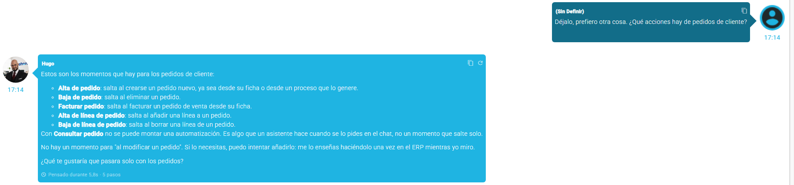
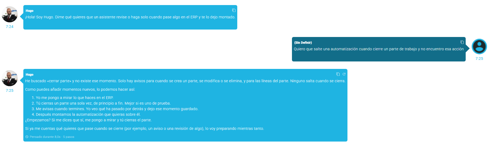
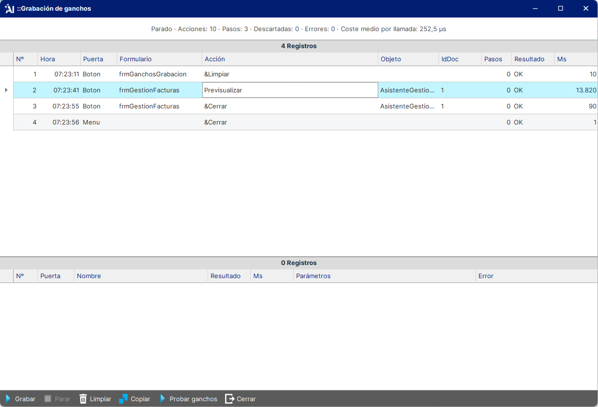

# Action catalog

The **action catalog** is the list of everything that can be done in the ERP and that the AI understands. It serves two purposes:

- for [Hugo](Hugo.md), each action is a **moment** when an automation can fire: *"when I post an invoice"*;
- for [Amanda](Amanda.md), each action is something **an agent can do**: *"give it the action to create tasks"*.

## What's in the catalog

Each action is named as **Document.Action** (`Factura.Actualizar`, `Cliente.Alta`) and belongs to a module: Ventas (Sales), Compras (Purchasing), Tesorería (Treasury), Maestros (Master data)…

| Type | What it is | Example |
|---|---|---|
| **Alta** (Create) | Create a record | New customer, new order |
| **Modificación** (Modify) | Change a record | Modify an item |
| **Baja** (Delete) | Delete a record | Delete a contact |
| **Consultar** (Query) | Search records, with totals and groupings | Query banks |
| **Abrir** (Open) | Open the record in the ERP | Open supplier |
| **Proceso** (Process) | A business process | Post invoice, invoice order, create delivery note from order |

The ERP ships with **more than a thousand actions**: create, modify, delete, query and open for each business object, plus the main processes.

To find out what's there, ask Hugo or Amanda:

> What actions are there for customer orders?

> What data does the post invoice action bring?

## Adding an action that doesn't exist

If you want an automation to fire on something that isn't in the catalog, an **administrator** can **record it**: they perform the action in the ERP while Hugo watches, and Hugo turns it into a new action.

1. **Tell Hugo:** *"I want it to fire when I close a work report and I can't find it"*. If it doesn't exist, Hugo offers to record it.
2. **Hugo turns recording on.** From that moment, the ERP logs the buttons and menus you click and the processes they launch.
3. **Perform the action in the ERP**, once and all the way through: open the work report and close it.
4. **Tell Hugo you're done.** Hugo reviews what was recorded, turns recording off, and proposes the new action to you: its name, when it fires, and what data it will bring.
5. **Hugo checks it without saving anything**, with the data you recorded, and shows you what it gets.
6. **When you say yes, he adds it to the catalog.** From then on you can use it in automations.

- Standard action names are **reserved**: if you choose one that already exists, Hugo suggests another.
- Actions added in your ERP **are checked in every version**. If any stops working after an update, Hugo tells you which one.
- An added action can be **removed from the catalog** by asking Hugo, if no automation uses it.

## AI hook diagnostics

For administrators only. In the administration menu, **Diagnóstico de ganchos IA** (AI hook diagnostics) opens the **Grabación de ganchos** (Hook recording) window, which shows what the ERP captures on each click. It's a diagnostic tool: you don't need it for normal use.

| Button | What it does |
|---|---|
| **Grabar** (Record) / **Parar** (Stop) | Starts or stops logging what happens in the ERP |
| **Limpiar** (Clear) | Deletes what has been logged |
| **Copiar** (Copy) | Copies what has been logged to the clipboard |
| **Probar ganchos** (Test hooks) | Tests end to end that each action in the catalog fires |

- **Acciones capturadas** (Captured actions): each click grouped as one action, with its time, the form, the object and the document, how many steps it had and whether it went well.
- **Pasos de la acción seleccionada** (Steps of the selected action): the processes that click launched, with their parameters and their result.

### Test hooks

**Probar ganchos** opens a record of each object in the catalog and saves it **without changes, inside a transaction that is rolled back**, to check that its modify action fires and brings the right document. Nothing stays saved.

When it finishes, it tells you how many actions went well, how many failed, and how many couldn't be tested (because there were no records or because the ERP doesn't allow saving them), and leaves the report on the clipboard and in a file.

!!! warning "Better without active modify automations"
    The test takes a few minutes. While it runs, any modify automations you have active may fire.

## Limitations

- A button on a **modal form opened from a menu** doesn't trigger its automation.
- An automation can't fire **during** an action, only once it has finished successfully: the inside of the ERP transaction is left out, so as not to block anyone.
