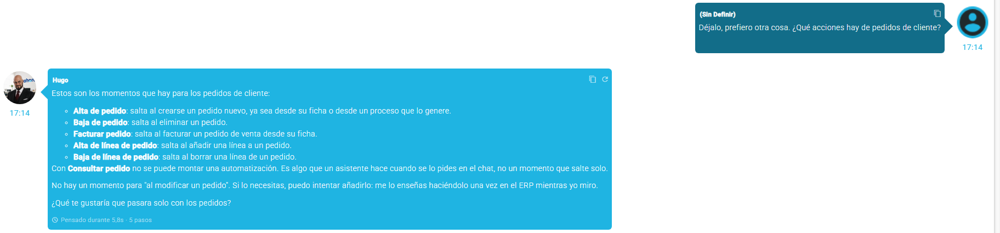
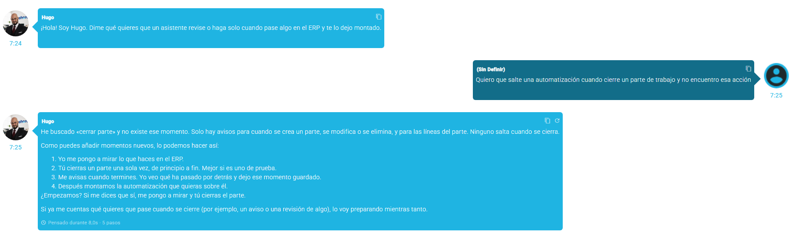
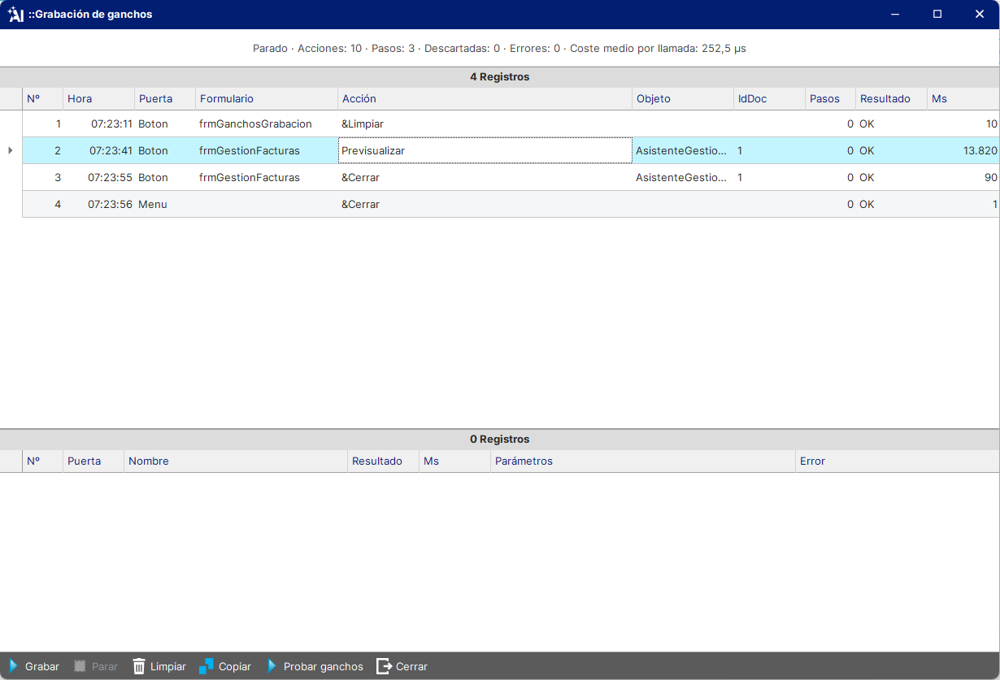

# Catálogo de acciones

El **catálogo de acciones** es la lista de todo lo que se puede hacer en el ERP y que la IA entiende. Sirve para dos cosas:

- para [Hugo](Hugo.md), cada acción es un **momento** en el que puede saltar una automatización: *«cuando actualice una factura»*;
- para [Amanda](Amanda.md), cada acción es algo que **un agente puede hacer**: *«dale la acción de dar de alta tareas»*.

## Qué hay en el catálogo

Cada acción se nombra como **Documento.Acción** (`Factura.Actualizar`, `Cliente.Alta`) y pertenece a un módulo: Ventas, Compras, Tesorería, Maestros…

| Tipo | Qué es | Ejemplo |
|---|---|---|
| **Alta** | Crear un registro | Alta de cliente, alta de pedido |
| **Modificación** | Cambiar un registro | Modificación de artículo |
| **Baja** | Borrar un registro | Baja de contacto |
| **Consultar** | Buscar registros, con totales y agrupaciones | Consultar bancos |
| **Abrir** | Abrir la ficha en el ERP | Abrir proveedor |
| **Proceso** | Un proceso de negocio | Actualizar factura, facturar pedido, albaranear pedido |

El ERP trae de serie **más de mil acciones**: alta, modificación, baja, consulta y apertura de cada objeto de negocio, y los procesos principales.

Para saber qué hay, pregúntale a Hugo o a Amanda:

> ¿Qué acciones hay de pedidos de cliente?

> ¿Qué datos trae la acción de actualizar factura?

## Añadir una acción que no existe

Si quieres que una automatización salte con algo que no está en el catálogo, un **administrador** puede **grabarlo**: hace la acción en el ERP mientras Hugo mira, y Hugo la convierte en una acción nueva.

1. **Díselo a Hugo:** *«quiero que salte cuando cierre un parte de trabajo y no lo encuentro»*. Si no existe, Hugo te propone grabarlo.
2. **Hugo enciende la grabación.** A partir de ese momento, el ERP apunta los botones y menús que pulsas y los procesos que lanzan.
3. **Haz la acción en el ERP**, una vez y entera: abre el parte y ciérralo.
4. **Dile a Hugo que ya está.** Hugo revisa lo grabado, apaga la grabación y te propone la acción nueva: su nombre, cuándo salta y qué datos traerá.
5. **Hugo la comprueba sin guardar nada**, con los datos que grabaste, y te enseña lo que saca.
6. **Con tu sí, la añade al catálogo.** Desde ese momento ya puedes usarla en automatizaciones.

- Los nombres de las acciones estándar están **reservados**: si eliges uno que ya existe, Hugo te propone otro.
- Las acciones añadidas en tu ERP **se comprueban en cada versión**. Si alguna deja de funcionar tras una actualización, Hugo te dice cuál.
- Una acción añadida se puede **quitar del catálogo** pidiéndoselo a Hugo, si ninguna automatización la usa.

## Diagnóstico de ganchos IA

Solo para administradores. En el menú de administración, **Diagnóstico de ganchos IA** abre la ventana **Grabación de ganchos**, que enseña lo que el ERP captura en cada clic. Es una herramienta de diagnóstico: para el uso normal no hace falta.

| Botón | Qué hace |
|---|---|
| **Grabar** / **Parar** | Empieza o deja de apuntar lo que pasa en el ERP |
| **Limpiar** | Borra lo apuntado |
| **Copiar** | Copia lo apuntado al portapapeles |
| **Probar ganchos** | Prueba de punta a punta que cada acción del catálogo salta |

- **Acciones capturadas:** cada clic agrupado como una acción, con su hora, el formulario, el objeto y el documento, cuántos pasos tuvo y si fue bien.
- **Pasos de la acción seleccionada:** los procesos que lanzó ese clic, con sus parámetros y su resultado.

### Probar ganchos

**Probar ganchos** abre un registro de cada objeto del catálogo y lo graba **sin cambios, dentro de una transacción que se deshace**, para comprobar que su acción de modificación salta y trae el documento correcto. No se queda grabado nada.

Al terminar, dice cuántas acciones han ido bien, cuántas mal y cuántas no se han podido probar (por no tener registros o porque el ERP no deja grabarlas), y deja el informe en el portapapeles y en un fichero.

!!! warning "Mejor sin automatizaciones de modificación activas"
    La prueba tarda unos minutos. Mientras dura, pueden saltar las automatizaciones de modificación que tengas activas.

## Limitaciones

- Un botón de un **formulario modal abierto desde un menú** no dispara su automatización.
- No se puede saltar **durante** una acción, solo cuando ha terminado bien: el interior de la transacción del ERP queda fuera, para no bloquear a nadie.
