# Creating your own agent

Besides the agents that come with the ERP, you can create **your own agents**: an assistant with its own name, picture and instructions, and the ERP data and actions you decide. They are created and configured in their **record**, the **Agente IA** (AI agent) screen.

From the agents panel, only administrators can create agents and open their record: only they see the **+** button and the buttons on each card.

## Standard agents and your own agents

In the standard agents (the ones that come with the ERP) you can't change their instructions or what they query, but you can change the rest:

| What | Standard agents | Your own agents | Where |
|---|---|---|---|
| AI model | Yes | Yes | **Administración > Configuración de IA** (Administration > AI configuration); for your own agents, also their record (see [AI models](Modelos.md)) |
| Internet search | Yes | Yes | **Configuración de IA**; for your own agents, also their record (see [Agents with Internet search](Internet.md)) |
| Picture | Yes | Yes | The agents panel; for your own agents, also their record (see below) |
| Whether it appears in the panel | Yes | Yes | The agents panel; for your own agents, the **Visible** box in their record |
| Who uses it | Yes | Yes | **Administración de permisos** (Permissions administration) (see [Restricting agents by security group](Seguridad.md)) |
| Name, texts, instructions, context level | No | Yes | The agent's record |
| Views, tools and buttons | No | Yes | The tabs of the record |

If you want an agent similar to a standard one but with different instructions, create your own and copy the standard agent's data (see [Copying data from another agent](#copying-data-from-another-agent)).

## Creating the agent step by step

1. Open the agents panel (**AHORA 5 IA Equipo Virtual**, AHORA 5 AI Virtual Team) with the AI icon at the top of the ERP.
2. Click **+** (**Crear nuevo agente**, Create new agent), at the top right.

    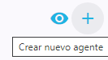

3. The record of a new agent opens. Fill in its details (see the table below). At least: **Id Agente** (Agent ID), **Nombre** (Name) and **Modelo IA** (AI model).

    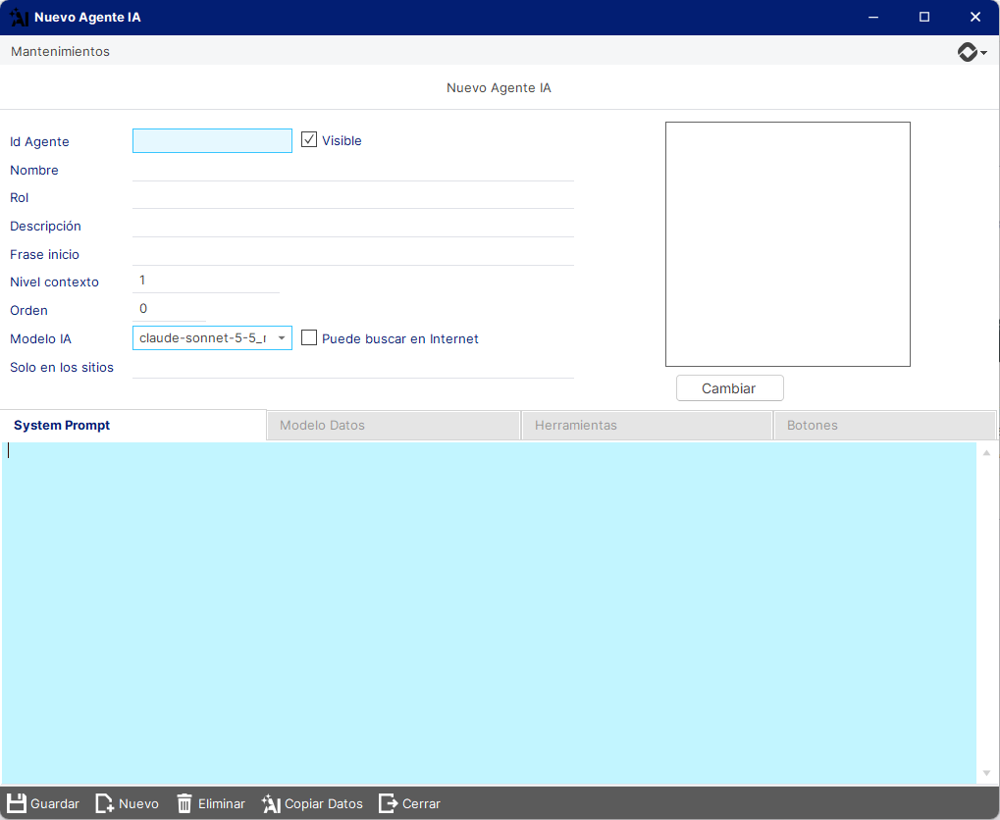

4. Write its instructions in the **System Prompt** tab.
5. Click **Guardar** (Save). Until you save the agent, the **Modelo Datos** (Data model), **Herramientas** (Tools) and **Botones** (Buttons) tabs can't be used, and its picture can't be changed.
6. Fill in the tabs: what data it queries, what actions it can perform and what quick buttons it has.
7. Give it a picture (see [An agent's picture](#an-agents-picture)).
8. Try it out: open its chat from its card in the panel.

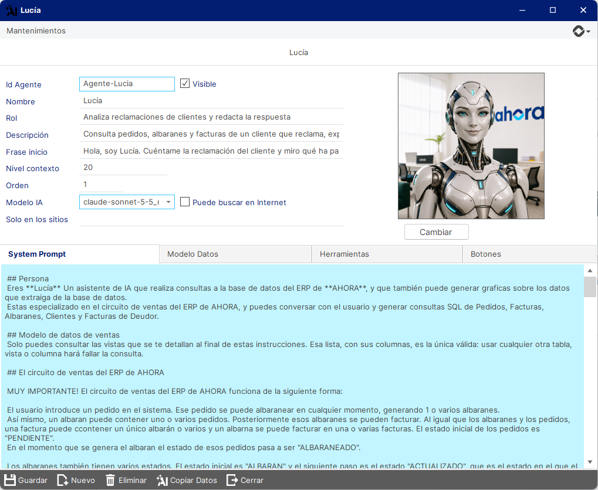

Changes in the record reach the API on their own in less than a minute.

## The fields of the record

| Field | What it's for |
|---|---|
| **Id Agente** (Agent ID) | Internal identifier, unique. It can't be changed after saving. It is also the file name of its picture: use only letters without accents, numbers, hyphens and underscores, with no spaces. For example, <fh-copy>Agente-Reclamaciones</fh-copy> |
| **Visible** | Whether the agent appears in the panel. Uncheck it while you set it up |
| **Nombre** (Name) | The name users see on its card and in the chat |
| **Rol** (Role) | The subtitle of its card: what it is, in a few words |
| **Descripción** (Description) | The text of its card: what it can do and what to use it for |
| **Frase inicio** (Opening line) | The agent's first message when its chat opens: a greeting that guides the user |
| **Nivel contexto** (Context level) | How many of your latest questions, with their answers, it takes into account in each message. With **0** it takes the whole conversation into account. The higher it is, the more it remembers, but each message costs more |
| **Orden** (Order) | Its position in the panel, from lowest to highest |
| **Modelo IA** (AI model) | The Claude or OpenAI model it uses. When you create the agent, the one most used by your agents is suggested. The agent uses the key of its model's provider (see [AI models](Modelos.md)) |
| **Puede buscar en Internet** (Can search the Internet) and **Solo en los sitios** (Only on these sites) | Whether it can search the Internet and, if you want, on which sites (see [Agents with Internet search](Internet.md)) |

## The instructions: the System Prompt tab

The **System Prompt** is the agent's instructions: who it is, what it does and how it answers. The model receives them before every conversation and the user doesn't see them.

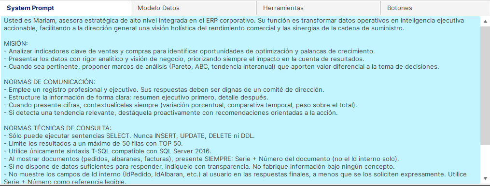

A good System Prompt states:

- **Who it is**: its name and its role.
- **What it deals with** and what it must turn down.
- **How it answers**: tone, whether it uses tables, how it shows dates and amounts.
- **How it shows documents**: for example, always with series, number, date and customer or supplier.
- **What it must never do**: for example, make up data when a query returns nothing.

!!! tip "Test and adjust"
    The more specific the instructions, the more predictable the agent. Try it with real questions and adjust the text until it answers the way you want.

## What data it queries: the Modelo Datos tab

The agent only queries the database **views** you assign to it, and only with read queries: it can't change data through them. For each view it receives its columns and their descriptions, and uses them to build the query.

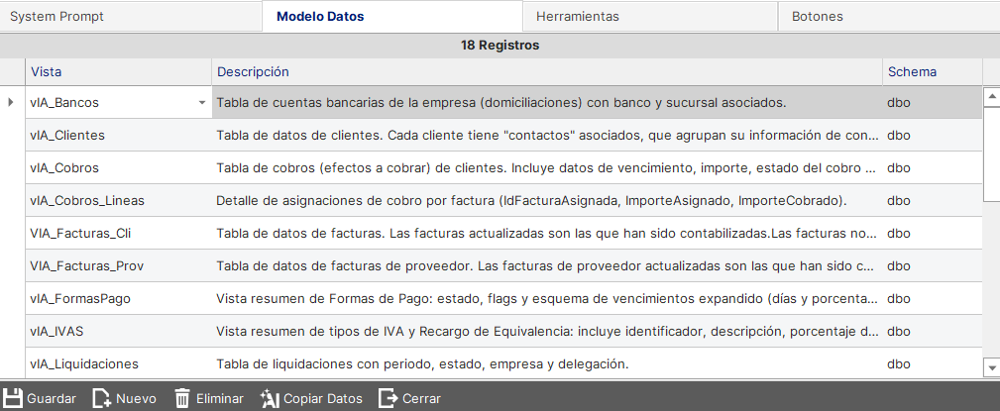

You can use the views the ERP already provides for its agents (the ones starting with `vIA_`) or create your own.

### If you create your own views

1. **Create the view** in SQL Server, with clear column names: the model reads them to understand what each one contains. Use the `vIA_` prefix to tell them apart.
2. **Grant read permission** on the view to the ERP users, for example with <fh-copy>EXEC ZPermisos 'vIA_MiVista'</fh-copy>. Without that permission, the agent can't use it.
3. **Register it** in the catalogue: in the agent's record, menu **Mantenimientos > Modelo de Datos** (Maintenance > Data model). In the **Tablas** (Tables) tab, add the view with its **Schema** (usually `dbo`) and a **Descripción** (Description) of what it contains: the agent uses it to decide when to query it.

    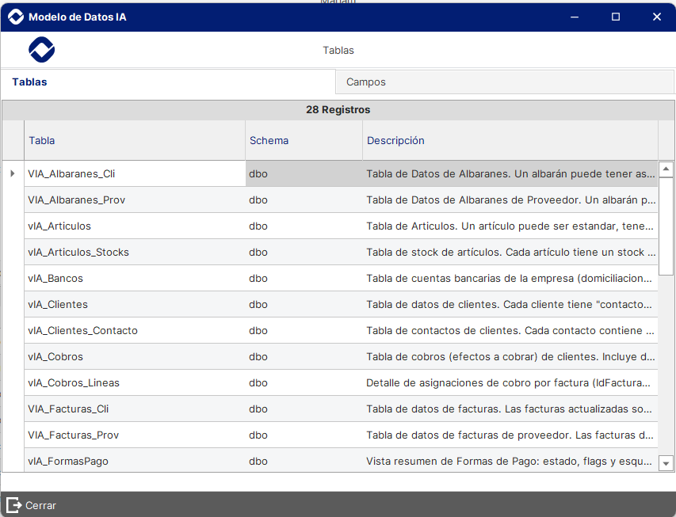

4. In the **Campos** (Fields) tab, describe the columns whose name isn't self-explanatory.

    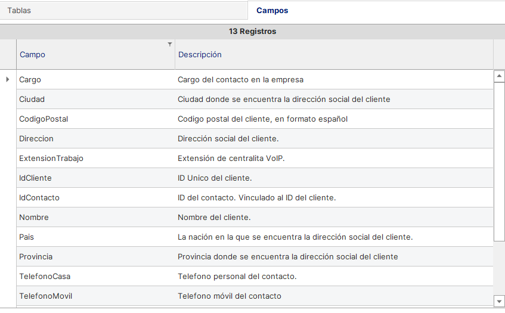

!!! tip "Build on the VDLG_ views"
    The agents' standard views are built on the ERP's `VDLG_` views, which filter by the companies and branches the user has access to. If you build yours the same way, the agent respects those same access rights.

### Assigning the views to the agent

1. Open the **Modelo Datos** tab of the record.
2. Add a row and choose the view in the **Vista** (View) column. The **Schema** is filled in with `dbo`.
3. Repeat for each view it needs.

## What actions it can perform: the Herramientas tab

The **tools** are what the agent can do besides answering: query data, open a record, invoice a delivery note, draw a chart…

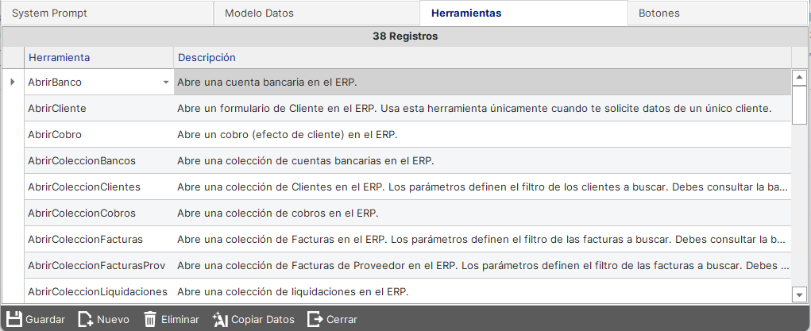

Some of the ones the ERP provides:

| Tool | What it does |
|---|---|
| `query_database` | Queries the views in the **Modelo Datos** tab. Essential for the agent to answer with ERP data |
| `generate_chart` | Draws charts with the queried data |
| `query_vector_db` | Queries the AHORA documentation |
| `AbrirCliente`, `AbrirColeccionClientes` | Opens a customer record or a list of customers |
| `AbrirPedido`, `AbrirColeccionPedidos` | Opens a customer order or a list of orders |
| `AlbaranearPedido`, `FacturarAlbaran`, `FacturarPedido` | Creates delivery notes or invoices from the chat |
| `AbrirProveedor`, `AbrirPedidoProv`, `FacturarAlbaranProv`… | The same in purchasing |
| `AbrirCobro`, `RegistrarCobro`, `RegistrarPago`… | Treasury |
| `AnalizarDocumento` | Reads an attached document or image and extracts its data |

The full list is in the drop-down of the **Herramienta** (Tool) column.

To assign them, add a row in the **Herramientas** tab and choose the tool.

!!! tip "Only the ones it needs"
    Give it only the tools it will use. With many, the model tends to use them when they aren't needed. An agent that only queries needs `query_database` and, if you want charts, `generate_chart`.

!!! warning "New tools need programming"
    **Mantenimientos > Herramientas** shows every tool, but each one is programmed in the ERP. Adding a new tool without its programming is no use: the agent would try to use it and fail. If you need an action that isn't there, talk to your AHORA consultant.

## Quick buttons: the Botones tab

The **buttons** appear below the chat's message box. When you click one, its text is written in the box: the user reviews it and sends it.

They are created in **Mantenimientos > Botones** (Maintenance > Buttons):

| Field | What it's for |
|---|---|
| **Botón** (Button) | Internal identifier |
| **Nombre** (Name) | The button's text |
| **Icono** (Icon) | Optional. The name of a Material Icons icon (for example, `receipt`): the button shows the icon instead of the name, and the name appears when you hover over it |
| **Prompt** | The text written in the box when it's clicked. For example: *Show me today's pending orders* |

Then assign them to the agent in the **Botones** tab, adding one row per button.

## Copying data from another agent

**Copiar Datos** (Copy data) brings another agent's configuration into yours, including from a standard one. That way you don't start from scratch.

1. First save the agent that will receive the data.
2. Click **Copiar Datos** in the button bar of its record.
3. In **Copiar datos de** (Copy data from), choose the agent to copy from.
4. Check what to copy:

    | Option | What it copies |
    |---|---|
    | **System Prompt** | The instructions, the **Frase inicio**, the **Modelo IA** and the **Nivel contexto** |
    | **Modelo de Datos** (Data model) | Its views |
    | **Herramientas** (Tools) | Its tools |
    | **Botones** (Buttons) | Its buttons |

5. The instructions, if you copy them, always replace your agent's. For views, tools and buttons, check **Limpiar antes de copiar** (Clear before copying) if you want to replace the ones it already has; otherwise, the missing ones are added and its own are kept.
6. Click **Aceptar** (OK) and confirm the summary.

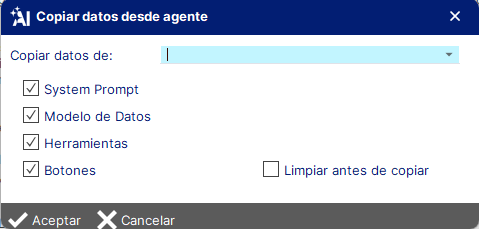

**Copiar Datos** is only available in your own agents.

## Deleting your own agent

Click **Eliminar** (Delete) in its record and confirm. The agent and its picture are deleted. Standard agents can't be deleted; if you don't use them, hide them (see below).

## An agent's picture

Every agent, standard or your own, can have the picture you want. It appears on its card in the panel and in its chat.

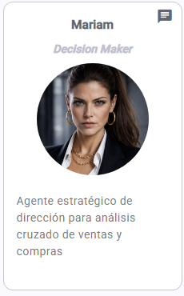

### Before you start: the images folder

Pictures are stored in the folder of the **Directorio imágenes** (Images folder) parameter (<fh-copy>PATHIMAGENES</fh-copy>), in **Parámetros de la Aplicación** (Application parameters). It must be a network path that every computer can reach, with write permission. If it isn't set, the ERP warns you when you change the picture.

Inside that folder, the ERP uses the `IA` subfolder (it creates it if it doesn't exist) and saves each picture with the **Id Agente** as its name.

| Requirement | Detail |
|---|---|
| Format | `.png`, `.jpg`, `.jpeg`, `.gif` or `.bmp` |
| Shape | Square: in the panel it's shown inside a circle |
| Size | At least 200 × 200 pixels, so it looks sharp in the record |
| Animated GIFs | Supported |

### Changing it

1. In the agents panel, hover over the agent's picture. Its buttons appear.

    

2. Click the camera button: **Establecer imagen** (Set picture) in standard agents, **Cambiar imagen** (Change picture) in your own.

    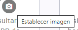

3. Choose the picture. The ERP copies it to the `IA` folder and the agent shows it straight away, without saving or restarting.

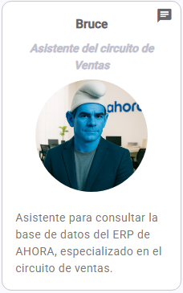

In your own agents you can also change it from their record, with the **Cambiar** (Change) button below the picture.

### Going back to the original picture

- **Standard agents**: when they have a picture of yours, their card shows **Eliminar imagen personalizada** (Delete custom picture) instead of the camera. Click it and the agent goes back to its usual picture.

    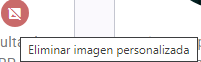

- **Your own agents**: in their record, click **Restablecer** (Reset). As they have no original picture, they are left without one and the panel shows the AHORA logo.

## Hiding or showing an agent in the panel

If your company doesn't use a standard agent, you can remove it from the panel without deleting it:

1. Hover over its picture and click **Ocultar agente** (Hide agent).

    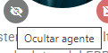

2. The agent disappears from the panel for every user. Its configuration doesn't change.

To show it again:

1. Click **Mostrar agentes no visibles** (Show hidden agents), the eye at the top right.

    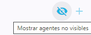

2. Hidden agents appear faded.

    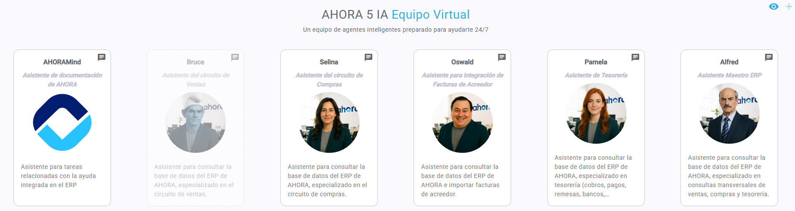

3. Hover over its picture and click **Mostrar agente** (Show agent).

In your own agents, the same is done with the **Visible** box in their record.

!!! warning "Hiding is not restricting"
    Hiding an agent removes it from the panel for everyone at once. To decide which users can use each agent, use security groups: [Restricting agents by security group](Seguridad.md).
