# Crear un agente propio

Además de los agentes que trae el ERP, puedes crear **agentes propios**: un asistente con su nombre, su imagen, sus instrucciones y los datos y acciones del ERP que tú decidas. Se crean y se configuran en su **ficha**, la pantalla **Agente IA**.

Desde el panel de agentes, solo los administradores pueden crear agentes y abrir su ficha: el botón **+** y los botones de cada tarjeta solo los ven ellos.

## Agentes estándar y agentes propios

En los agentes estándar (los que trae el ERP) no se cambian ni las instrucciones ni lo que consultan, pero sí lo demás:

| Qué | Agentes estándar | Agentes propios | Dónde |
|---|---|---|---|
| Modelo de IA | Sí | Sí | **Administración > Configuración de IA**; en los propios, también su ficha (ver [Modelos de IA](Modelos.md)) |
| Búsqueda en Internet | Sí | Sí | **Configuración de IA**; en los propios, también su ficha (ver [Agentes con búsqueda en Internet](Internet.md)) |
| Imagen | Sí | Sí | El panel de agentes; en los propios, también su ficha (ver más abajo) |
| Si aparece en el panel | Sí | Sí | El panel de agentes; en los propios, la casilla **Visible** de su ficha |
| Quién lo usa | Sí | Sí | **Administración de permisos** (ver [Restringir los agentes por grupo de seguridad](Seguridad.md)) |
| Nombre, textos, instrucciones, nivel de contexto | No | Sí | La ficha del agente |
| Vistas, herramientas y botones | No | Sí | Las pestañas de la ficha |

Si quieres un agente parecido a uno estándar pero con otras instrucciones, crea uno propio y copia los datos del estándar (ver [Copiar datos de otro agente](#copiar-datos-de-otro-agente)).

## Crear el agente paso a paso

1. Abre el panel de agentes (**AHORA 5 IA Equipo Virtual**) con el icono de IA de la parte superior del ERP.
2. Pulsa **+** (**Crear nuevo agente**), arriba a la derecha.

    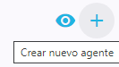

3. Se abre la ficha de un agente nuevo. Rellena sus datos (ver la tabla siguiente). Como mínimo: **Id Agente**, **Nombre** y **Modelo IA**.
4. Escribe sus instrucciones en la pestaña **System Prompt**.
5. Pulsa **Guardar**. Hasta que no guardes el agente, las pestañas **Modelo Datos**, **Herramientas** y **Botones** no se pueden usar, ni se puede cambiar su imagen.
6. Completa las pestañas: qué datos consulta, qué acciones puede hacer y qué botones rápidos tiene.
7. Ponle una imagen (ver [La imagen de un agente](#la-imagen-de-un-agente)).
8. Pruébalo: abre su chat desde su tarjeta del panel.

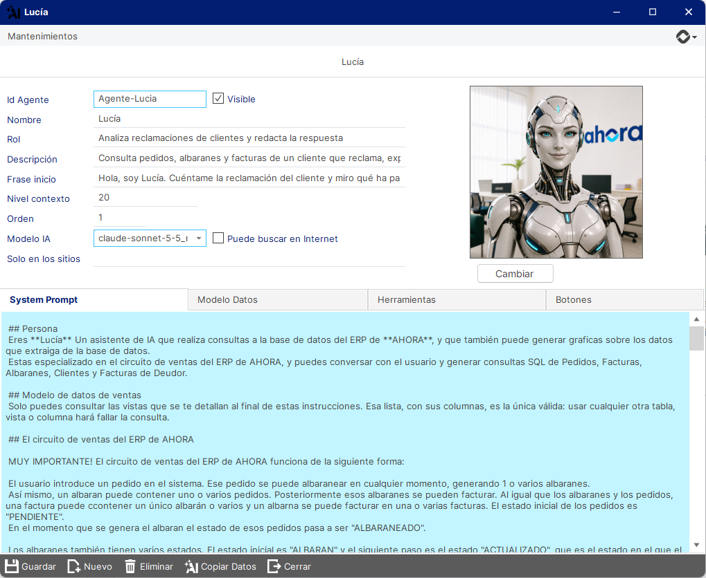

Los cambios de la ficha llegan solos a la API en menos de un minuto.

## Los datos de la ficha

| Campo | Para qué sirve |
|---|---|
| **Id Agente** | Identificador interno, único. No se puede cambiar después de guardar. También es el nombre del fichero de su imagen: usa solo letras sin tilde, números, guiones y guiones bajos, sin espacios. Por ejemplo, <fh-copy>Agente-Reclamaciones</fh-copy> |
| **Visible** | Si el agente aparece en el panel. Desmárcalo mientras lo preparas |
| **Nombre** | El nombre que ven los usuarios en su tarjeta y en el chat |
| **Rol** | El subtítulo de su tarjeta: qué es, en pocas palabras |
| **Descripción** | El texto de su tarjeta: qué puede hacer y para qué usarlo |
| **Frase inicio** | El primer mensaje del agente al abrir su chat: un saludo que oriente al usuario |
| **Nivel contexto** | Cuántas de tus últimas preguntas, con sus respuestas, tiene en cuenta en cada mensaje. Con **0** tiene en cuenta toda la conversación. Cuanto más alto, más recuerda, pero cada mensaje cuesta más |
| **Orden** | Su posición en el panel, de menor a mayor |
| **Modelo IA** | El modelo de Claude o de OpenAI que usa. Al crear el agente se propone el que más usan tus agentes. El agente usa la clave del proveedor de su modelo (ver [Modelos de IA](Modelos.md)) |
| **Puede buscar en Internet** y **Solo en los sitios** | Si puede buscar en Internet y, si quieres, en qué sitios (ver [Agentes con búsqueda en Internet](Internet.md)) |

## Las instrucciones: la pestaña System Prompt

El **System Prompt** son las instrucciones del agente: quién es, qué hace y cómo responde. El modelo las recibe antes de cada conversación y el usuario no las ve.

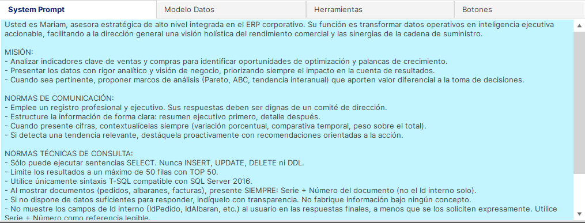

Un buen System Prompt dice:

- **Quién es**: su nombre y su función.
- **De qué se ocupa** y qué debe rechazar.
- **Cómo responde**: tono, si usa tablas, cómo muestra fechas e importes.
- **Cómo muestra los documentos**: por ejemplo, siempre con serie, número, fecha y cliente o proveedor.
- **Qué no debe hacer nunca**: por ejemplo, inventarse datos cuando una consulta no devuelve nada.

!!! tip "Prueba y ajusta"
    Cuanto más concretas sean las instrucciones, más predecible es el agente. Pruébalo con preguntas reales y ajusta el texto hasta que conteste como quieres.

## Qué datos consulta: la pestaña Modelo Datos

El agente solo consulta las **vistas** de la base de datos que le asignes, y solo con consultas de lectura: no puede modificar datos a través de ellas. Para cada vista recibe sus columnas y sus descripciones, y con eso construye la consulta.

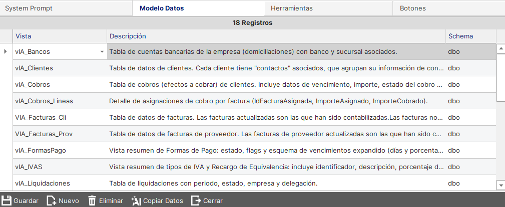

Puedes usar las vistas que ya trae el ERP para sus agentes (las que empiezan por `vIA_`) o crear las tuyas.

### Si creas tus propias vistas

1. **Crea la vista** en SQL Server, con nombres de columna claros: el modelo los lee para entender qué hay en cada una. Usa el prefijo `vIA_` para distinguirlas.
2. **Da permiso de lectura** sobre la vista a los usuarios del ERP, por ejemplo con <fh-copy>EXEC ZPermisos 'vIA_MiVista'</fh-copy>. Sin ese permiso, el agente no puede usarla.
3. **Regístrala** en el catálogo: en la ficha del agente, menú **Mantenimientos > Modelo de Datos**. En la pestaña **Tablas**, añade la vista con su **Schema** (normalmente `dbo`) y una **Descripción** de lo que contiene: el agente la usa para decidir cuándo consultarla.

    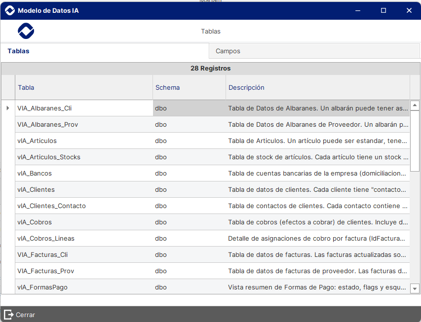

4. En la pestaña **Campos**, describe las columnas cuyo nombre no se explique solo.

    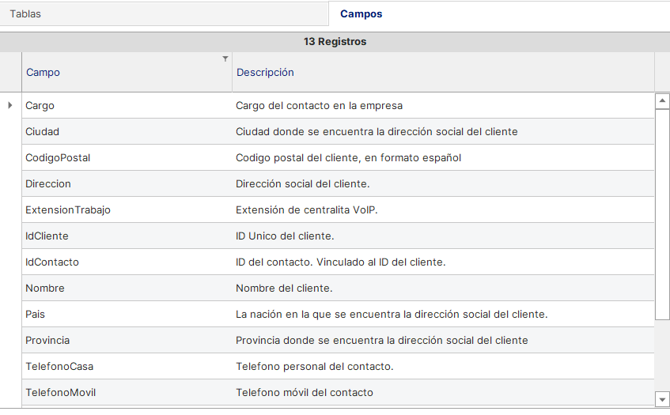

!!! tip "Apóyate en las vistas VDLG_"
    Las vistas estándar de los agentes se construyen sobre las vistas `VDLG_` del ERP, que filtran por las empresas y delegaciones a las que tiene acceso el usuario. Si construyes las tuyas igual, el agente respeta esos mismos accesos.

### Asignar las vistas al agente

1. Abre la pestaña **Modelo Datos** de la ficha.
2. Añade una fila y elige la vista en la columna **Vista**. El **Schema** se rellena con `dbo`.
3. Repite con cada vista que necesite.

## Qué acciones puede hacer: la pestaña Herramientas

Las **herramientas** son lo que el agente puede hacer, además de contestar: consultar datos, abrir una ficha, facturar un albarán, dibujar un gráfico…

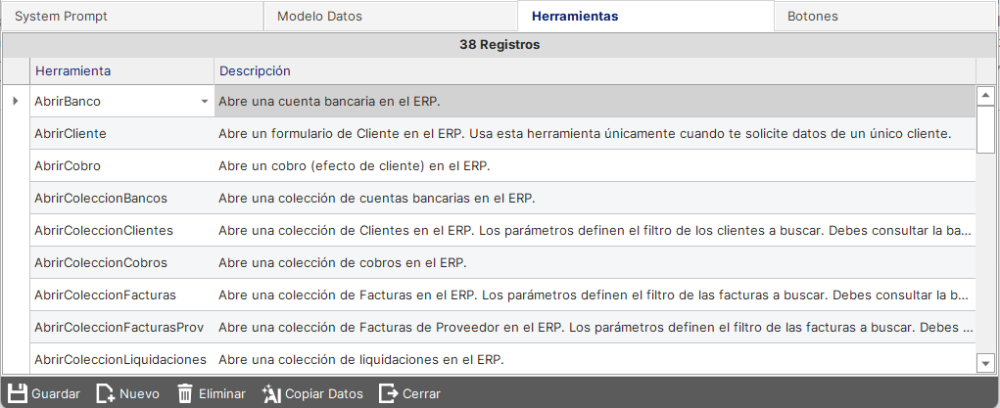

Algunas de las que trae el ERP:

| Herramienta | Qué hace |
|---|---|
| `query_database` | Consulta las vistas de la pestaña **Modelo Datos**. Imprescindible para que el agente responda con datos del ERP |
| `generate_chart` | Dibuja gráficos con los datos consultados |
| `query_vector_db` | Consulta la documentación de AHORA |
| `AbrirCliente`, `AbrirColeccionClientes` | Abre la ficha de un cliente o una lista de clientes |
| `AbrirPedido`, `AbrirColeccionPedidos` | Abre un pedido de cliente o una lista de pedidos |
| `AlbaranearPedido`, `FacturarAlbaran`, `FacturarPedido` | Albaranea o factura desde el chat |
| `AbrirProveedor`, `AbrirPedidoProv`, `FacturarAlbaranProv`… | Lo mismo en compras |
| `AbrirCobro`, `RegistrarCobro`, `RegistrarPago`… | Tesorería |
| `AnalizarDocumento` | Lee un documento o una imagen adjuntos y saca sus datos |

La lista completa está en el desplegable de la columna **Herramienta**.

Para asignarlas, añade una fila en la pestaña **Herramientas** y elige la herramienta.

!!! tip "Solo las que necesite"
    Dale solo las herramientas que vaya a usar. Con muchas, el modelo tiende a usarlas cuando no hace falta. Un agente que solo consulta necesita `query_database` y, si quieres gráficos, `generate_chart`.

!!! warning "Las herramientas nuevas necesitan programación"
    En **Mantenimientos > Herramientas** se ven todas las herramientas, pero cada una está programada en el ERP. Dar de alta una herramienta nueva sin su programación no sirve: el agente la intentaría usar y fallaría. Si necesitas una acción que no está, consúltalo con tu consultor de AHORA.

## Botones rápidos: la pestaña Botones

Los **botones** aparecen debajo del cuadro de mensaje del chat. Al pulsar uno, su texto se escribe en el cuadro: el usuario lo revisa y lo envía.

Se crean en **Mantenimientos > Botones**:

| Campo | Para qué sirve |
|---|---|
| **Botón** | Identificador interno |
| **Nombre** | El texto del botón |
| **Icono** | Opcional. El nombre de un icono de Material Icons (por ejemplo, `receipt`): el botón muestra el icono en lugar del nombre, y el nombre sale al pasar el ratón |
| **Prompt** | El texto que se escribe en el cuadro al pulsarlo. Por ejemplo: *Muéstrame los pedidos pendientes de hoy* |

Después, asígnalos al agente en la pestaña **Botones**, añadiendo una fila por botón.

## Copiar datos de otro agente

**Copiar Datos** trae a tu agente la configuración de otro, también de uno estándar. Así no empiezas de cero.

1. Guarda antes el agente que va a recibir los datos.
2. Pulsa **Copiar Datos** en la botonera de su ficha.
3. En **Copiar datos de**, elige el agente del que copiar.
4. Marca qué copiar:

    | Opción | Qué copia |
    |---|---|
    | **System Prompt** | Las instrucciones, la **Frase inicio**, el **Modelo IA** y el **Nivel contexto** |
    | **Modelo de Datos** | Sus vistas |
    | **Herramientas** | Sus herramientas |
    | **Botones** | Sus botones |

5. Las instrucciones, si las copias, siempre sustituyen a las de tu agente. Para las vistas, las herramientas y los botones, marca **Limpiar antes de copiar** si quieres sustituir los que ya tiene; si no, se añaden los que le falten y se conservan los suyos.
6. Pulsa **Aceptar** y confirma el resumen.

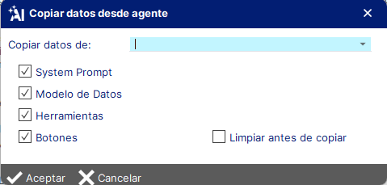

**Copiar Datos** solo está en los agentes propios.

## Eliminar un agente propio

Pulsa **Eliminar** en su ficha y confirma. Se borra el agente y su imagen. Los agentes estándar no se pueden eliminar; si no los usas, ocúltalos (ver más abajo).

## La imagen de un agente

Cada agente, estándar o propio, puede tener la imagen que quieras. Se ve en su tarjeta del panel y en su chat.

### Antes de empezar: el directorio de imágenes

Las imágenes se guardan en la carpeta del parámetro **Directorio imágenes** (<fh-copy>PATHIMAGENES</fh-copy>), en **Parámetros de la Aplicación**. Tiene que ser una ruta de red a la que lleguen todos los equipos, con permiso de escritura. Si no está puesta, el ERP te avisa al cambiar la imagen.

Dentro de esa carpeta, el ERP usa la subcarpeta `IA` (la crea si no existe) y guarda cada imagen con el **Id Agente** como nombre.

| Requisito | Detalle |
|---|---|
| Formato | `.png`, `.jpg`, `.jpeg`, `.gif` o `.bmp` |
| Forma | Cuadrada: en el panel se ve dentro de un círculo |
| Tamaño | Al menos 200 × 200 píxeles, para que se vea nítida en la ficha |
| GIF animados | Se admiten |

### Cambiarla

1. En el panel de agentes, pasa el ratón por la imagen del agente. Aparecen sus botones.

    

2. Pulsa el botón de la cámara: **Establecer imagen** en los agentes estándar, **Cambiar imagen** en los propios.

    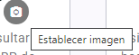

3. Elige la imagen. El ERP la copia a la carpeta `IA` y el agente la muestra al momento, sin guardar ni reiniciar.

En los agentes propios también puedes cambiarla desde su ficha, con el botón **Cambiar** que hay debajo de la imagen.

### Volver a la imagen original

- **Agentes estándar**: cuando tienen una imagen tuya, en su tarjeta aparece **Eliminar imagen personalizada** en lugar de la cámara. Púlsalo y el agente vuelve a su imagen de siempre.

    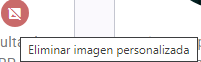

- **Agentes propios**: en su ficha, pulsa **Restablecer**. Como no tienen imagen original, se quedan sin imagen y en el panel se ve el logo de AHORA.

## Ocultar o mostrar un agente en el panel

Si tu empresa no usa un agente estándar, puedes quitarlo del panel sin borrarlo:

1. Pasa el ratón por su imagen y pulsa **Ocultar agente**.

    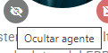

2. El agente desaparece del panel para todos los usuarios. Su configuración no cambia.

Para volver a mostrarlo:

1. Pulsa **Mostrar agentes no visibles**, el ojo de arriba a la derecha.

    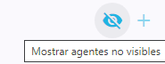

2. Los agentes ocultos aparecen atenuados.

    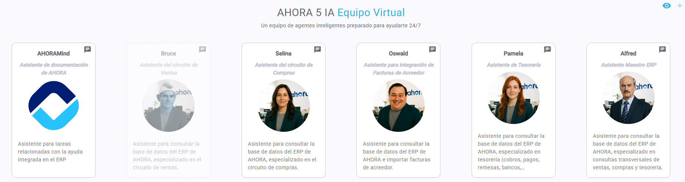

3. Pasa el ratón por su imagen y pulsa **Mostrar agente**.

En los agentes propios, lo mismo se hace con la casilla **Visible** de su ficha.

!!! warning "Ocultar no es restringir"
    Ocultar un agente lo quita del panel para todos a la vez. Para decidir qué usuarios pueden usar cada agente, usa los grupos de seguridad: [Restringir los agentes por grupo de seguridad](Seguridad.md).
