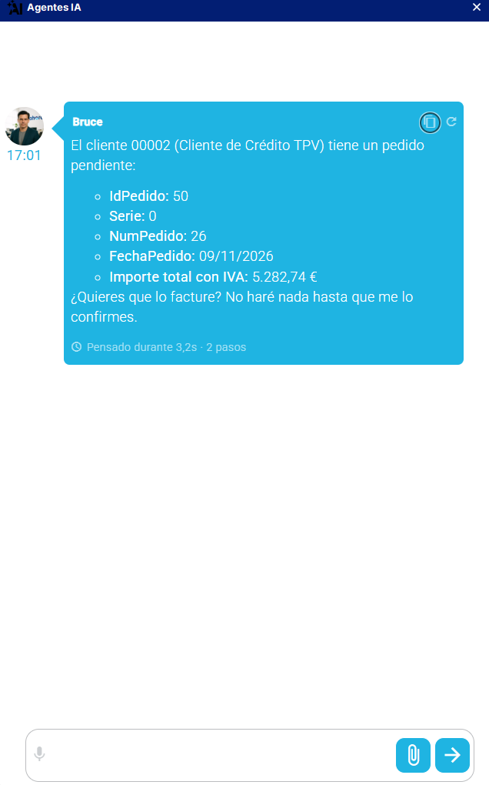
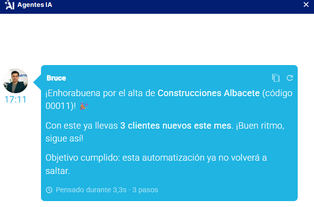
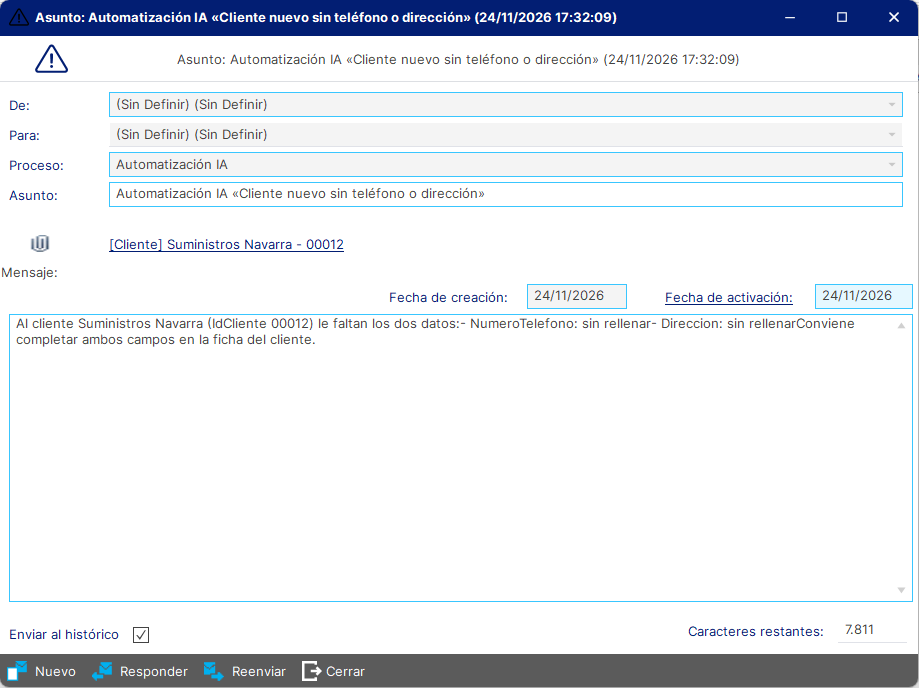
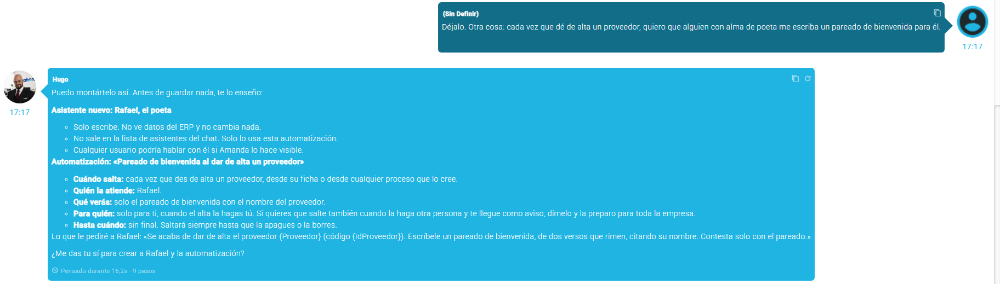
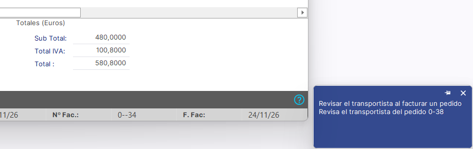

# Automation examples

Ideas ready to ask [Hugo](Hugo.md) for as they are or adapted to your company. Each example tells you what to say, what the agent will do, and how to check that it works.

The examples use the ERP demo data: the customer **Cliente de Crédito TPV**, the customer **EXTRANJERO**, the **COMERCIAL** group…

## Suggest invoicing pending orders

> Every time I post a sales invoice, have Bruce check whether that customer has pending orders and suggest invoicing them. If there are none, don't tell me anything.

| | |
|---|---|
| **When** | When an invoice is posted |
| **Who** | Bruce, Sales agent |
| **Form** | Por detrás, avisa si hay algo (In the background, notify if there's something) |

**What happens:** when you post an invoice for *Cliente de Crédito TPV*, which has pending orders, Bruce's window opens with its orders and their amount, and he suggests invoicing them. If you say yes, he asks for confirmation and invoices them with your permissions. When you post one for *EXTRANJERO*, which has no pending orders, nothing appears.

## A challenge that switches itself off

> This month I want to sign up new customers. Every time I create one, have someone congratulate me and tell me how many I've got. It should switch itself off when I reach 3.

| | |
|---|---|
| **When** | New customer |
| **Who** | Bruce, Sales agent (chosen by Hugo) |
| **Form** | Solo su respuesta (Just its answer) |
| **Options** | Memoria (Memory: keeps count) and Hasta (Until: on reaching 3) |

**What happens:** with each new customer, Bruce congratulates you and tells you how many you've got. On the third one he ends with *«Objetivo cumplido: esta automatización ya no volverá a saltar»* (Goal achieved: this automation won't fire again), and the automation is switched off.

## Notify another department

> When a customer is created, have Alfred check whether the phone number or address is missing and, if anything is missing, notify me and the COMERCIAL group in the ERP notifications.

| | |
|---|---|
| **When** | New customer, whoever creates it (for the whole company) |
| **Who** | Alfred |
| **Form** | Por detrás, avisa si hay algo |
| **Options** | Notify: me and the COMERCIAL group |

**What happens:** whoever creates the customer sees nothing. If the record is missing the phone number or address, you and the COMERCIAL employees get a notification in the ERP with what's missing and the link to the customer.

!!! tip "Hugo tells you what the agent can't see"
    If you ask it to check something the agent can't see (for example, the customer's email or payment method, which Alfred doesn't query), Hugo tells you, logs it as pending, and suggests something else it can check.

!!! info "Administrators only"
    Notifying other people can be set up by an administrator. As a user, you can ask for the notification to reach only you.

## A summary first thing in the morning

> Every working day at 9:00, have Pamela tell me the overdue collections. When there are none left, she should stop notifying me.

| | |
|---|---|
| **When** | Monday to Friday at 9:00 |
| **Who** | Pamela, Treasury agent |
| **Form** | Solo su respuesta |
| **Options** | Hasta (no overdue collections left) |

**What happens:** every working morning, when you open the ERP or at 9:00 if you already have it open, Pamela shows you the overdue collections. So you don't have to wait until tomorrow, ask Hugo *"test it now"*.

## Keep an eye on a project's spending

> Every time I post a supplier invoice from the supplier EL BANQUERO, tell me how much we've spent with them this year and let me know if we go over €10,000.

| | |
|---|---|
| **When** | When a supplier or creditor invoice is posted |
| **Who** | Selina, Purchasing agent |
| **Form** | Por detrás, avisa si hay algo |
| **Options** | Memoria (the amount spent in the year) |

**What happens:** Selina adds up each invoice from that supplier and only shows up when the amount spent in the year exceeds €10,000. With other suppliers' invoices she does nothing.

## A custom agent for a specific job

> Every time I create a supplier, I want someone with a poet's soul to write me a welcome couplet for them.

No standard agent writes poetry, so Hugo offers to **build one** just for this automation: «Rafael, el poeta» (Rafael, the poet). Since it only has to write, it starts from no agent and doesn't see any ERP data; it receives the supplier's name with the automation. It stays hidden and only this automation uses it.

!!! info "Administrators only"
    Building new agents is reserved for ERP administrators.

## A fixed reminder, without AI

> I want a fixed reminder, without AI: when I invoice an order, show me "Revisa el transportista del pedido {Serie}-{Numero}" (Check the carrier for order {Serie}-{Numero}).

| | |
|---|---|
| **When** | Invoice order |
| **Form** | Aviso (Notice, without AI) |

**What happens:** when you invoice an order from its record, a notification appears in the corner with the text, the series and the order number. It doesn't query any AI, so it doesn't use anything.

!!! tip "Data in curly braces"
    Each action brings specific data. If you ask for one it doesn't bring (for example, `{NumPedido}`), Hugo tells you and suggests the ones available: here, `{Serie}` and `{Numero}`.

## Ideas to inspire you

- *"When a customer goes over their credit risk when I invoice them, notify me and the VENTAS group."*
- *"On Mondays at 8:00, summarize the quotes that expire this week."*
- *"On the last day of each month at 18:00, tell me which supplier delivery notes are still not invoiced."*
- *"When I create an item, check that it has a family, VAT and a sale price, and tell me only if something is missing."*

!!! tip "If Hugo says it can't be done"
    If what you ask for needs an ERP moment that isn't in the catalog, or data that no agent sees, Hugo will tell you and **log it as pending**. An administrator can add new actions by recording them: see [Action catalog](CatalogoAcciones.md).
