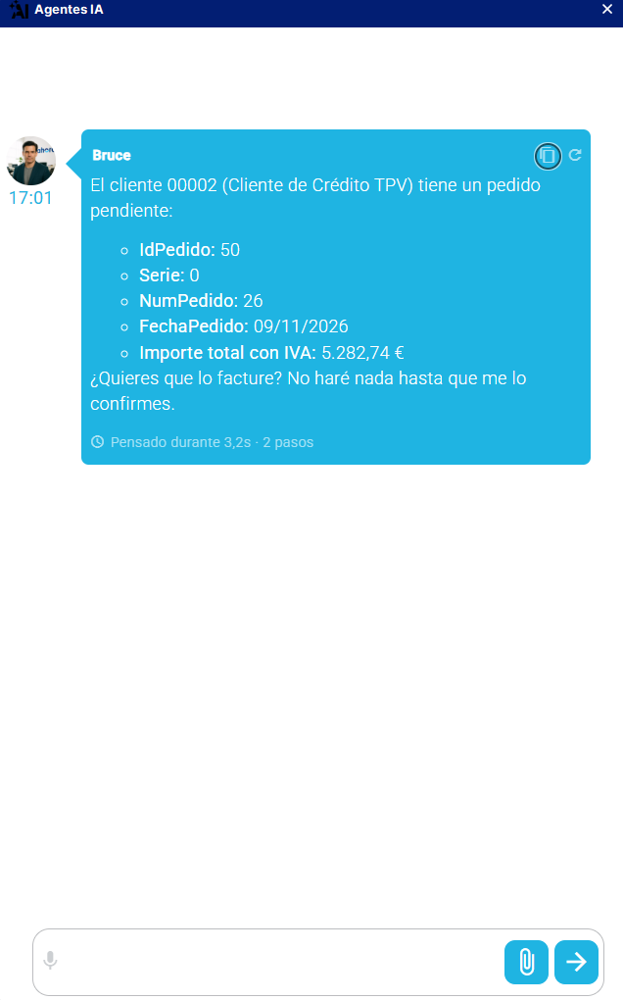
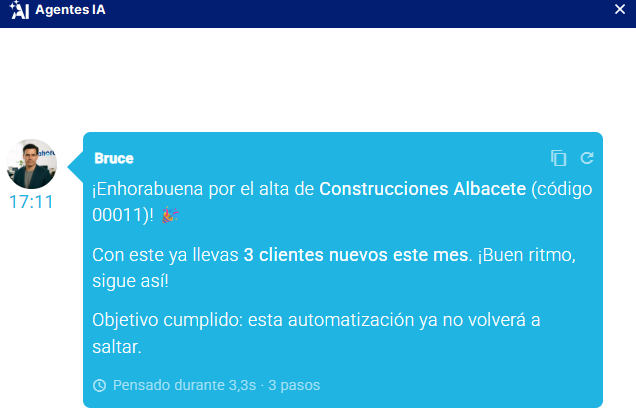
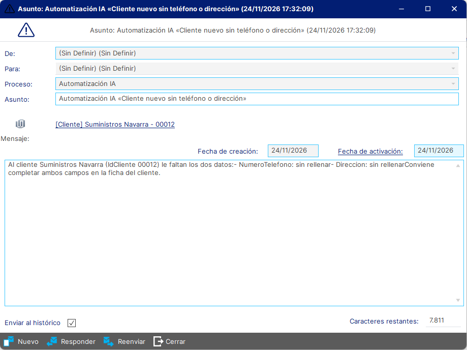
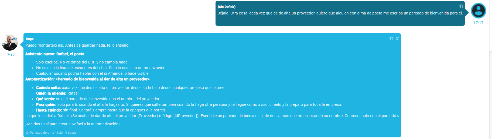
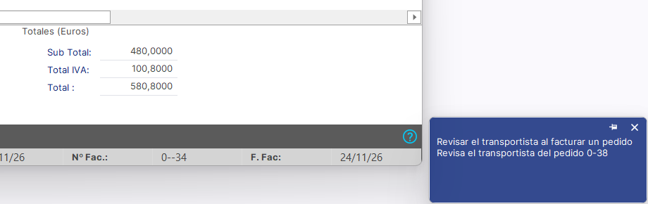

# Ejemplos de automatizaciones

Ideas listas para pedírselas a [Hugo](Hugo.md) tal cual o adaptadas a tu empresa. Cada ejemplo dice qué frase usar, qué hará el agente y cómo comprobar que funciona.

Los ejemplos usan los datos de demostración del ERP: el cliente **Cliente de Crédito TPV**, el cliente **EXTRANJERO**, el grupo **COMERCIAL**…

## Proponer facturar los pedidos pendientes

> Cada vez que actualice una factura de venta, que Bruce mire si ese cliente tiene pedidos pendientes y me proponga facturarlos. Si no tiene ninguno, que no me diga nada.

| | |
|---|---|
| **Cuándo** | Al actualizar una factura |
| **Quién** | Bruce, agente de Ventas |
| **Forma** | Por detrás, avisa si hay algo |

**Qué pasa:** al actualizar una factura de *Cliente de Crédito TPV*, que tiene pedidos pendientes, se abre la ventana de Bruce con sus pedidos y su importe, y te propone facturarlos. Si le dices que sí, te pide confirmación y los factura con tus permisos. Al actualizar una de *EXTRANJERO*, que no tiene pendientes, no aparece nada.

## Un reto que se apaga solo

> Este mes quiero dar de alta clientes nuevos. Cada vez que dé uno de alta, que alguien me felicite y me diga cuántos llevo. Que se apague sola cuando lleve 3.

| | |
|---|---|
| **Cuándo** | Alta de cliente |
| **Quién** | Bruce, agente de Ventas (lo elige Hugo) |
| **Forma** | Solo su respuesta |
| **Opciones** | Memoria (lleva la cuenta) y Hasta (al llegar a 3) |

**Qué pasa:** con cada cliente nuevo, Bruce te felicita y te dice cuántos llevas. En el tercero termina con *«Objetivo cumplido: esta automatización ya no volverá a saltar»*, y la automatización queda apagada.

## Avisar a otro departamento

> Cuando se dé de alta un cliente, que Alfred revise si le falta el teléfono o la dirección y, si falta algo, que nos avise a mí y al grupo COMERCIAL en los avisos del ERP.

| | |
|---|---|
| **Cuándo** | Alta de cliente, la haga quien la haga (para toda la empresa) |
| **Quién** | Alfred |
| **Forma** | Por detrás, avisa si hay algo |
| **Opciones** | Avisar a: yo y grupo COMERCIAL |

**Qué pasa:** quien da de alta el cliente no ve nada. Si a la ficha le falta el teléfono o la dirección, tú y los empleados de COMERCIAL recibís un aviso en el ERP con lo que falta y el enlace al cliente.

!!! tip "Hugo te dice lo que el agente no puede ver"
    Si le pides que revise algo que el agente no ve (por ejemplo, el email o la forma de pago del cliente, que Alfred no consulta), Hugo te lo dice, lo apunta como pendiente y te propone otra cosa que sí pueda comprobar.

!!! info "Solo administradores"
    Avisar a otras personas lo puede montar un administrador. Como usuario, puedes pedir que el aviso te llegue solo a ti.

## Un resumen a primera hora

> Cada día laborable a las 9:00, que Pamela me diga los cobros vencidos. Cuando no quede ninguno, que deje de avisarme.

| | |
|---|---|
| **Cuándo** | De lunes a viernes a las 9:00 |
| **Quién** | Pamela, agente de Tesorería |
| **Forma** | Solo su respuesta |
| **Opciones** | Hasta (que no quede ningún cobro vencido) |

**Qué pasa:** cada mañana laborable, al abrir el ERP o a las 9:00 si ya lo tienes abierto, Pamela te enseña los cobros vencidos. Para no esperar a mañana, pídele a Hugo *«pruébala ahora»*.

## Vigilar el gasto de un proyecto

> Cada vez que actualice una factura de proveedor del proveedor EL BANQUERO, dime cuánto llevamos gastado con él este año y avísame si pasamos de 10.000 €.

| | |
|---|---|
| **Cuándo** | Al actualizar una factura de proveedor o de acreedor |
| **Quién** | Selina, agente de Compras |
| **Forma** | Por detrás, avisa si hay algo |
| **Opciones** | Memoria (lo gastado en el año) |

**Qué pasa:** Selina suma cada factura de ese proveedor y solo aparece cuando lo gastado en el año supera los 10.000 €. Con las facturas de otros proveedores no hace nada.

## Un agente a medida para un trabajo concreto

> Cada vez que dé de alta un proveedor, quiero que alguien con alma de poeta me escriba un pareado de bienvenida para él.

Ningún agente estándar escribe poesía, así que Hugo te propone **preparar uno** solo para esta automatización: «Rafael, el poeta». Como solo tiene que escribir, parte de ningún agente y no ve ningún dato del ERP; recibe el nombre del proveedor con la automatización. Queda oculto y solo lo usa esta automatización.

!!! info "Solo administradores"
    Preparar agentes nuevos está reservado a los administradores del ERP.

## Un recordatorio fijo, sin IA

> Quiero un recordatorio fijo, sin IA: cuando facture un pedido, que me salga «Revisa el transportista del pedido {Serie}-{Numero}».

| | |
|---|---|
| **Cuándo** | Facturar pedido |
| **Forma** | Aviso (sin IA) |

**Qué pasa:** al facturar un pedido desde su ficha sale una notificación en la esquina con el texto, la serie y el número del pedido. No consulta a ninguna IA, así que no consume nada.

!!! tip "Los datos entre llaves"
    Cada acción trae unos datos concretos. Si pides uno que no trae (por ejemplo, `{NumPedido}`), Hugo te lo dice y te propone los que hay: aquí, `{Serie}` y `{Numero}`.

## Ideas para inspirarte

- *«Cuando un cliente supere su riesgo al facturarle, avísame a mí y al grupo VENTAS.»*
- *«Los lunes a las 8:00, resúmeme las ofertas que caducan esta semana.»*
- *«El último día de cada mes a las 18:00, dime qué albaranes de proveedor siguen sin facturar.»*
- *«Cuando dé de alta un artículo, comprueba que tiene familia, IVA y precio de venta, y solo si falta algo, dímelo.»*

!!! tip "Si Hugo dice que no se puede"
    Si lo que pides necesita un momento del ERP que no está en el catálogo, o un dato que ningún agente ve, Hugo te lo dirá y lo **apuntará como pendiente**. Un administrador puede añadir acciones nuevas grabándolas: mira [Catálogo de acciones](CatalogoAcciones.md).
