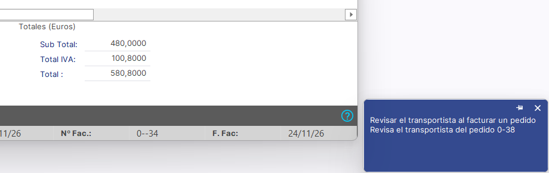
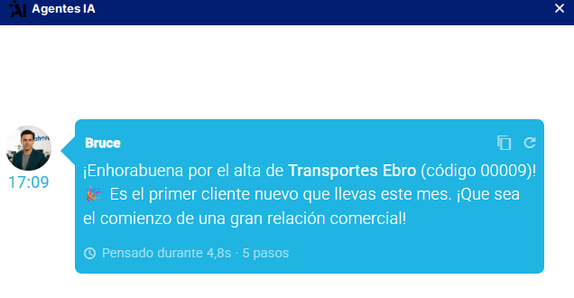
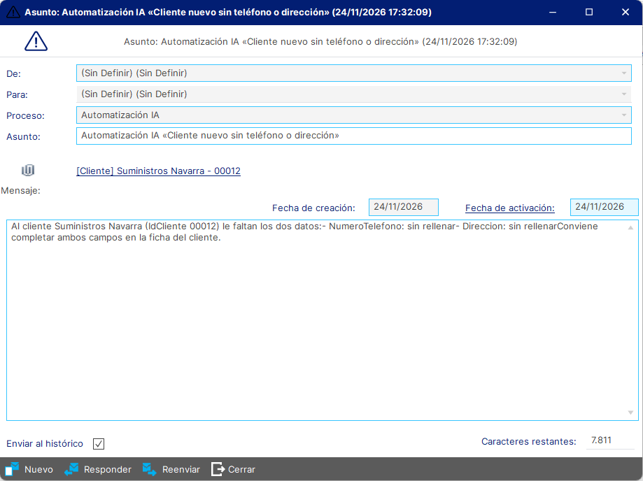
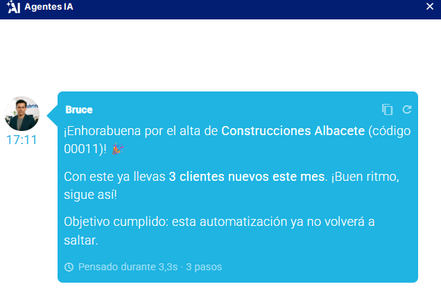

# Automation forms and options

Every automation has a **moment** when it fires, a **form** in which you find out and, if you need it, some extra **option**: who it's for, whom it notifies, what time it fires, when it switches itself off, or whether it keeps count of something.

You don't need to remember the names: you tell [Hugo](Hugo.md) in your own words and he chooses the form and options. This page helps you know everything you can ask him for.

## When it fires

### When something happens in the ERP

The automation fires when you **successfully** finish an ERP action: posting an invoice, invoicing an order, creating a customer… If the action fails, it doesn't fire.

The agent receives the document data: customer, number, date, amount… That way it doesn't have to look it up.

Some of the most used actions in the catalog:

| Action | Fires… |
|---|---|
| Actualizar factura (Post invoice) | When a sales or debtor invoice is posted |
| Actualizar factura de proveedor o de acreedor (Post supplier or creditor invoice) | When a supplier or creditor invoice is posted |
| Facturar pedido / Facturar albarán (Invoice order / Invoice delivery note) | When the invoice for an order or a delivery note is generated |
| Generar albarán del pedido (Generate delivery note from order) | When a delivery note is created from an order |
| Alta de cliente, proveedor, artículo, pedido, oferta… (New customer, supplier, item, order, quote…) | When the record is created |

!!! info "Creations fire wherever they come from"
    A creation fires whether you create the record from its form or any other ERP process creates it (an import, a copy, a wizard…). In a process that creates many records at once, it fires **once**, with the first one and the total number of records.

In [Action catalog](CatalogoAcciones.md) you'll find how to search for actions and how to add the ones that are missing.

### At a set time

When what you want doesn't depend on something happening in the ERP: *"every morning"*, *"on Mondays"*, *"on the 1st of every month"*.

| Schedule | Example |
|---|---|
| Every day | Every day at 8:00 |
| Working days | Monday to Friday at 9:00 |
| Some days of the week | Monday and Thursday at 17:30 |
| One day of the month | The 1st at 7:00 (if the month doesn't have that day, the last day) |
| The last day of the month | The last day at 18:00 |

- It fires in **your open ERP**, once for each scheduled time. If your ERP was closed at that time, it fires **when you open it**.
- The first time is the **next** scheduled time after creating it: it never fires for a time that has already passed.
- The agent receives the date, the time and the day of the week.

## Forms: how you find out

| Form | What you see | When to use it |
|---|---|---|
| **Por detrás, avisa si hay algo** (In the background, notify if there's something) | Nothing, unless the condition is met; then, the agent's answer | Things that happen often and only sometimes matter: *"notify me only if the customer has overdue collections"* |
| **Solo su respuesta** (Just its answer) | The agent's answer in a window | When you always want the result: *"tell me how much I've sold this month"* |
| **Toda la conversación** (The whole conversation) | The agent's chat with everything it has done | When you want to keep talking with it about that document |
| **Aviso** (Notice) | A notification in the corner with a fixed message, **without AI** | A reminder that always says the same thing: *"Check the carrier's insurance"* |

The agents' windows open **without blocking the ERP**. If several automations fire at once, each one opens its own, staggered. They appear on screen even if your ERP is minimized.

!!! tip "«Por detrás» saves interruptions"
    In «Por detrás, avisa si hay algo», the agent checks the condition with its tools before deciding. If it isn't met, you don't even know it looked. It's the recommended form for everything that happens often.

## Options

### For me or for everyone

- **For me** (default): it fires only on what you do in your ERP.
- **For everyone**: it fires in the ERP of **every user in the company**, each with their own data. Only an administrator can create it.

### Notifying other people

Instead of showing it to you, the result goes to the **ERP notifications** of the people you specify:

- **"me"**: yourself, in your notifications;
- **employees**, by their user;
- **security groups**: all their employees, without duplicates and without those who are on leave.

> When a customer is created without a phone number or address, have Alfred notify me and the COMERCIAL group.

The notification carries the process **«Automatización IA»** (AI automation), the automation's name and, if it fires for a document, the **link to that document**. Whoever performs the action sees nothing.

!!! info "Administrators only"
    Notifying other people is reserved for administrators. Any user can use **"me"** so that the result reaches their own notifications instead of a window.

!!! warning "With an agent, not with «Toda la conversación»"
    Notifying other people works with the forms **Aviso**, **Solo su respuesta** and **Por detrás, avisa si hay algo**. Not with «Toda la conversación», because that conversation is for whoever performs the action.

### Hasta (Until): switching itself off

An automation keeps firing until you deactivate or delete it. With **Hasta**, it switches itself off when a goal is met:

> Every time I create a customer, congratulate me and tell me how many I've got; switch it off when I reach 3.

1. Each time it fires, the agent does what it's asked and **checks whether the end condition is already met**.
2. On the day it's met, it still answers you and ends with the line **«Objetivo cumplido: esta automatización ya no volverá a saltar.»** (Goal achieved: this automation won't fire again.)
3. The automation is **switched off**, with the date on which the goal was met.

If you later ask Hugo to reactivate it as it is, he'll warn you that it would switch off again as soon as it fires, and will suggest removing the end condition or setting another goal.

!!! info "Write it as something that can be checked"
    *"Until I reach €10,000 in sales this month"* can be checked with data. *"Until I get tired of it"* can't. Hugo will help you make it specific. It only works with an agent, not with the Aviso form.

### Memoria (Memory): keeping count

Agents have a **memory** that lasts from one time to the next. With it, an automation can keep count: *"how many invoices so far this month"*, *"whether I already notified you today"*, *"the last thing I saw"*.

> Every time I post a supplier invoice, tell me how much we've spent this quarter.

Hugo tells the agent what to record and when to start from zero (every month, every quarter…). You don't have to do anything else.

## Next steps

- [Automation examples](Ejemplos.md): all of this combined in real cases.
- [My AI automations](MisAutomatizaciones.md): where to see and change them.
