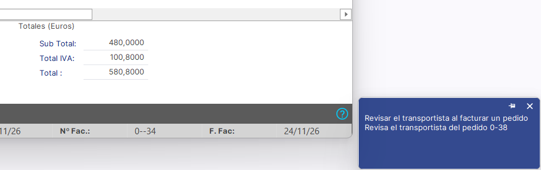
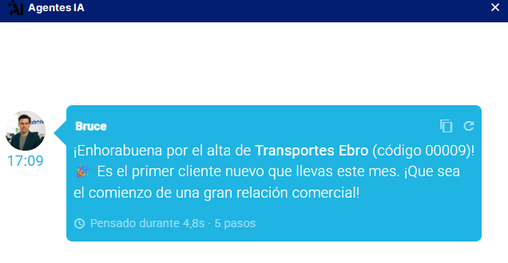
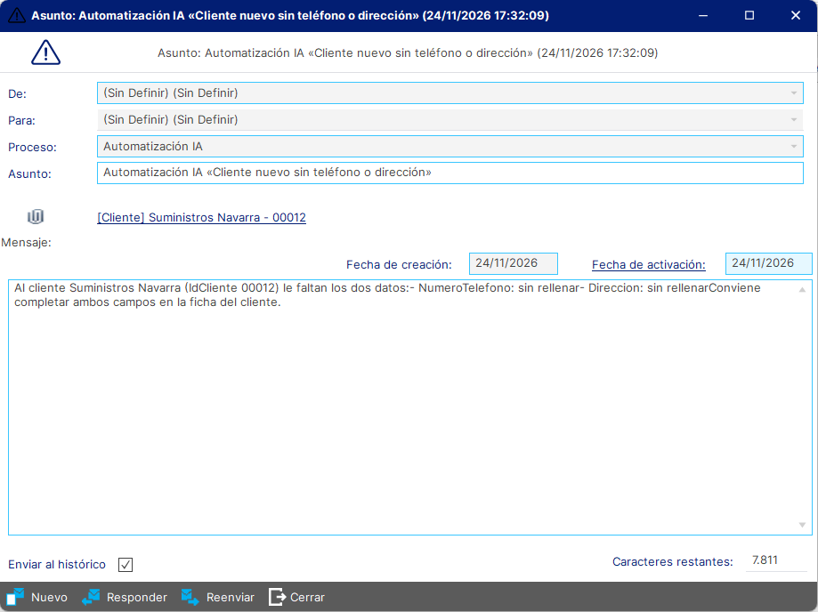
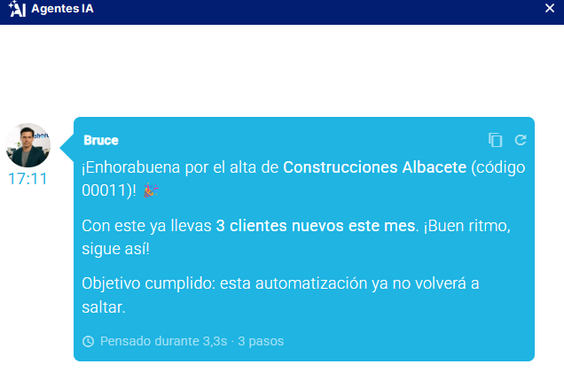

# Formas y opciones de una automatización

Toda automatización tiene un **momento** en que salta, una **forma** de enterarte y, si la necesitas, alguna **opción** más: para quién es, a quién avisa, a qué hora salta, cuándo se apaga sola o si lleva la cuenta de algo.

No hace falta que recuerdes los nombres: se lo dices a [Hugo](Hugo.md) con tus palabras y él elige la forma y las opciones. Esta página te sirve para saber todo lo que le puedes pedir.

## Cuándo salta

### Cuando pasa algo en el ERP

La automatización salta cuando terminas **bien** una acción del ERP: actualizar una factura, facturar un pedido, dar de alta un cliente… Si la acción falla, no salta.

El agente recibe los datos del documento: cliente, número, fecha, importe… Así no tiene que buscarlos.

Algunas acciones del catálogo que más se usan:

| Acción | Salta… |
|---|---|
| Actualizar factura | Al actualizar una factura de venta o de deudor |
| Actualizar factura de proveedor o de acreedor | Al actualizar una factura de proveedor o de acreedor |
| Facturar pedido / Facturar albarán | Al generar la factura de un pedido o de un albarán |
| Generar albarán del pedido | Al albaranear un pedido |
| Alta de cliente, proveedor, artículo, pedido, oferta… | Al crearse el registro |

!!! info "Las altas saltan vengan de donde vengan"
    Un alta salta tanto si creas el registro desde su ficha como si lo crea cualquier otro proceso del ERP (una importación, una copia, un asistente…). En un proceso que crea muchos registros de golpe, salta **una vez**, con el primero y el número total de registros.

En [Catálogo de acciones](CatalogoAcciones.md) tienes cómo se buscan y cómo se añaden las que falten.

### A una hora

Cuando lo que quieres no depende de algo que pase en el ERP: *«todas las mañanas»*, *«los lunes»*, *«el día 1 de cada mes»*.

| Programación | Ejemplo |
|---|---|
| Todos los días | Cada día a las 8:00 |
| Días laborables | De lunes a viernes a las 9:00 |
| Unos días de la semana | Lunes y jueves a las 17:30 |
| Un día del mes | El día 1 a las 7:00 (si el mes no tiene ese día, el último) |
| El último día del mes | El último día a las 18:00 |

- Salta en **tu ERP abierto**, una vez por cada hora prevista. Si a esa hora tenías el ERP cerrado, salta **al abrirlo**.
- La primera vez es la **siguiente** hora prevista después de crearla: nunca salta por una hora que ya ha pasado.
- El agente recibe la fecha, la hora y el día de la semana.

## Formas: cómo te enteras

| Forma | Qué ves | Cuándo usarla |
|---|---|---|
| **Por detrás, avisa si hay algo** | Nada, salvo que se cumpla la condición; entonces, la respuesta del agente | Lo que pasa muchas veces y solo a veces importa: *«avísame solo si el cliente tiene cobros vencidos»* |
| **Solo su respuesta** | La respuesta del agente en una ventana | Cuando siempre quieres el resultado: *«dime cuánto llevo vendido este mes»* |
| **Toda la conversación** | El chat del agente con todo lo que ha hecho | Cuando quieres seguir hablando con él sobre ese documento |
| **Aviso** | Una notificación en la esquina con un mensaje fijo, **sin IA** | Un recordatorio que siempre dice lo mismo: *«Revisa el seguro del transportista»* |

Las ventanas de los agentes se abren **sin bloquear el ERP**. Si saltan varias automatizaciones a la vez, cada una abre la suya, escalonadas. Aparecen en pantalla aunque tengas el ERP minimizado.

!!! tip "«Por detrás» ahorra interrupciones"
    En «Por detrás, avisa si hay algo», el agente comprueba la condición con sus herramientas antes de decidir. Si no se cumple, no te enteras de que ha mirado. Es la forma recomendada para todo lo que pasa a menudo.

## Opciones

### Para mí o para todos

- **Para mí** (por defecto): salta solo con lo que haces tú en tu ERP.
- **Para todos**: salta en el ERP de **cada usuario de la empresa**, cada uno con sus datos. Solo la puede crear un administrador.

### Avisar a otras personas

En vez de enseñártelo a ti, el resultado va a los **avisos del ERP** de las personas que digas:

- **«yo»**: tú mismo, en tus avisos;
- **empleados**, por su usuario;
- **grupos de seguridad**: todos sus empleados, sin repetir y sin los que estén de baja.

> Cuando se dé de alta un cliente sin teléfono o sin dirección, que Alfred nos avise a mí y al grupo COMERCIAL.

El aviso lleva el proceso **«Automatización IA»**, el nombre de la automatización y, si salta por un documento, el **enlace a ese documento**. Quien hace la acción no ve nada.

!!! info "Solo administradores"
    Avisar a otras personas está reservado a los administradores. Cualquier usuario puede usar **«yo»** para que el resultado le llegue a sus propios avisos en vez de a una ventana.

!!! warning "Con agente, no con «Toda la conversación»"
    Avisar a otras personas funciona con las formas **Aviso**, **Solo su respuesta** y **Por detrás, avisa si hay algo**. Con «Toda la conversación» no, porque esa conversación es para quien hace la acción.

### Hasta: que se apague sola

Una automatización salta siempre hasta que la desactives o la borres. Con **Hasta**, se apaga sola cuando se cumple un objetivo:

> Cada vez que dé de alta un cliente, felicítame y dime cuántos llevo; que se apague al llegar a 3.

1. Cada vez que salta, el agente hace lo que le piden y **comprueba si ya se cumple** la condición de fin.
2. El día que se cumple, te contesta igualmente y termina con la línea **«Objetivo cumplido: esta automatización ya no volverá a saltar.»**
3. La automatización queda **apagada**, con la fecha en que se cumplió.

Si después le pides a Hugo que la reactive tal cual, te avisará de que se volvería a apagar en cuanto salte, y te propondrá quitarle la condición de fin o ponerle otra meta.

!!! info "Escríbelo como algo que se pueda comprobar"
    *«Hasta que consiga 10.000 € de ventas este mes»* se puede comprobar con datos. *«Hasta que me canse»* no. Hugo te ayudará a concretarlo. Solo vale con agente, no con la forma Aviso.

### Memoria: llevar la cuenta

Los agentes tienen una **memoria** que dura de una vez para otra. Con ella, una automatización puede llevar cuentas: *«cuántas facturas van este mes»*, *«si ya te avisé hoy»*, *«lo último que vi»*.

> Cada vez que actualice una factura de proveedor, dime cuánto llevamos gastado este trimestre.

Hugo le dice al agente qué apuntar y cuándo empezar de cero (cada mes, cada trimestre…). No tienes que hacer nada más.

## Siguientes pasos

- [Ejemplos de automatizaciones](Ejemplos.md): todo esto combinado en casos reales.
- [Mis automatizaciones IA](MisAutomatizaciones.md): dónde se ven y se cambian.
