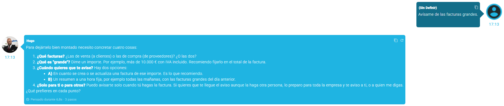
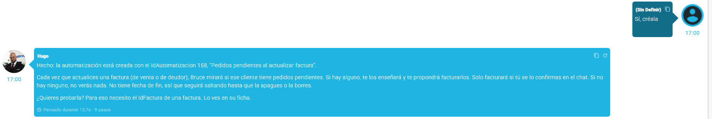
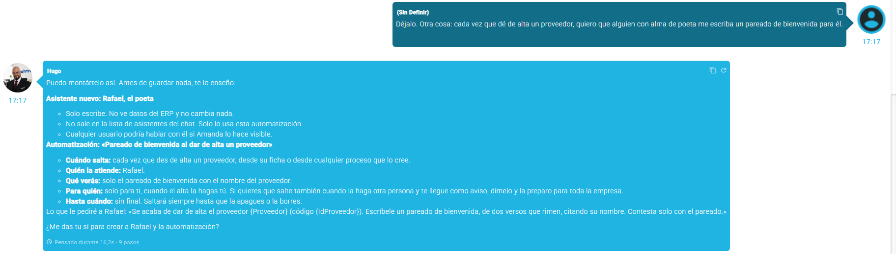
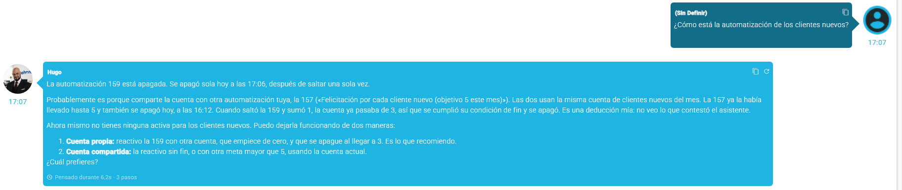
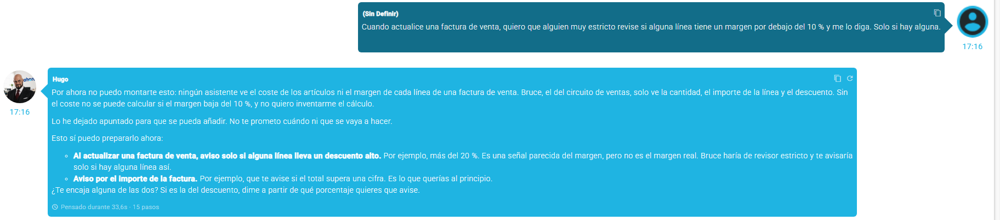

# Hugo - Automations agent

{ width="96" align=right }

Hugo is the agent who **sets up your automations**. You tell him in your own words what you want to happen and when, and he takes care of the rest: he finds the ERP moment that fits, picks the agent that will handle it, writes its instructions, shows you how it would look and, when you say yes, leaves it running.

> Hi! I'm Hugo. Tell me what you want an assistant to check or do on its own when something happens in the ERP, and I'll set it up for you.

You'll find him in the chat's list of agents. For his automations to fire, an administrator has to turn on the `IA_GANCHOS_ACTIVO` parameter (see [AI automations](Automatizaciones.md#activarlas)). Hugo can't turn it on: if it's off, he tells you in his first answer and offers to leave the automation ready for when it is.

## What he can do for you

| You ask him… | Hugo… |
|---|---|
| A new automation | Proposes it to you in full and creates it when you say yes |
| To test it | Runs it against a real document, as if the action had just happened |
| To tell you how one is doing | Explains when it fires, who handles it, whether it's active or whether it switched itself off |
| To change, activate or deactivate it | Shows you the change and applies it when you say yes |
| To delete one or several | Shows you the list of what he would delete and deletes it when you confirm |
| To see your automations | Summarizes them for you or opens **Mis automatizaciones IA** (My AI automations) |
| Something no agent knows how to do | Builds a new agent just for that automation (administrators) |
| Something the ERP doesn't allow hooking into | Tells you clearly and logs it as pending |

## How he works

Hugo **never saves anything without showing it to you first**. He always follows the same steps:

1. **He understands what you're asking for.** If something important is missing (for example, what counts as "goal achieved"), he asks you. He usually gives you options and his recommendation; if you tell him *"whatever you recommend"*, he goes with that.
2. **He looks for the ERP action** that triggers the automation in the action catalog: *post invoice*, *new customer*, *invoice order*… or a time, if it doesn't depend on something happening in the ERP.
3. **He picks the agent** that will handle it, after checking that it sees the data and has the tools needed.
4. **He shows you the summary**: when it fires, who handles it, exactly what it will ask, when it will notify you, and who it's for.
5. **He creates it when you say yes** and gives you its number (IdAutomatizacion).

!!! tip "The more specific, the better"
    *"Notify me of large invoices"* forces Hugo to ask. *"When I post a sales invoice over €3,000, have Bruce tell me whether the customer has overdue collections"* is set up on the first try.

## Choosing who handles it

Hugo chooses among the agents **you can use**: Bruce (Sales), Selina (Purchasing), Pamela (Treasury), Alfred (Master data), Bárbara (Accounting), Oswald (Creditor invoices), and any your company has built. You can ask him for a specific one (*"have Pamela look at it"*) or let him choose.

If the work doesn't fit any agent, Hugo can **build a custom one** just for that automation. That agent:

- **starts from a standard agent** and never sees more data or has more tools than the agent it starts from; if it only has to write, it starts from none and doesn't see any ERP data;
- stays **hidden**: it doesn't appear in the chat's list of agents, only the automation uses it;
- is deleted along with the automation if no one else uses it.

!!! info "Administrators only"
    Building new agents and creating automations for the whole company is reserved for ERP administrators. If you aren't one, Hugo will tell you and suggest alternatives with the agents that already exist.

To build agents that you can also use in the chat, talk to [Amanda](Amanda.md).

## Test before you trust it

Once the automation is created, ask him to test it:

> Try it with invoice 52.

Hugo runs it against that document as if the action had just happened, and you see exactly what the agent would do. The ones that fire at a set time are tested without a document: *"test it now"*.

## Asking him about your automations

Hugo knows all your automations and those of the whole company that affect you:

- *"What automations do I have?"*
- *"How is the island one doing?"* → he tells you whether it's active, off, or whether it **switched itself off** when it met its goal, and when.
- *"Turn it back on"* → if it switched itself off and its end condition is still met, he warns you that it would switch off again and suggests removing the condition or setting another goal.
- *"Delete all the test ones except the island one"* → he shows you the list of what he would delete and what stays before deleting anything.

## What Hugo doesn't do

- **He doesn't act on your documents.** Hugo sets up automations; the work is done by the agents that handle them.
- **He doesn't invent ERP moments.** He only uses actions that exist in the catalog. If you ask for something that can't be hooked into, he tells you and logs it as pending so it can be taken into account.
- **He doesn't send emails or messages outside the ERP.** Notifications to other people reach their **ERP notifications**.

## Next steps

- [Automation forms and options](FormasYOpciones.md): everything you can ask Hugo for.
- [Automation examples](Ejemplos.md): ideas ready to copy.
