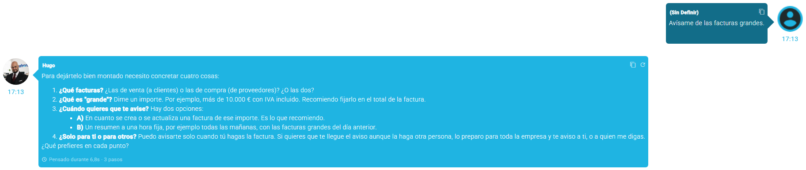
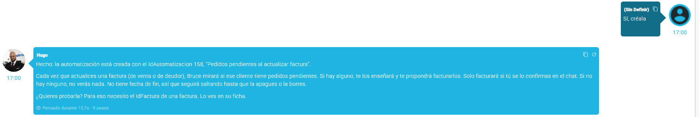
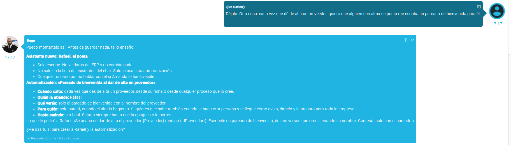
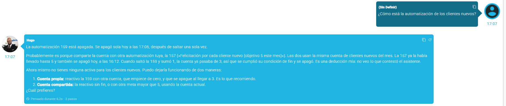
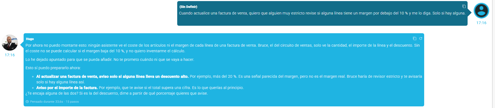

# Hugo - Agente de Automatizaciones

{ width="96" align=right }

Hugo es el agente que **monta tus automatizaciones**. Le cuentas con tus palabras qué quieres que pase y cuándo, y él se encarga del resto: busca el momento del ERP que encaja, elige el agente que lo atenderá, redacta sus instrucciones, te enseña cómo quedaría y, cuando le das el sí, la deja funcionando.

> ¡Hola! Soy Hugo. Dime qué quieres que un asistente revise o haga solo cuando pase algo en el ERP y te lo dejo montado.

Lo encuentras en la lista de agentes del chat. Para que sus automatizaciones salten, un administrador tiene que activar el parámetro `IA_GANCHOS_ACTIVO` (mira [Automatizaciones de IA](Automatizaciones.md#activarlas)). Hugo no puede activarlo: si está apagado, te lo dice en su primera respuesta y te ofrece dejar la automatización preparada para entonces.

## Qué puede hacer por ti

| Le pides… | Hugo… |
|---|---|
| Una automatización nueva | Te la propone completa y la crea cuando le dices que sí |
| Que la pruebe | La lanza contra un documento real, como si acabara de pasar la acción |
| Que te diga cómo está una | Te explica cuándo salta, quién la atiende, si está activa o si se apagó sola |
| Cambiarla, activarla o desactivarla | Te enseña el cambio y lo aplica cuando le das el sí |
| Borrar una o varias | Te enseña la lista de lo que borraría y lo borra cuando confirmas |
| Ver tus automatizaciones | Te las resume o te abre **Mis automatizaciones IA** |
| Algo que ningún agente sabe hacer | Prepara un agente nuevo solo para esa automatización (administradores) |
| Algo que el ERP no permite enganchar | Te lo dice claramente y lo apunta como pendiente |

## Cómo trabaja

Hugo **nunca guarda nada sin enseñártelo antes**. Siempre sigue los mismos pasos:

1. **Entiende lo que pides.** Si falta algo importante (por ejemplo, qué cuenta como «objetivo conseguido»), te pregunta. Suele darte opciones y su recomendación; si le dices *«lo que recomiendes»*, sigue con eso.
2. **Busca la acción del ERP** que dispara la automatización en el catálogo de acciones: *actualizar factura*, *alta de cliente*, *facturar pedido*… o una hora, si no depende de algo que pase en el ERP.
3. **Elige el agente** que la atenderá, después de comprobar que ve los datos y tiene las herramientas que hacen falta.
4. **Te enseña el resumen**: cuándo salta, quién la atiende, qué le pedirá exactamente, cuándo te avisará y para quién es.
5. **La crea cuando le dices que sí** y te da su número (IdAutomatizacion).

!!! tip "Cuanto más concreto, mejor"
    *«Avísame de las facturas grandes»* obliga a Hugo a preguntar. *«Cuando actualice una factura de venta de más de 3.000 €, que Bruce me diga si el cliente tiene cobros vencidos»* se monta a la primera.

## Elegir quién la atiende

Hugo elige entre los agentes que **tú puedes usar**: Bruce (Ventas), Selina (Compras), Pamela (Tesorería), Alfred (Maestros), Bárbara (Contabilidad), Oswald (Facturas de acreedor) y los que haya preparado tu empresa. Puedes pedirle uno concreto (*«que lo mire Pamela»*) o dejar que elija él.

Si el trabajo no encaja con ningún agente, Hugo puede **preparar uno a medida** solo para esa automatización. Ese agente:

- **parte de un agente estándar** y nunca ve más datos ni tiene más herramientas que el agente del que parte; si solo tiene que escribir, parte de ninguno y no ve ningún dato del ERP;
- queda **oculto**: no sale en la lista de agentes del chat, solo lo usa la automatización;
- se borra junto con la automatización si nadie más lo usa.

!!! info "Solo administradores"
    Preparar agentes nuevos y crear automatizaciones para toda la empresa está reservado a los administradores del ERP. Si no lo eres, Hugo te lo dirá y te propondrá alternativas con los agentes que ya existen.

Para preparar agentes que también puedas usar en el chat, habla con [Amanda](Amanda.md).

## Probar antes de fiarse

Con la automatización ya creada, pídele que la pruebe:

> Pruébala con la factura 52.

Hugo la lanza contra ese documento como si acabara de pasar la acción, y ves exactamente lo que haría el agente. Las que saltan a una hora se prueban sin documento: *«pruébala ahora»*.

## Preguntarle por tus automatizaciones

Hugo conoce todas tus automatizaciones y las de toda la empresa que te afectan:

- *«¿Qué automatizaciones tengo?»*
- *«¿Cómo está la de la isla?»* → te dice si está activa, apagada o si **se apagó sola** al cumplir su objetivo, y cuándo.
- *«Vuelve a activarla»* → si se apagó sola y su condición de fin se sigue cumpliendo, te avisa de que se volvería a apagar y te propone quitarle la condición o ponerle otra meta.
- *«Borra todas las de prueba menos la de la isla»* → te enseña la lista de lo que borraría y lo que se queda antes de borrar nada.

## Lo que Hugo no hace

- **No actúa sobre tus documentos.** Hugo monta automatizaciones; el trabajo lo hacen los agentes que las atienden.
- **No inventa momentos del ERP.** Solo usa acciones que existen en el catálogo. Si pides algo que no se puede enganchar, te lo dice y lo apunta como pendiente para que se tenga en cuenta.
- **No envía emails ni mensajes fuera del ERP.** Los avisos a otras personas llegan a sus **avisos del ERP**.

## Siguientes pasos

- [Formas y opciones de una automatización](FormasYOpciones.md): todo lo que se le puede pedir a Hugo.
- [Ejemplos de automatizaciones](Ejemplos.md): ideas listas para copiar.
