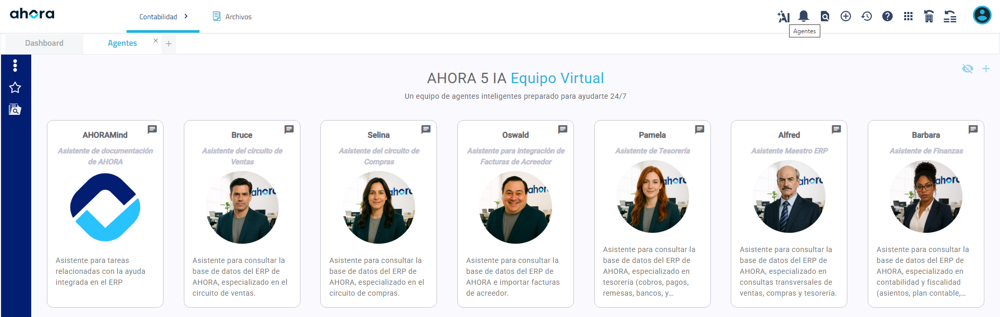

# ERP AI agents

The **AI agents** are assistants you talk to in natural language, as you would to a colleague. They query the ERP's real data with your permissions, summarise it or draw you a chart, open documents and, when they have the tools for it, create or process documents. Before sensitive operations they ask you to confirm.

## The agents

| Agent | What it helps you with |
|---|---|
| [**Bruce**](Bruce.md) | Sales: customer orders, delivery notes and invoices |
| [**Selina**](Selina.md) | Purchasing: supplier orders, delivery notes and invoices |
| [**Bárbara**](Barbara.md) | Accounting and tax |
| [**Alfred**](Alfred.md) | The big picture: sales, purchasing and treasury, query only |
| [**Pamela**](Pamela.md) | Treasury: collections, payments and remittances |
| [**Oswald**](Oswald.md) | Creditor invoices from the supplier's document |
| [**AHORAMind**](AhoraMind.md) | Questions about how the ERP works |

You can also [create your own agents](CrearAgente.md).

## The screen assistants

Some ERP screens have their own AI assistant, which works on what you have in front of you:

| Assistant | Where it works |
|---|---|
| [**Gridito**](AsistentesPantalla.md#gridito-the-grids-ai) | The grids: **Analizar con IA** (Analyse with AI) and the AI filter |
| [**ReportDesigner**](AsistentesPantalla.md#reportdesigner-the-report-designers-chat) | The report designer |
| [**Configurador IA**](AsistentesPantalla.md#configurador-ia-the-screen-configurators-chat) | The screen configurator |

## Before you start

1. **The AHORA API** must be installed (AHORA API service) and its address set in the <fh-copy>API_URL</fh-copy> parameter.
2. **An administrator** opens **Administración > Configuración de IA** (AI configuration), enters the AI provider's key and tests it. In a new installation every agent comes with Claude, so the Anthropic key is enough. All of this is explained in [AI models](Modelos.md).

!!! warning "A paid API account, not a subscription"
    The key must come from an **API** account with the provider (Anthropic or OpenAI) with a payment method. A Claude or ChatGPT subscription won't do: it covers the chat on their website, not API usage. The provider only charges for what is used.

## How to talk to an agent

- Click **Agentes** (Agents) in the ERP's top bar and choose the agent. AHORAMind is also in the **Ayuda** (Help) panel.

    

- Write what you need just as you would say it, or dictate it with the microphone: [Voice dictation in the chat](Voz.md).
- Each user sees the agents their security group allows: [Restricting agents by security group](Seguridad.md).
- An agent can search the Internet if you turn it on: [Agents with Internet search](Internet.md).

!!! tip "Be specific"
    The more specific the request, the better it handles it: *"EXTRANJERO's invoices from October"* is better than *"invoices"*. If something is ambiguous, such as an order number that exists in several years, the agent asks you which one.
