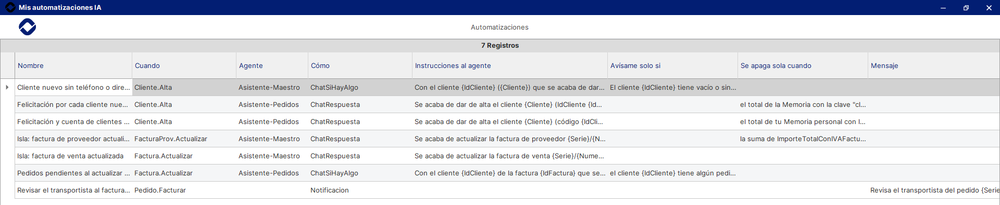

# My AI automations

In **Archivo › Mis automatizaciones IA** (File › My AI automations) you have all your automations in a grid: you see them at a glance, change them, activate or deactivate them, and delete them.

[Hugo](Hugo.md) also opens it for you if you ask him: *"open my automations"*.

## What you see

| Column | What it is |
|---|---|
| **Nombre** (Name) | The name Hugo gave it. You can change it. |
| **Cuando** (When) | The ERP action that triggers it, or *Programada* (Scheduled) if it fires at a set time |
| **Agente** (Agent) | The agent that handles it |
| **Cómo** (How) | The form: *Aviso* (Notice), *Solo su respuesta* (Just its answer), *Por detrás, avisa si hay algo* (In the background, notify if there's something) or *Toda la conversación* (The whole conversation) |
| **Instrucciones al agente** (Instructions to the agent) | What the agent is asked to do each time it fires |
| **Avísame solo si** (Notify me only if) | The condition, in the *Por detrás, avisa si hay algo* form |
| **Se apaga sola cuando** (Switches itself off when) | The end condition (Hasta, Until), if it has one |
| **Mensaje** (Message) | The fixed text, in the *Aviso* form |
| **Para** (For) | *Personal* (yours alone) or *Empresa* (Company: for everyone) |
| **Activa** (Active) | Whether it's switched on |

## What each person sees

- **A user** sees only their personal automations.
- **An administrator** also sees those of **their whole company**, the ones that are for everyone. They don't see those of other companies.

## Changing, deactivating and deleting

- **Deactivate:** uncheck **Activa**. It stops firing right away, also in other users' ERPs if it's for everyone, without anyone having to log back in.
- **Change:** edit the column you want, for example the instructions or the condition. Changes are applied when you close the window.
- **Delete:** delete the row.

!!! tip "For bigger changes, Hugo is better"
    To touch up a text, the grid is the quickest. To change when it fires, who handles it, or to add a «Hasta», ask Hugo: he checks that everything fits before saving.

## The ones that switch themselves off

An automation with **Se apaga sola cuando** is deactivated on the day the agent checks that its goal has been met. You'll see it with **Activa** unchecked. Hugo tells you when it switched off.

If you activate it again without changing its end condition, the agent will probably see that it's still met and switch it off again as soon as it fires. Change the condition or remove it first.
