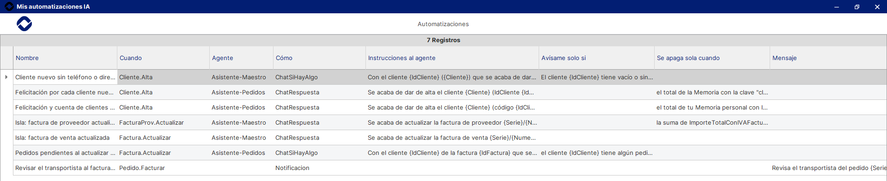

# Mis automatizaciones IA

En **Archivo › Mis automatizaciones IA** tienes todas tus automatizaciones en una rejilla: las ves de un vistazo, las cambias, las activas o desactivas y las borras.

También te la abre [Hugo](Hugo.md) si se lo pides: *«ábreme mis automatizaciones»*.

## Qué ves

| Columna | Qué es |
|---|---|
| **Nombre** | El nombre que le puso Hugo. Puedes cambiarlo. |
| **Cuando** | La acción del ERP que la dispara, o *Programada* si salta a una hora |
| **Agente** | El agente que la atiende |
| **Cómo** | La forma: *Aviso*, *Solo su respuesta*, *Por detrás, avisa si hay algo* o *Toda la conversación* |
| **Instrucciones al agente** | Lo que se le pide al agente cada vez que salta |
| **Avísame solo si** | La condición, en la forma *Por detrás, avisa si hay algo* |
| **Se apaga sola cuando** | La condición de fin (Hasta), si la tiene |
| **Mensaje** | El texto fijo, en la forma *Aviso* |
| **Para** | *Personal* (solo tuya) o *Empresa* (para todos) |
| **Activa** | Si está encendida |

## Qué ve cada uno

- **Un usuario** ve solo sus automatizaciones personales.
- **Un administrador** ve además las de **toda su empresa**, las que son para todos. No ve las de otras empresas.

## Cambiar, desactivar y borrar

- **Desactivar:** desmarca **Activa**. Deja de saltar enseguida, también en los ERP de los demás usuarios si es para todos, sin que nadie tenga que volver a entrar.
- **Cambiar:** edita la columna que quieras, por ejemplo las instrucciones o la condición. Los cambios se aplican al cerrar la ventana.
- **Borrar:** elimina la fila.

!!! tip "Para cambios de fondo, mejor Hugo"
    Para retocar un texto, la rejilla es lo más rápido. Para cambiar cuándo salta, quién la atiende o añadirle un «Hasta», pídeselo a Hugo: comprueba que todo encaja antes de guardar.

## Las que se apagan solas

Una automatización con **Se apaga sola cuando** queda desactivada el día que el agente comprueba que se ha cumplido su objetivo. La verás con **Activa** desmarcada. Hugo te dice cuándo se apagó.

Si la vuelves a activar sin cambiar su condición de fin, es probable que el agente vea que se sigue cumpliendo y la apague otra vez en cuanto salte. Cambia antes la condición o quítala.
