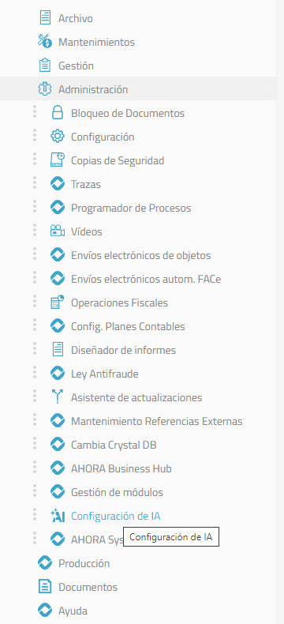
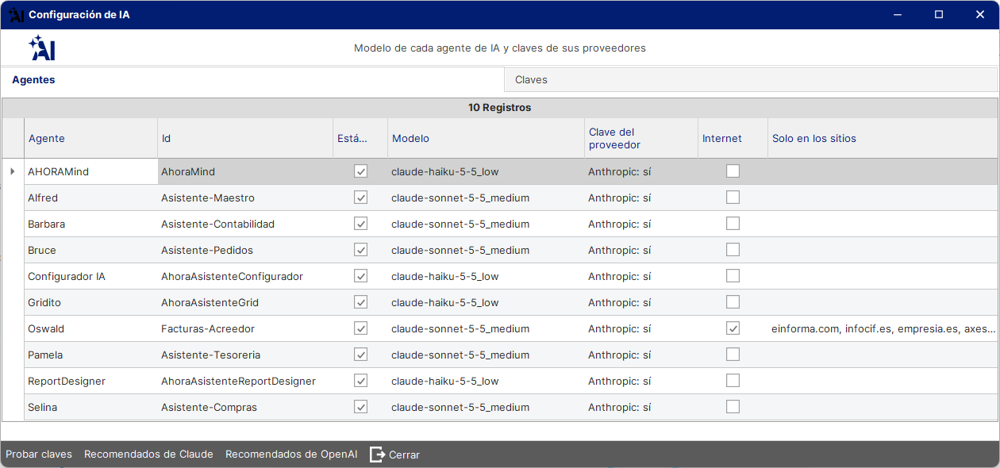
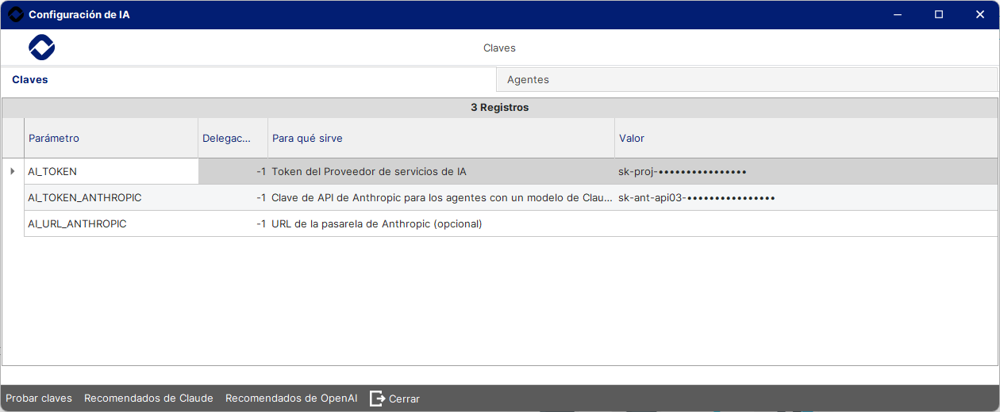
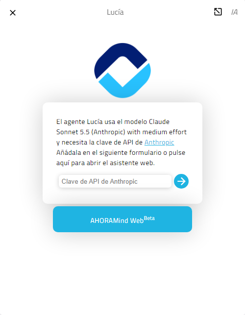
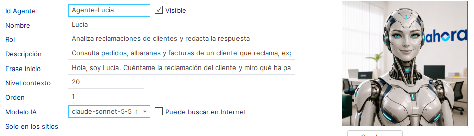

# AI models: Claude and OpenAI

Each ERP agent works with an **AI model**, which is what understands what you ask for and decides which tools to use. You can use models from two providers:

- **Anthropic**: the **Claude** models (Haiku, Sonnet, Opus…);
- **OpenAI**: the **GPT** models (GPT-5.4 mini, GPT-5.5, GPT-6…).

Each agent has its own, so you can combine them: for example, Claude for the agents that work the most and a cheaper model for those that only query.

This also applies to the ERP's **screen assistants**, which are agents like the rest:

| Assistant | Where it works |
|---|---|
| **Gridito** | The grids' AI: **Analizar con IA** (Analyse with AI) and the AI filter |
| **ReportDesigner** | The report designer's chat |
| **Configurador IA** | The screen configurator's chat |

Each one uses the model it has set and its provider's key, just like the chat agents.

## AI configuration: the first step

Everything you need to get started is on a single screen: **Administración > Configuración de IA** (AI configuration). Only administrators can see and open it.

It has two tabs:

- **Agentes** (Agents): every agent, including the standard ones and the screen assistants, with its model, whether it can search the Internet and whether its provider's key is set.
- **Claves** (Keys): each provider's key and, if you use one, the address of the Anthropic gateway.

In a new installation every agent already comes with Claude, as in the image, so you only need to enter the Anthropic key. To start using AI:

1. In **Claves**, enter your provider's key.
2. Click **Probar claves** (Test keys). The ERP asks the provider whether the key works, at no cost.
3. If you work with OpenAI, click **Recomendados de OpenAI** (Recommended for OpenAI): the standard agents switch to its recommended models. **Recomendados de Claude** switches them back to Claude's. Your own agents are left untouched.

Changes take effect immediately, without restarting the ERP.

| Recommended | Chat agents | Screen assistants and AHORAMind |
|---|---|---|
| **Claude** | Claude Sonnet, medium effort | Claude Haiku, low effort |
| **OpenAI** | GPT-5.5, low effort | GPT-5.4 mini, low effort |

## Each provider's keys

Each provider needs its key. They're entered in the **Claves** tab of **Configuración de IA** and stored in these parameters of the ERP's general configuration:

| Provider | Parameter | Where to get the key |
|---|---|---|
| OpenAI | <fh-copy>AI_TOKEN</fh-copy> | platform.openai.com/api-keys |
| Anthropic | <fh-copy>AI_TOKEN_ANTHROPIC</fh-copy> | console.anthropic.com (starts with `sk-ant-`) |

You only need the keys for the providers whose models you use. If a screen assistant is missing its provider's key, its chat and **Analizar con IA** don't appear.

If your company uses several branches, a branch can have its own key: the **Claves** tab shows all of them, and each user uses their branch's key if there is one.

!!! tip "The chat asks you for it"
    If you open an agent's chat and the key for its model's provider is missing, the chat's configuration screen tells you which key it needs, from which provider and where to get it, and saves it in its parameter.

### Anthropic gateway (optional)

If your company accesses the Claude models through its own gateway instead of directly, enter its full address (starting with `https://`) in <fh-copy>AI_URL_ANTHROPIC</fh-copy>. If you leave it empty, Anthropic's is used.

## Changing an agent's model

Any agent's model is changed in the **Agentes** tab of **Configuración de IA**. The chat agents also have it in their **record**, in the **Modelo IA** (AI model) field. Changes reach the API on their own in less than a minute.

The Claude models are offered with different levels of **effort**: *low*, *medium*, *high*, *xhigh* and *max*. With more effort, the model thinks more before answering: it gets difficult things right more often, but it takes longer and costs more.

| Model | What for |
|---|---|
| **Claude Sonnet**, low or medium effort | The ERP agents: a good balance between accuracy, speed and cost |
| **Claude Haiku** | Simple tasks, when cost matters most |
| **Claude Opus** | The most complex work |
| **GPT-5.4 mini, GPT-5.5, GPT-6…** | If your company works with OpenAI. GPT-5.4 mini is fast and cheap |

## Which model the agents come with

- **In a new installation**, every agent starts with **Claude**, so only the Anthropic key is needed: the chat agents with **Claude Sonnet** (medium effort), and the screen assistants and AHORAMind with **Claude Haiku** (low effort).
- **When updating**, each agent **keeps the model it already had**, unless it's one that OpenAI has retired or is about to retire (see below).
- **Hugo and Amanda**, who are new, come with Claude Sonnet.

!!! warning "If you only have an OpenAI key"
    When updating, your agents keep their OpenAI model, but **Hugo and Amanda** arrive with Claude. You have two options: add the Anthropic key (`AI_TOKEN_ANTHROPIC`) or click **Recomendados de OpenAI** in **Configuración de IA**.

## Models retired by OpenAI

OpenAI shuts down its old models and, from that day on, an agent that uses them stops answering. That's why the ERP no longer offers these:

- GPT-3.5 Turbo, GPT-4 Turbo, GPT-4.1 and GPT-4o, with their mini and nano versions;
- GPT-5, GPT-5 mini and GPT-5 nano, with all their variants;
- o3 and o4-mini.

When updating, once only, the agents that used one of them move to **GPT-5.4 mini**, with the same OpenAI key. Afterwards you can change their model whenever you like, in **Configuración de IA** or in their record.
