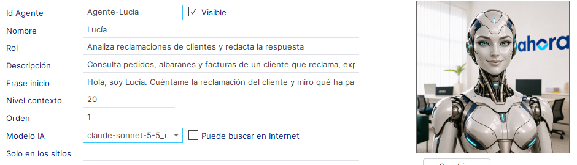

# Modelos de IA: Claude y OpenAI

Cada agente del ERP trabaja con un **modelo de IA**, que es el que entiende lo que le pides y decide qué herramientas usar. Puedes usar modelos de dos proveedores:

- **Anthropic**: los modelos **Claude** (Haiku, Sonnet, Opus…);
- **OpenAI**: los modelos **GPT** (GPT-5.4 mini, GPT-5.5, GPT-6…).

Cada agente tiene el suyo, así que puedes combinarlos: por ejemplo, Claude para los agentes que más trabajan y un modelo más económico para los que solo consultan.

Esto vale también para los **asistentes de las pantallas** del ERP, que son agentes como los demás:

| Asistente | Dónde trabaja |
|---|---|
| **Gridito** | La IA de las rejillas: **Analizar con IA** y el filtro con IA |
| **ReportDesigner** | El chat del diseñador de informes |
| **Configurador IA** | El chat del configurador de pantallas |

Cada uno usa el modelo de su ficha y la clave de su proveedor, igual que los agentes del chat.

## Las claves de cada proveedor

Cada proveedor necesita su clave. Se guardan en la configuración general del ERP:

| Proveedor | Parámetro | Dónde se saca la clave |
|---|---|---|
| OpenAI | <fh-copy>AI_TOKEN</fh-copy> | platform.openai.com/api-keys |
| Anthropic | <fh-copy>AI_TOKEN_ANTHROPIC</fh-copy> | console.anthropic.com (empieza por `sk-ant-`) |

Solo hace falta la clave de los proveedores cuyos modelos uses. Si a un asistente de pantalla le falta la clave de su proveedor, su chat y **Analizar con IA** no aparecen.

!!! tip "El chat te la pide"
    Si abres el chat de un agente y falta la clave del proveedor de su modelo, la pantalla de configuración del chat te dice qué clave necesita, de qué proveedor y dónde sacarla, y la guarda en su parámetro.

### Pasarela de Anthropic (opcional)

Si tu empresa accede a los modelos de Claude a través de una pasarela propia en lugar de directamente, indica su dirección en <fh-copy>AI_URL_ANTHROPIC</fh-copy>. Si lo dejas vacío, se usa la de Anthropic.

## Cambiar el modelo de un agente

El modelo se elige en la **ficha del agente**, en el campo **Modelo IA**. Los cambios llegan solos a la API en menos de un minuto.

Los modelos de Claude se ofrecen con distintos niveles de **esfuerzo**: *low*, *medium*, *high*, *xhigh* y *max*. Con más esfuerzo, el modelo piensa más antes de contestar: acierta más en lo difícil, pero tarda más y cuesta más.

| Modelo | Para qué |
|---|---|
| **Claude Sonnet**, esfuerzo bajo o medio | Los agentes del ERP: buen equilibrio entre acierto, velocidad y coste |
| **Claude Haiku** | Tareas sencillas, cuando importa más el coste |
| **Claude Opus** | Lo más complejo |
| **GPT-5.4 mini, GPT-5.5, GPT-6…** | Si tu empresa trabaja con OpenAI. GPT-5.4 mini es rápido y económico |

## Qué modelo traen los agentes

- **En una instalación nueva**, los agentes estándar nacen con **Claude Sonnet** (esfuerzo medio), y los asistentes de las pantallas con **GPT-5.4 mini**.
- **Al actualizar**, cada agente **conserva el modelo que ya tenía**, salvo si es uno que OpenAI ha retirado o retira pronto (ver más abajo).
- **Hugo y Amanda**, que llegan nuevos, vienen con Claude Sonnet.

!!! warning "Si solo tienes clave de OpenAI"
    Al actualizar, tus agentes siguen con su modelo de OpenAI, pero **Hugo y Amanda** llegan con Claude. Tienes dos opciones: añadir la clave de Anthropic (`AI_TOKEN_ANTHROPIC`) o cambiarles el modelo a uno de OpenAI en su ficha.

## Modelos retirados por OpenAI

OpenAI apaga sus modelos antiguos y, desde ese día, un agente que los use deja de contestar. Por eso el ERP ya no ofrece estos:

- GPT-3.5 Turbo, GPT-4 Turbo, GPT-4.1 y GPT-4o, con sus versiones mini y nano;
- GPT-5, GPT-5 mini y GPT-5 nano, con todas sus variantes;
- o3 y o4-mini.

Al actualizar, una sola vez, los agentes que usaban uno de ellos pasan a **GPT-5.4 mini**, con la misma clave de OpenAI. Después puedes cambiarles el modelo en su ficha cuando quieras.
