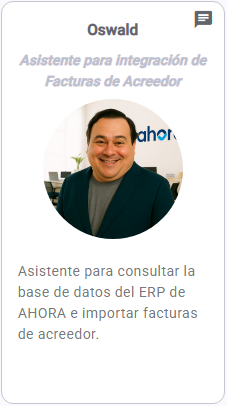
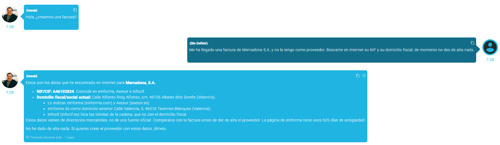

# Oswald - Creditor invoice agent

{ width="160" align=right }

Oswald turns a supplier's document into an ERP **creditor invoice**. You give him a photo, a PDF or the text of the invoice, and he extracts the data, looks up the supplier, asks you for whatever is missing and creates the invoice. He also queries, opens and prints creditor invoices and suppliers.

> Hola, ¿creamos una factura? (Hi, shall we create an invoice?)

He's designed for whoever records the service invoices received every day: utilities, repairs, consultancy… You'll find him in the chat's list of agents, under the name **Oswald**.

Oswald only works with creditor invoices, which carry no items and don't come from an order or a delivery note. For purchase invoices with items, use [Selina](Selina.md).

## Creating an invoice from the document

Attach the invoice to the chat and ask him: *"Create a creditor invoice from this image"*.

1. **He extracts the document's data**: supplier and their tax ID, invoice number, date, the taxable base and VAT for each rate, equivalence surcharge, personal income tax (IRPF) withholding and total.
2. **He looks up the supplier** in the ERP. If the document shows the tax ID, he uses it first, because it's more reliable than the name.
3. **He asks you for whatever is missing**, in a list.
4. **He creates the invoice**, opens it on its screen and saves the document in its document management.
5. **He tells you the total he has saved**, so you can compare it with the one on paper.

To create the invoice he needs, at a minimum, the **supplier**, the **supplier's invoice number** and the **totals**. Without them he doesn't create it: he asks you for them.

### How he fills in the invoice

| Field | What Oswald does |
|---|---|
| Date | The document's. If it has none, he uses today's |
| Payment method | Only if the document states it. Otherwise he leaves it empty and the ERP uses the supplier's |
| Lines | One per VAT rate, adding up those with the same rate. Never two lines with the same rate |
| VAT type | The standard, reduced or super-reduced one. A special scheme (REBU margin scheme, customs, agricultural…) only if the document says so explicitly |
| Equivalence surcharge | Only if the document shows it |
| IRPF withholding | The withholding type and its amount, if the document shows them |
| Total | The document's, as it is. He never changes it to make it balance |

### If the supplier doesn't exist

Oswald tells you and offers to create it with the document's data: *"Create the supplier if it doesn't exist"*. Whatever doesn't appear in the document he leaves empty, with no filler. If there's already a supplier with that tax ID, he doesn't create another one: he tells you which one it is.

In new installations, Oswald comes with Internet search turned on for einforma, infocif, empresia and axesor, to fill in a new supplier's company name and address from their tax ID. He tells you which page each piece of data comes from, so you can check it before saving it. The details and the risks are in [Agents with Internet search](Internet.md).

## Querying, opening and printing

| You ask him… | Oswald… |
|---|---|
| *"Show me last month's creditor invoices"* | Lists them with their Id, number, date, supplier and amount |
| *"Open creditor invoice 5421"* | Opens it on its screen |
| *"Open the creditor invoices for the third quarter"* | Opens the filtered collection |
| *"Show the invoices whose supplier is similar to Reparaciones Gómez"* | Looks up the similar suppliers and shows you their invoices |
| *"Print the invoice you've just created"* | Prints it, without looking it up again |
| *"Find the supplier that appears in this document"* | Looks it up and opens it if you ask him to |

He also makes **charts** from what he queries: *"Make me a chart of creditor spending by month"*.

## What he asks you to confirm

**A new supplier.** He doesn't create it until you say yes.

**Which supplier it is.** If several suppliers have a name similar to the one on the document, he asks you which one it is.

**Which invoice it is.** The same number can exist in several years and for several suppliers. If there are several, he lists them and asks you which one. He never chooses himself.

**A repeated invoice.** If there's already a creditor invoice from that supplier with that same number, he creates nothing and warns you. If you reply that you want it anyway, he creates it with the same data; if you say no, he doesn't create it.

**A mismatch.** If the sum of the lines doesn't match the document's total, he shows you the difference and asks whether to create it anyway. The IRPF withholding is taken into account: with a withholding, the total is lower than the sum of the lines, and that isn't a mismatch.

!!! tip "Reply straight away"
    The confirmation applies to that invoice with that data. If you take more than a quarter of an hour to reply, Oswald asks you again.

## What Oswald doesn't do

- **He doesn't change the document's total.** If there's a difference of a few cents, he doesn't record it as rounding: he warns you about the mismatch and you decide.
- **He doesn't create the invoice without the supplier, the supplier's invoice number and the totals.**
- **He doesn't make up a supplier.** He only uses one that exists in the ERP or the one he creates with you.
- **He doesn't invoice a blocked supplier.** It has to be unblocked in the ERP first.
- **He doesn't create an invoice without an accounting year** for its date: he tells you so you can choose another date or create the year.
- **He doesn't modify or delete** invoices already saved.
- **He doesn't work with purchase invoices** with items: that's for [Selina](Selina.md).

## Model and keys

Oswald works with a **Claude** (Anthropic) or **OpenAI** model. In a new installation he comes with Claude Sonnet. An administrator changes the model and the keys in **Administración > Configuración de IA** (AI configuration): see [AI models](Modelos.md).

!!! warning "The Internet needs a model that can search"
    If you change Oswald's model to an OpenAI one that can't search, he'll no longer be able to look up new suppliers' details on the Internet. Which models can search: [Agents with Internet search](Internet.md).
