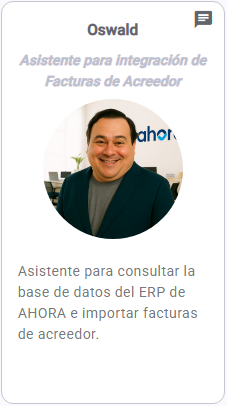
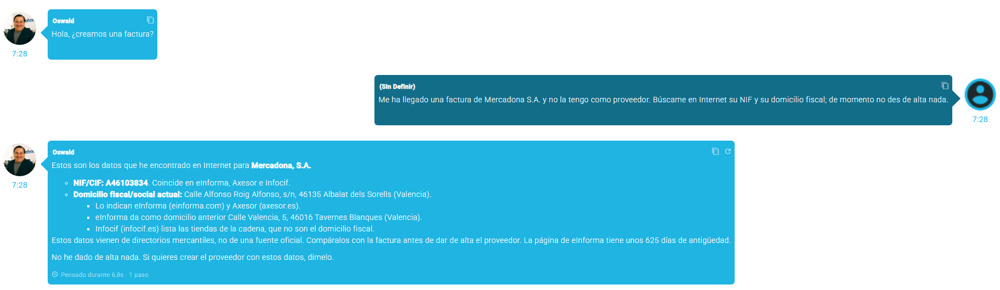

# Oswald - Agente de facturas de acreedor

{ width="160" align=right }

Oswald convierte el documento de un proveedor en una **factura de acreedor** del ERP. Le pasas una foto, un PDF o el texto de la factura, y él saca los datos, busca al proveedor, te pide lo que falte y crea la factura. También consulta, abre e imprime facturas de acreedor y proveedores.

> Hola, ¿creamos una factura?

Está pensado para quien registra a diario las facturas recibidas de servicios: suministros, reparaciones, asesorías… Lo encuentras en la lista de agentes del chat, con el nombre **Oswald**.

Oswald solo trabaja con facturas de acreedor, que no llevan artículos ni vienen de un pedido o un albarán. Para las facturas de compra con artículos, usa a [Selina](Selina.md).

## Crear una factura a partir del documento

Adjunta la factura al chat y pídeselo: *«Crea una factura de acreedor con esta imagen»*.

1. **Saca los datos del documento**: proveedor y su NIF, número de factura, fecha, bases e IVA de cada tipo, recargo de equivalencia, retención de IRPF y total.
2. **Busca al proveedor** en el ERP. Si el documento trae el NIF, lo usa primero, porque es más fiable que el nombre.
3. **Te pide lo que falte**, en una lista.
4. **Crea la factura**, te la abre en su pantalla y guarda el documento en su gestión documental.
5. **Te dice el total que ha grabado**, para que lo compares con el del papel.

Para crear la factura necesita, como mínimo, el **proveedor**, el **número de factura del proveedor** y los **totales**. Sin ellos no la crea: te los pide.

### Cómo rellena la factura

| Dato | Qué hace Oswald |
|---|---|
| Fecha | La del documento. Si no la trae, pone la de hoy |
| Forma de pago | Solo si el documento la dice. Si no, la deja vacía y el ERP pone la del proveedor |
| Líneas | Una por cada tipo de IVA, sumando las que tienen el mismo. Nunca dos líneas con el mismo tipo |
| Tipo de IVA | El general, reducido o superreducido. Un régimen especial (REBU, aduana, agrario…) solo si el documento lo dice expresamente |
| Recargo de equivalencia | Solo si el documento lo muestra |
| Retención de IRPF | El tipo de retención y su importe, si el documento los trae |
| Total | El del documento, tal cual. Nunca lo cambia para que cuadre |

### Si el proveedor no existe

Oswald te lo dice y te ofrece darlo de alta con los datos del documento: *«Crea el proveedor si no existe»*. Lo que no aparece en el documento lo deja vacío, sin rellenos. Si ya hay un proveedor con ese NIF, no crea otro: te dice cuál es.

En las instalaciones nuevas, Oswald nace con la búsqueda en Internet activada en einforma, infocif, empresia y axesor, para completar la razón social y la dirección de un proveedor nuevo a partir de su NIF. Te dice de qué página sale cada dato, para que lo compruebes antes de grabarlo. Los detalles y los riesgos están en [Agentes con búsqueda en Internet](Internet.md).

## Consultar, abrir e imprimir

| Le pides… | Oswald… |
|---|---|
| *«Muéstrame las facturas de acreedor del mes pasado»* | Te las lista con su Id, número, fecha, proveedor e importe |
| *«Abre la factura de acreedor 5421»* | La abre en su pantalla |
| *«Abre las facturas de acreedor del tercer trimestre»* | Abre la colección filtrada |
| *«Muestra las facturas cuyo proveedor sea parecido a Reparaciones Gómez»* | Busca los proveedores parecidos y te enseña sus facturas |
| *«Imprime la factura que acabas de crear»* | La imprime, sin volver a buscarla |
| *«Busca el proveedor que aparece en este documento»* | Lo busca y te lo abre si se lo pides |

También hace **gráficos** con lo que consulta: *«Hazme un gráfico con el gasto de acreedores por mes»*.

## Qué te pide confirmar

**Un proveedor nuevo.** No lo da de alta sin que le digas que sí.

**Cuál es el proveedor.** Si varios proveedores tienen un nombre parecido al del documento, te pregunta cuál es.

**Cuál es la factura.** El mismo número puede existir en varios años y proveedores. Si hay varias, te las lista y te pregunta cuál. Nunca elige él.

**Una factura repetida.** Si ya hay una factura de acreedor de ese proveedor con ese mismo número, no crea nada y te avisa. Si contestas que la quieres igualmente, la crea con los mismos datos; si dices que no, no la crea.

**Un descuadre.** Si la suma de las líneas no da el total del documento, te enseña la diferencia y te pregunta si la creas igualmente. La retención de IRPF se tiene en cuenta: con retención, el total es menor que la suma de las líneas, y eso no es un descuadre.

!!! tip "Contesta en el momento"
    La confirmación vale para esa factura con esos datos. Si tardas más de un cuarto de hora en contestar, Oswald te lo vuelve a preguntar.

## Lo que Oswald no hace

- **No cambia el total del documento.** Si hay una diferencia de céntimos, no la apunta como redondeo: te avisa del descuadre y decides tú.
- **No crea la factura sin proveedor, número de factura del proveedor ni totales.**
- **No inventa un proveedor.** Solo usa uno que exista en el ERP o el que da de alta contigo.
- **No factura a un proveedor bloqueado.** Antes hay que desbloquearlo en el ERP.
- **No crea una factura sin ejercicio contable** para su fecha: te lo dice para que elijas otra fecha o deis de alta el ejercicio.
- **No modifica ni borra facturas** ya grabadas.
- **No trabaja con facturas de compra** con artículos: eso es de [Selina](Selina.md).

## Modelo y claves

Oswald funciona con un modelo de **Claude** (Anthropic) o de **OpenAI**. En una instalación nueva viene con Claude Sonnet. El modelo y las claves los cambia un administrador en **Administración > Configuración de IA**: mira [Modelos de IA](Modelos.md).

!!! warning "Internet necesita un modelo que sepa buscar"
    Si cambias el modelo de Oswald a uno de OpenAI que no sabe buscar, ya no podrá buscar en Internet los datos de los proveedores nuevos. Qué modelos saben buscar: [Agentes con búsqueda en Internet](Internet.md).
