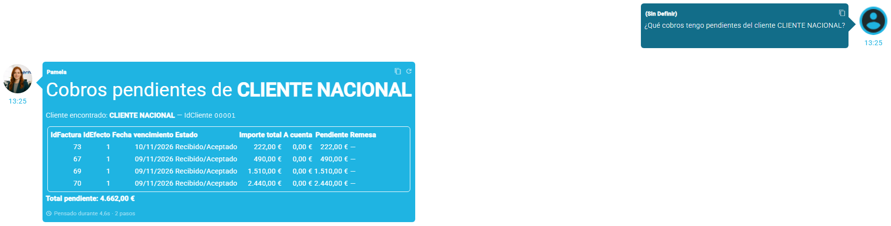

# Pamela - Agente de Tesorería

{ width="160" align=right }

Pamela es la agente de **tesorería**: cobros, pagos, vencimientos, remesas y bancos. Le preguntas con tus palabras qué te deben, qué debes o qué vence, y te contesta con los datos de tu ERP. También registra cobros y pagos, prepara remesas de cobro y te abre en el ERP lo que necesitas ver.

> Hola, ¿qué quieres revisar de tesorería?

Está pensada para quien lleva la tesorería, la administración o las finanzas de la empresa. La encuentras en la lista de agentes del chat.

Pamela no lleva asientos, IVA ni modelos fiscales: eso es de [Bárbara](Barbara.md).

## Qué puede hacer por ti

### Consultar

Pamela consulta los datos reales del ERP antes de darte una cifra o una lista.

| Le preguntas por… | Por ejemplo |
|---|---|
| Lo que te debe un cliente | *«¿Cuánto me debe el cliente Martínez?»* |
| Lo que debes a un proveedor | *«¿Cuánto debo a Suministros Gómez?»* |
| Cobros y pagos pendientes | *«¿Qué pagos tengo pendientes esta semana?»* |
| Vencimientos | *«Dame los vencimientos de la próxima semana»* |
| Un resumen | *«Resumen de cobros y pagos pendientes»* (te da los dos totales y el saldo neto) |
| Remesas | *«Muéstrame las remesas de cobro del último trimestre»* |
| Cuentas bancarias de la empresa | *«¿Qué cuentas bancarias tenemos y con qué IBAN?»* |

También hace **gráficos** con los datos que consulta: *«Gráfica de los cobros pendientes agrupados por mes»*, *«Gráfica de pagos pendientes por proveedor»*.

Cuando te enseña una lista de documentos, incluye su número interno. Así puedes seguir con *«registra el primero»* o *«abre ese»* sin repetir los datos.

### Abrir e imprimir en el ERP

| Le pides… | Pamela… |
|---|---|
| *«Abre la cartera de pagos»* | Abre la cartera entera, sin filtros |
| *«Abre la cartera de cobros del cliente Pérez»* | Abre la cartera filtrada por ese cliente |
| *«Abre la remesa de ayer»* | Busca la remesa y la abre |
| *«Imprime los cobros vencidos de Martínez»* | Los imprime |

Abre e imprime cobros, pagos, remesas de cobro, cuentas bancarias, clientes y proveedores, de uno en uno o en lista.

### Registrar cobros y pagos

Pamela registra el cobro o el pago de un **efecto que ya existe** en la cartera:

- *«Registra el cobro de la factura 125 de Martínez»*
- *«Marca como pagado el vencimiento de la factura de Suministros Gómez»*

El efecto se registra tal cual está en la cartera: no le puedes indicar otro importe. Para un cobro o un pago parcial, hazlo desde el ERP.

Antes de registrarlo, el ERP comprueba que el efecto tiene una domiciliación bancaria y, en los pagos, que no está ya pagado. Si falta algo, Pamela te dice qué es y no registra nada.

### Remesas de cobro

- **Crear una remesa**: *«Crea una remesa de cobros en el banco Sabadell»*. Si no dices el banco, usa la primera cuenta bancaria activa de la empresa que tenga IBAN. La cuenta tiene que tener IBAN y su banco, código SWIFT; si no, te lo dice y no crea nada.
- **Meter cobros en una remesa**: *«Mete en esa remesa los cobros pendientes de Martínez»*. La remesa tiene que estar sin actualizar, y cada cobro, en estado *Recibido/Aceptado*, sin bloquear y sin cobros a cuenta. Si uno no cumple, te dice por qué.

!!! info "Solo remesas de cobro"
    Pamela consulta las remesas de pago, pero no las crea, no les mete efectos y no las abre ni las imprime. Eso se hace desde el ERP.

## Qué te pide confirmar

**Cuál es, si hay varios.** La numeración de las facturas se reinicia cada año, así que el mismo número puede estar en varios años o series. Si tu petición encaja con más de un documento, o con varios clientes o proveedores de nombre parecido, Pamela te enseña los candidatos y espera a que elijas. No elige ella, ni siquiera el más reciente.

!!! warning "Registrar no pide un sí aparte"
    Registrar un cobro o un pago no tiene un paso de confirmación propio: si la petición es clara y el efecto es uno solo, Pamela puede registrarlo directamente. Lo mismo al crear una remesa o meter un cobro en ella. Asegúrate de qué efecto hablas antes de pedirlo.

## Lo que Pamela no hace

- **No crea cobros ni pagos sueltos.** Los cobros y los pagos nacen de las facturas al crearlas en el ERP. Si se lo pides, te lo explica y te ofrece abrir la cartera.
- **No actualiza ni desactualiza remesas**, no saca ni mueve un efecto de una remesa, no genera el fichero para el banco (SEPA, cuadernos 19, 32 o 58) y no envía remesas.
- **No trabaja con remesas de pago**, salvo para consultarlas.
- **No borra ni modifica** cobros, pagos ni remesas.
- **No sabe el saldo de los bancos.** Conoce las cuentas bancarias de la empresa, no sus movimientos. Para el saldo contable de una cuenta de bancos, pregúntale a [Bárbara](Barbara.md): *«¿Qué saldo tiene la 572?»*.
- **No inventa datos.** Si una consulta no devuelve nada, te lo dice.

## Modelo y claves

Pamela funciona con un modelo de **Claude** (Anthropic) o de **OpenAI**. En una instalación nueva viene con Claude Sonnet. El modelo y las claves los cambia un administrador en **Administración > Configuración de IA**: mira [Modelos de IA](Modelos.md).

Por defecto Pamela no busca en Internet. Para activarlo, mira [Agentes con búsqueda en Internet](Internet.md).
