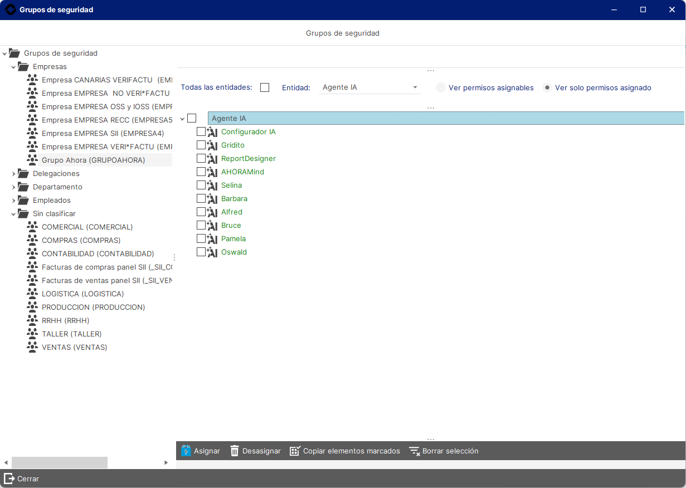

# Restringir los agentes por grupo de seguridad

Puedes decidir qué usuarios pueden usar cada agente de IA, igual que haces con los menús, los nodos o los listados: con los **grupos de seguridad**. Cada agente es una entidad de seguridad más, **Agente IA**.

## Cómo funciona

- Cada usuario solo ve en el panel de agentes los que están asignados a alguno de sus grupos de seguridad, y solo puede conversar con esos.
- La API también lo comprueba: si un usuario intenta abrir el chat de un agente que no tiene asignado, por ejemplo con un enlace directo, recibe un aviso de que no tiene acceso y no obtiene ninguna respuesta del agente.
- Los accesos por empresa y delegación se siguen aplicando, además de los grupos.
- La regla vale para todos los usuarios, también para los administradores. Eso sí, en **Administración > Configuración de IA** los administradores ven siempre todos los agentes (ver [Modelos de IA](Modelos.md)).

## Lo que viene asignado

Para que nadie se quede sin IA, todos los agentes vienen asignados al grupo **GRUPOAHORA**:

- **Al actualizar**, los agentes que ya existían quedan asignados a GRUPOAHORA.
- **Los agentes nuevos**, también los que crees tú, nacen asignados a GRUPOAHORA.

A partir de ahí, cada empresa decide qué restringir.

!!! warning "Usuarios fuera de GRUPOAHORA"
    Si tienes usuarios que no pertenecen a GRUPOAHORA (por ejemplo, usuarios restringidos con un grupo propio), no verán ningún agente hasta que asignes alguno a su grupo. Revisa los permisos de la entidad **Agente IA** nada más actualizar.

## Restringir un agente a unos grupos

Se hace en **Administración > Configuración > Admon > Otros > Administración de permisos**.

Primero, quítaselo a GRUPOAHORA:

1. En el árbol **Grupos de seguridad** de la izquierda, selecciona **GRUPOAHORA**.
2. En **Entidad**, elige **Agente IA**. Con **Ver solo permisos asignados** aparecen los agentes que tiene asignados ese grupo.

    

3. Marca el agente o agentes que quieras restringir.
4. Pulsa **Desasignar** y confirma. Desde ese momento, los usuarios que solo tenían el agente por GRUPOAHORA dejan de verlo.

Después, dáselo a los grupos que sí deben usarlo:

1. En el árbol de la izquierda, selecciona el grupo.
2. En **Entidad**, elige **Agente IA** y marca **Ver permisos asignables** para ver todos los agentes.
3. Marca los agentes.
4. Pulsa **Asignar** y confirma.

Las opciones **Asignar permisos** y **Desasignar permisos** también están en el menú que sale al pulsar con el botón derecho sobre la lista de agentes.

!!! tip "Qué grupos tienen un agente"
    Pasa el ratón por un agente de la lista: verás qué grupos lo tienen asignado.

!!! warning "Un agente sin ningún grupo no lo ve nadie"
    Si quitas un agente de todos sus grupos, ningún usuario puede usarlo. Para volver a abrirlo, asígnalo de nuevo a GRUPOAHORA o al grupo que corresponda.

## Lo que hay que tener en cuenta

- **El permiso es por agente completo, no por dato.** Quien tiene acceso a un agente puede consultar todo lo que ese agente consulta. No se pueden permitir unas consultas y negar otras dentro del mismo agente.
- **Las columnas ocultas no se trasladan.** Si has ocultado a un usuario columnas de una rejilla (por ejemplo, el precio de las líneas de compra), los agentes no lo tienen en cuenta. Para que no llegue a esa información, no le asignes los agentes que la consultan.
- **Varios agentes pueden consultar la misma información.** Antes de dar por restringida un área, revisa qué agentes la consultan (ver el ejemplo siguiente).
- **Tus agentes propios**: revisa qué vistas consulta cada uno en la pestaña **Modelo Datos** de su ficha (ver [Crear un agente propio](CrearAgente.md)).

## Ejemplo: un usuario que no debe ver compras

Con el modelo de datos estándar, estos agentes consultan información de compras. Un usuario que no deba ver costes ni precios de compra no debe tener asignado ninguno:

| Agente | Información de compras que consulta |
|---|---|
| **Selina** (compras) | Pedidos, albaranes y facturas de proveedor, con sus líneas y precios |
| **Oswald** (facturas de acreedor) | Facturas de proveedor |
| **Pamela** (tesorería) | Facturas de proveedor |
| **Alfred** (consultas transversales) | Facturas de proveedor |
| **Barbara** (contabilidad y fiscalidad) | Apuntes contables, también los de compras |

**Bruce** (ventas) no consulta costes ni precios de compra con el modelo de datos estándar, así que puede mantenerlo si lo necesita.

## Preguntas frecuentes

### ¿Los agentes consultan con los permisos del usuario o con los de un servicio?

Con los del usuario conectado: las consultas se lanzan con su usuario de SQL Server y su sesión del ERP. Por eso se aplican sus accesos por empresa y delegación. Los grupos de seguridad, en cambio, son una configuración del ERP, no de SQL Server: por eso se comprueban aparte, como se explica en esta página.

### ¿Puedo quitarle a un usuario el permiso de SQL Server sobre las vistas de los agentes?

No es una configuración soportada:

- El agente pierde esas vistas o falla al consultarlas, en lugar de avisar de que no hay acceso.
- No sirve si el usuario es administrador de SQL Server.
- Habría que revisarlo a mano en cada actualización.

Para restringir los agentes, usa los grupos de seguridad.

### ¿Sirve «Ocultar agente» para restringir?

No. **Ocultar agente** quita el agente del panel para todos los usuarios a la vez: sirve para retirar un agente que tu empresa no usa (ver [Crear un agente propio](CrearAgente.md#ocultar-o-mostrar-un-agente-en-el-panel)). Para decidir quién lo usa, usa los grupos de seguridad.
