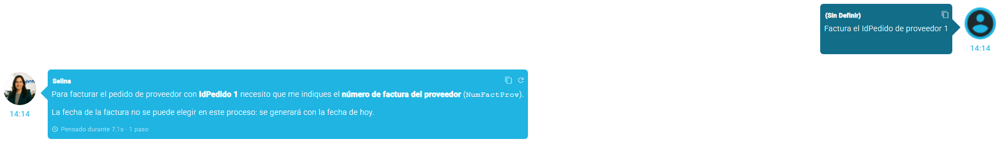

# Selina - Agente de Compras

{ width="96" align=right }

Selina es la agente del **circuito de compras**: pedidos, albaranes y facturas de proveedor, proveedores y artículos. Le preguntas en lenguaje normal y te contesta con los datos reales del ERP, te hace una gráfica, te abre los documentos y, si se lo pides, albaranea, factura o actualiza.

> Hola, ¿en qué puedo ayudarte hoy?

Está pensada para el departamento de compras, los responsables de aprovisionamiento y dirección financiera. La encuentras en la lista de agentes del chat (mira [Agentes IA del ERP](Introduccion.md)).

## Qué puede hacer

| Le pides… | Selina… |
|---|---|
| Una consulta | Busca en los datos de compras y te da la respuesta o el listado |
| Una gráfica | Te la dibuja en el chat, en barras verticales u horizontales |
| Abrir o imprimir | Abre o imprime un documento, un proveedor, un artículo o una colección filtrada |
| Albaranear o facturar | Genera el albarán o la factura de los pedidos y albaranes de proveedor que le digas |
| Actualizar | Actualiza albaranes y facturas de proveedor |
| Dar de alta | Crea proveedores y artículos |

Selina trabaja **con tu usuario**: solo ve los proveedores, series y almacenes a los que tienes acceso en el ERP.

## Consultas y gráficas

Ve los pedidos de proveedor con sus líneas, los albaranes y las facturas de proveedor (también las de acreedor), los proveedores con sus contactos, los artículos con su stock por almacén y las series de compra. Algunos ejemplos:

- *«Muéstrame los pedidos de proveedor pendientes»*
- *«Dame todos los datos del pedido de proveedor 4321»*
- *«Pedidos de proveedor pendientes de facturar entre el 1 de marzo y el 30 de abril»*
- *«Total de compras del último mes, ordenado por proveedor»*
- *«Total de compras agrupado por proveedor y artículo»*
- *«Lista las facturas de proveedor por fecha»*
- *«Dime el total de las facturas de acreedor de este mes»*
- *«Cuenta los artículos comprados en el último mes»*
- *«¿Cuánto stock tengo del artículo TORNILLO-M8 en cada almacén?»*
- *«Genera una gráfica con las compras de cada proveedor en el último trimestre»*

Para Selina, los **pedidos pendientes** son los que están en estado PENDIENTE. Si en una respuesta incluye también los ALBARANEADO (albaraneados, pero pendientes de facturar), te lo dice.

Cuando le pides un listado de documentos, te da de cada uno su **Id**, su serie, su número, la fecha, el estado y el proveedor. Con el Id puedes pedirle después que actúe sobre uno de la lista: *«factura el segundo»*, *«abre el 29»*.

!!! tip "Si el número se repite"
    La numeración se reinicia cada año, así que el pedido 5 puede existir en varios años o series. Si le das un número que coincide con varios documentos, Selina te enseña todos y te pregunta cuál. No elige ella.

El número de albarán y el de factura **que trae el proveedor** no son el Id del documento en el ERP. Selina los distingue: puedes buscar por ellos, y ella usa el Id para actuar.

Selina no te enseña la consulta SQL que ha usado, pero si se la pides te la da.

## Abrir e imprimir

Selina abre en el ERP un **pedido**, un **albarán** o una **factura de proveedor**, un **proveedor** o un **artículo**, o una **colección** de cualquiera de ellos con el filtro que le digas. También los imprime.

- *«Abre los proveedores de tipo Nacional»*
- *«Abre las facturas de proveedor del tercer trimestre de 2024»*
- *«Abre los pedidos del proveedor EXTRANJERO»*
- *«Imprime el pedido de proveedor 4321»*

Si le das un nombre en vez de un código, lo busca antes. Para abrir un solo registro, los datos tienen que identificar uno solo; si no, te pregunta.

## Albaranear, facturar y actualizar

Selina sigue el circuito de compras del ERP. En compras, los documentos llevan los datos del proveedor, así que a veces te los pide antes de hacer nada:

| Acción | Sobre qué | Qué te pide |
|---|---|---|
| **Albaranear** un pedido | Pedidos en estado PENDIENTE | La fecha del albarán. El número de albarán del proveedor es opcional |
| **Facturar** un pedido | Pedidos en estado PENDIENTE, sin albaranes | El número de factura del proveedor. La factura sale siempre con la fecha de hoy |
| **Facturar** un albarán | Albaranes que no estén facturados | El número de factura del proveedor y la fecha de la factura |
| **Actualizar** un albarán | Albaranes en estado ALBARAN | Nada |
| **Actualizar** una factura | Facturas en estado FACTURA NO ACTUALIZADA | Nada. El proveedor tiene que tener NIF |

Si falta algún dato, te lo pide todo en un solo mensaje. Nunca se inventa un número de factura o de albarán del proveedor.

Te dice el resultado documento a documento: el Id del albarán o la factura que ha generado o, si alguno ha fallado, el motivo.

- *«Albaranea el pedido de proveedor 12 con fecha de hoy y albarán del proveedor AB-778»*
- *«Factura el albarán 34: es la factura F-2026-118 del proveedor, del 20 de noviembre»*
- *«Actualiza las facturas de proveedor de esta semana»*

!!! warning "Cada documento, su número"
    Cada albarán y cada factura de proveedor lleva **su propio número**. Si quieres procesar varios a la vez, Selina no puede ponerles a todos el mismo: te pedirá el número de cada uno o los procesará de uno en uno.

!!! warning "Un documento por cada pedido o albarán"
    Selina genera un albarán por cada pedido y una factura por cada albarán. **No agrupa** varios pedidos en un albarán ni varios albaranes en una factura, ni parte un documento en varios. Eso hazlo desde el ERP.

## Dar de alta proveedores y artículos

- *«Crea el proveedor FICTICIO con NIF B12345674»*
- *«Crea el artículo TORNILLO-M8, tornillo inoxidable de métrica 8»*

Para un **proveedor** necesita al menos el nombre y el NIF. Si no le dices el tipo, lo crea como Nacional; también puede ser Comunitario, Extranjero o Sujeto pasivo. Los datos que no le des los deja vacíos: no se los inventa. Si ya hay un proveedor con ese NIF, no crea otro: te dice cuál es.

Para un **artículo** necesita el código y la descripción. Si no le das el código, te lo pide o te propone uno a partir de la descripción.

Al terminar te da el código del registro creado, pero no lo abre: pídeselo si quieres verlo.

## Qué te pide confirmar

| Si le pides… | Selina… |
|---|---|
| Albaranear, facturar o actualizar **un solo documento** | Lo hace sin preguntar, en cuanto tiene los datos que necesita |
| Hacerlo con **varios documentos a la vez** | Te enseña cuáles son y te pregunta *«¿Quieres continuar?»* antes de tocar nada |
| Algo sobre un número que existe en varios años o series | Te enseña los candidatos y te pregunta cuál |

La confirmación vale para esos mismos documentos y durante 15 minutos. Si tardas más o cambias la lista, te la vuelve a pedir.

!!! warning "Con un solo documento, actúa"
    Si solo quieres saber si se puede hacer algo, díselo así: *«¿se puede facturar el albarán 34? Solo pregunto»*. Selina mirará su estado sin facturarlo. Lo que genera Selina no se deshace desde el chat.

## Lo que Selina no hace

- **Lotes.** No albaranea ni factura pedidos con artículos que llevan lote, y no factura ni actualiza albaranes con lotes sin asignar. Te lo dice: asigna el lote y haz la operación desde el ERP.
- **Bloqueos.** Si el documento o el proveedor están bloqueados, no sigue. Desbloquéalos en el ERP.
- **Facturas de proveedores sin NIF.** El ERP no las actualiza: completa antes la ficha del proveedor.
- **Fecha de la factura al facturar un pedido.** Siempre es la de hoy. Si necesitas otra fecha, albaranea el pedido y factura después el albarán, o hazlo desde el ERP.
- **Modificar o borrar.** No cambia los datos de pedidos, albaranes, facturas, proveedores ni artículos, ni los borra.
- **Otros temas.** Solo habla del circuito de compras del ERP. Para ventas, habla con [Bruce](Bruce.md).

Las consultas devuelven como mucho 50 filas si no le pides más. Por defecto, Selina **no busca en Internet**: mira [Agentes con búsqueda en Internet](Internet.md).

## Modelo y claves

En una instalación nueva, Selina trabaja con **Claude Sonnet**. Puede usar un modelo de Claude (Anthropic) o de OpenAI: el modelo y las claves de los proveedores los gestiona un administrador. Lo tienes en [Modelos de IA](Modelos.md).
