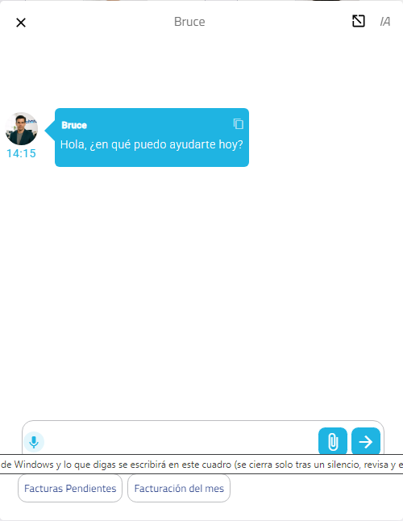

# Voice dictation in the chat

In the agents' chat you can **dictate** your message instead of typing it. The ERP opens **Windows voice typing** and what you say is written in the message box. Handy for long questions or when your hands are busy.

Dictation only writes: **it never sends the message**. You always review it and send it yourself.

## How to use it

1. Open an agent's chat.
2. Click the **microphone** button, to the left of the message box. The Windows voice typing panel opens.

    

3. Speak. What you say is written in the box as you go.
4. When you stop talking for about two seconds, dictation closes on its own. You can also close it by clicking the microphone again.
5. Review the text, correct it if needed and send it with **Enter** or with the arrow.

If you open dictation and say nothing, it closes on its own after a few seconds.

While the agent is answering, the microphone can't be clicked, just like the send button.

!!! tip "Dictate in parts"
    If you pause, dictation closes. To carry on, click the microphone again: the new text is added where the cursor is.

## What you need

| Requirement | Detail |
|---|---|
| Microphone | Connected and recognised by Windows |
| Windows voice typing | The ERP uses Windows' own voice typing, the same one that opens with **Windows + H** in any text field |

The language and the recognition quality are those of Windows voice typing: they are set up in Windows, not in the ERP.

## If something doesn't work

### The microphone button is grey and can't be clicked

If the agent isn't answering, the ERP has checked that dictation can't be used on that computer. Hover over the button to see why; the most common reason is **No se ha detectado ningún micrófono en este equipo** (No microphone has been detected on this computer). Connect a microphone and open the chat again.

### "No se ha podido abrir el dictado de voz de Windows" appears

That message means "Windows voice typing could not be opened". Try pressing **Windows + H** in any text field, outside the ERP. If it doesn't open there either, voice typing isn't available on that Windows: check it in the Windows settings.

### The text isn't what I said

- Speak clearly and at a normal pace.
- Reduce background noise and move closer to the microphone.
- Check in the Windows sound settings that the right microphone is selected.
